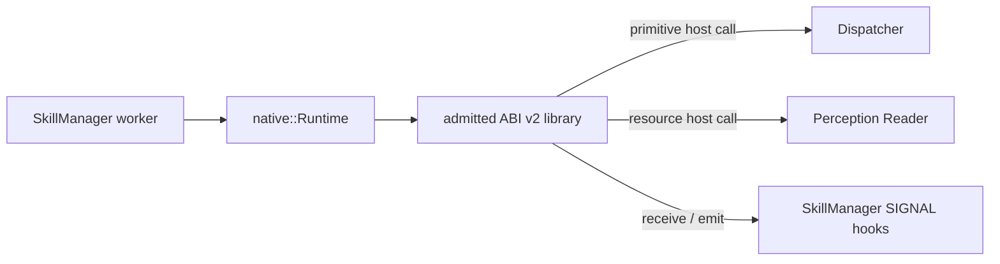

# Native skill 运行时

[Skill runtime 总览](../skills_cn.md) · [SkillManager supervisor](manager_cn.md) · [Native ABI](../../../../../docs/eos/develop/interfaces/skills/native/abi.md) · [构建、安装与测试](../../../../../docs/eos/develop/interfaces/skills/native/build-install-test.md) · [English](../../../../../docs/eos/design/runtime/skills/native.md)

native runtime 是面向经过审核的 deployment-owned C ABI v2 library 的可执行 `SkillRuntime` 实现。它在 `eosd` 进程内运行 skill code；其目标是低开销 capability call，而不是隔离不可信 code。

> **Legacy authoring path：** ABI v2 为尚未迁移的 deployment skill 保持支持，但新的 first-party skill 应使用 [built-in author API](authoring_cn.md)。ABI 为 compatibility 而冻结，不会扩展为 built-in process feature 的完整镜像。

## 所有权边界

`src/eos/runtime/skills/native/` 拥有 regular-file discovery、dynamic-library lifetime、ABI v2 table validation、copied metadata、compiled JSON Schema、exact skill lookup、invocation-scoped host callback 与 provider result validation。其 `eos::runtime::skills::native::Runtime` 实现由 `SkillRuntime` 与 SkillManager 消费的 profile-neutral `Provider` contract。

runtime 不拥有 execution record、worker scheduling、claim、idempotency、deadline 或 event retention；这些属于 SkillManager。它不拥有 primitive safety 或 hardware release；每个 physical effect 都到达 Dispatcher。它也不拥有 ActionList DAG 或 fact。

## 准入

`Runtime::LoadDirectory` 按字典序扫描一个选定 absolute directory。它只接受顶层、普通、非 symlink 的 `*.skill.so` 文件。每个 library 必须导出 `eos_skill_library_query_v2`、返回结构有效的 immutable table，并在该 runtime 内声明唯一的 exact `{name, version}` skill identity。

准入会复制所有 string 与 descriptor，验证 SemVer identity 与 table bound，编译 parameter、result 和 SIGNAL JSON Schema，根据 Dispatcher 解析已声明 primitive identity，检查 resource URI template，验证 claim template，并确认 callback/capability 一致。legacy-only symbol、无效 slice、重复 identity、错误 schema、缺失 primitive、无效 resource template 或不一致 declaration，会在该 runtime 向 SkillManager 注册前拒绝完整 directory load。

已准入 library 在进程生命周期内保持映射。不存在 native hot reload 或 unload path。SkillManager startup 还会拒绝与另一个 logical runtime 重复的 exact identity。

## Execution 与 capability

SkillManager 通过 `RuntimeRegistry` 选择 native runtime，并在 execution 排队前调用 `Provider::ValidateArguments`。worker 随后使用 exact identity、validated argument、request-derived command identity、cancellation predicate、SIGNAL callback 与 device-claim callback，同步调用 `Provider::ExecuteWithHooks`。

invocation-scoped host table 只公开已声明 primitive call、allowlisted resource read、cooperative cancellation、有界 SIGNAL receive/emit、structured diagnostic 与 checkpoint。primitive call 通过 Dispatcher 并使用 derived command ID。resource read 通过普通 perception Reader，并必须匹配已声明 URI template。host pointer 与返回的 ABI slice 仅在文档规定的 invocation lifetime 内有效。log、checkpoint 与 `report_failure` 是 ABI v2 末尾的可选 callback；旧 host 缺失它们时 invocation 仍然有效，failure reporting 不改变预期 outcome。

runtime 接受冻结的原始 completion size，仅在 `struct_size` 覆盖追加字段时读取 message。它根据已声明 result schema 验证返回 result，并把 ABI status、acceptance、稳定 reason、1,024-byte 有界 message、result 与 primitive acknowledgement 映射为 `RunResult`。SkillManager 继续负责把 `RunResult` 转换为 public execution terminal state。

## 失败与隔离

缺失 callback、无效 ABI memory description、互相矛盾的 terminal data、未声明 capability、格式错误的 primitive acknowledgement、无效 emitted SIGNAL 或无效 result payload 均 fail closed。一旦 invocation 产生 protocol failure，该 invocation 后续 primitive release 会被 latch off。

每次 invocation 最多接受一次有效的 `eos_skill_failure_v2`。新版 skill 上报的 reason/message 优先成为 terminal cause；旧 skill 只返回 bare failure 时，runtime 回退到最后失败的 primitive、resource 或 SIGNAL operation。两者都不存在时才使用 `skill.failed`。primitive safety latch 与 cause tracking 分离，因此 unavailable、 protocol error、cancelled、failed 与 rejected capability 不会都被误报为 `primitive.rejected`。

Cancellation 与 deadline 是协作式的。它们会使后续 host operation 失败或交付 `CANCEL`，但不能抢占 library callback。native library 可以阻塞 worker、延迟 shutdown、破坏 process memory 或终止 `eosd`；只有经过审核的 deployment-owned library 可以使用此 runtime。

## 日志与调试

Native admission 与 invocation record 使用 `skills` logger 以及 SkillManager 传播的 correlation ID。debug field 可以包含 library identity、skill identity、command identity、ABI/protocol status、capability name、有界 reason code、duration 与 primitive acknowledgement count；之前的 manager routing event 标识 logical runtime。日志永远不包含 argument、result、schema、resource value、SIGNAL payload、primitive acknowledgement body、credential、raw ABI buffer 或 raw protobuf。

provider 层的 `skill_execute_completed` 是 debug detail。SkillManager 只生成一条 `skill_execution_terminal` summary，其中包含 execution/request correlation、status、 稳定 reason、安全 message、duration、capability count，以及可用时的 last failed activity；failure 与 timeout 为 warning level，预期 rejection/cancellation 保持 debug level。同一 reason/message 会进入 public execution snapshot；自动化只依赖 status/reason，不能解析 message。

skill diagnostic 经清理后写成 `skill_authored_log`，每秒 16 条、burst 64， 且每次 invocation 最多接受 1,024 条。checkpoint 成为 public journal record， 每个 execution 最多 256 条；automatic activity event 最多 512 条。quota 或 retention 拒绝只增加 dropped accounting，并在 terminal 时汇总，不得使原操作失败。

对于 admission failure，检查第一个有界 reason 与具名 library；configured load 保持为空。对于 execution failure，使用 execution ID 与 skill identity 关联 `skills` 和 `dispatch`。timeout 或 cancellation 不能证明 native code 已返回，而 protocol error 表示该 invocation 不应再释放 primitive。

## 测试

`eos_native_skills_tests` 覆盖有效 ABI v2 loading、legacy rejection、malformed table 与 slice rejection、schema validation、primitive 与 resource capability enforcement、SIGNAL receive 与 emit、cancellation、result mapping、protocol latching、exact registry lookup 与 process-lifetime ownership。SkillManager test 分别验证向 owning runtime 的 routing、worker scheduling、claim、deadline 与 retained event。
