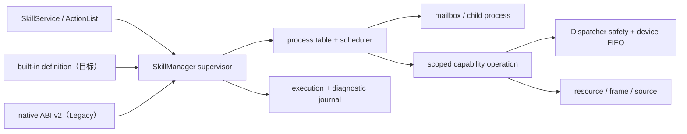

# Skill runtime 总览

[运行时总览](README_cn.md) · [ActionList 运行时](actionlist_cn.md) · [编写 skill](../../develop/interfaces/skills/native/README_cn.md) · [通过 gRPC 调用 skill](../../develop/interfaces/grpc_cn.md) · [English](../../../../docs/eos/design/runtime/skills.md)

[Process model](skills/process-model_cn.md) · [IPC](../../develop/interfaces/skills/native/ipc_cn.md) · [Data 与 time](skills/data_cn.md) · [Observability](skills/observability_cn.md) · [Built-in authoring](skills/authoring_cn.md)

EOS 正在把 skill subsystem 演进为 **logical skill process** supervisor。skill definition 类似 executable；每次调用都会成为由 manager 拥有的 process，具有 opaque `execution_id`、lifecycle、parent、operation、mailbox、cancellation state 与 journal history。`SkillManager` 仍是 catalog 和 lifecycle 的唯一 authority，Dispatcher 仍是 primitive safety 与 per-device ordering 的最终 gate。

> **状态说明：** **已实现** 描述当前代码；**目标** 是 built-in runtime redesign 正在引入的 contract；**Legacy** 在迁移期间继续支持；**未来** 仅表示 architecture boundary，不代表当前可执行功能。

## Linux 类比及其边界

该模型借鉴 Linux process manager 中有用的概念：executable definition、类似 PID 的 execution ID、process table、parent/child tree、wait 与 terminate、IPC mailbox、bounded scheduling 和 reaping。这些概念使 skill author 面对一个可检查的 lifecycle，而不是零散 thread 与 callback。

Built-in skill process 仍是运行在 `eosd` 内部的 trusted coroutine。它们没有 address-space isolation、user、permission、signal、cgroup、`fork`/`exec`，也没有安全的 `SIGKILL` 等价物。blocking 或 CPU-bound handler 仍可能损害 daemon。hard resource limit、sandbox、独立 crash containment 与强制终止属于**未来** external-process runtime。

## Runtime profile

| Profile | 状态 | 用途 |
| --- | --- | --- |
| Built-in C++ | **目标** | 静态链接、显式注册的 coroutine skill，只使用 capability-scoped API。 |
| Native ABI v2 | **已实现 / Legacy** | 经审核的 in-process shared library；为尚未迁移的 skill 保留，不提供 memory isolation 或 hard kill。 |
| External process | **未来** | 用于 isolated process、cgroup、sandbox 与 crash containment；当前不 discover 或执行任何内容。 |

Exact `{name, version}` identity 只有一个 owner。runtime 内或跨 runtime 的重复 ownership 会拒绝 startup；runtime 顺序不产生 precedence。现有 `SkillService`、ActionList skill target、execution state 与 exact routing 保持兼容。

## Process tree 与 lifecycle

**目标：** built-in handler 返回 `Task<Outcome>`。start 在 scheduling 前创建 process record。process 可 `spawn` 已声明的 skill、交换 typed message、等待 child exit 或请求 terminate。child 是带 `parent_execution_id` 的普通 manager execution；child failure 对 parent 可见，但不会自动使 parent failure。

Process tree 是 structured 的：不允许 detached child、自调用或 ancestor invocation；最大深度 8，每个 parent 最多 32 个 live child。parent completion、cancellation、timeout 与 shutdown 都会 cancel active descendant。parent/child handle 不能 attach 到无关 execution。spawn 前先解析 claim，防止 parent 在持有 whole-execution claim 时创建会等待该 claim 的 child。

**已实现：** `SkillManager` 已拥有 bounded execution record、idempotent start request、exact provider routing、cancellation、deadline、retention、replay、claim 与 terminal reaping。Native provider 使用该 lifecycle，但尚未公开 structured child-process API。

## Async execution 与 primitive 并发

**目标：** coroutine wait 会 suspend，而不是占用 runnable-skill worker。manager 拥有两个 bounded scheduler：

- 默认 4 个 runnable-skill worker；
- 默认 8 个 capability-operation worker；
- 每个 execution 最多 64 个、全局最多 256 个 outstanding primitive operation。

每次 primitive invocation 都有独立的 `operation_id`、state、timestamp、claim、cancellation 与 result。一个 skill 可启动多个 primitive，多个 skill 也可并发运行 primitive。不同 device 可并行；同一 device 的 call 异步等待并保持 Dispatcher FIFO，等待不会占用 skill coroutine worker，也不会绕过 safety admission。queue deadline 由 timer 驱动，cancellation 无需等待 handler polling 即可到达 queued 与 active operation。

Non-reentrant serialization 按 exact skill identity 与 owning runtime scoped。repeated active operation、claim 与 activity 取代容易误导的单一 current-activity view。observer 由独立 bounded executor delivery，因此 slow observer 不会占用 execution capacity。

**已实现：** manager scheduling 与 global device/resource claim 已有界，Dispatcher 已仲裁 primitive call。Native primitive call 从 skill 视角仍为同步；coroutine operation scheduler 与 repeated operation model 是 redesign 目标。

## Typed IPC

**目标：** built-in skill 通过 declared、schema-validated channel 通信，不共享 object，也不直接访问其他 execution。process API 提供 `spawn`、`send`、`receive`、`request`、`await_exit` 与 `terminate`。External Agent SIGNAL 复用相同 mailbox machinery，同时保留 public behavior。

每个 immutable message envelope 携带 message/request/correlation/causation ID、sender/recipient execution ID、channel 与 schema version、timestamp metadata、mailbox sequence、deadline/TTL、payload size 与 digest，以及 object payload。mailbox 默认保存 256 条 pending message。send 在 backpressure 下 suspend；closed/full mailbox、expired deadline、dead target、duplicate request conflict、cancellation 或 schema failure 都返回明确 failure。ordering 仅保证每个 sender/channel FIFO；不承诺 global ordering 或 implicit broadcast。

正常 diagnostics 不持久化 raw IPC payload。skill 只获得 relationship-scoped process handle，不能任意访问 manager 或其他 execution。

## 统一 timestamp contract

**目标：** IPC、source、resource observation、primitive request/result、frame、log、checkpoint、lifecycle event 与 terminal result 共用 `EventTime` metadata：

- `source_timestamp_ns`：producer 提供的 event time；
- `source_clock_id`：UTC、EOS boot-monotonic 或 named device clock；
- `observed_at`：EOS receive 时的 UTC；
- `observed_monotonic_ns`：同一 boot 内用于 ordering 与 latency 的时间；
- `boot_id`：EOS process epoch；
- scoped sequence 与 event ID。

EOS 不会为未知 device clock 伪造 UTC。producer timestamp 可乱序到达；manager sequence 保留 admission order。source 的 exact/before/after/nearest query 使用 producer time，并以 sequence 作为 tie-breaker。public protobuf 只做 additive change，因此现有 client 可继续解析当前 field。

**已实现：** execution lifecycle 与 source data 已按各 profile 携带 timestamp。统一 exchange metadata type、boot-aware ordering，以及跨全部 capability 的完整传播仍是 redesign 目标。

## Observability 与 journald

设计区分三个 view：

1. list 与 monitor API 使用的 live process table；
2. 用于 lifecycle、IPC、capability、checkpoint 与 child event 的 bounded sanitized execution journal；
3. 跨 daemon restart、供 operator 使用的 persistent local diagnostic journal。

**目标：** 每个重要 transition 记录 stable ID 与 reason code、runtime/skill identity、severity 与 outcome、common timestamp，以及 queue/wait/run/capability latency。payload metadata 仅保留 safe size、schema identity 与 SHA-256 digest。persistence 在 manager lock 外异步完成，使用 framed checksummed record、crash-tail repair、rotation、boot-aware filtering，以及明确的 gap/reset 与 degraded-storage event。

正常 diagnostics 不持久化 argument、result、SIGNAL/IPC body、frame、speech、credential、resource value 或 raw protobuf。可选 payload capture 短期有效且默认关闭；启用时要求 deployment key、严格 file permission、authenticated encryption、expiry 与 audit event。

**已实现：** `skills` structured logger 记录 manager/provider transition；`SkillJournald` 公开 bounded execution history、checkpoint、activity span、counter、duration 与 replay cursor。Native skill 可发出 diagnostic log 和 checkpoint。persistent checksummed storage、完整 IPC/operation event、明确 cursor gap 与 secure capture 是 redesign 目标。

Trusted built-in `observe_human@1.0.0` 只有在同一 ID 与足够重叠的有效 bbox 出现在三个严格递增的 source generation 后才接受 stable human。它只执行扫描和跟踪，不启动私有 pose/face inference，也不写入 stable-frame attachment。pose、action 和 face identity 由持续 perception resource 提供，不在 skill 之间传递。部署可通过 `acquire_timeout_ms` 限制首次获取时间；超时会发布绑定当前 execution 的 `owner.found=false` fact，并以 `found:false` 正常完成，让 ActionList 显式选择空房间分支，而不是把正常的“无人”视为失败。

## Author boundary

**目标：** `eos::runtime::skills::builtin` 提供显式注册的 `Definition`、`Execution`、`Outcome` 与 typed `Result<T>/Error` API。`Execution` 提供 cancellation-aware primitive、resource、frame、timestamped source、process IPC、log 与 checkpoint wrapper。skill 不会直接获得 Dispatcher、perception/model internal、filesystem、network、workflow-manager 或 hardware handle。不使用 static registration。

ActionList 继续拥有 DAG scheduling 与 workflow fact。skill target 成为普通 manager process，遵循与直接 `SkillService` start 相同的 routing、claim、deadline、cancellation、terminal state 与 observability rule。

## 验证要求

该 subsystem 的变更必须保留 public service 与 legacy native path，并测试 suspended-process scale、不同 device concurrency、同一 device FIFO、cancellation/deadline delivery、process-tree cleanup、recursion 与 claim-deadlock rejection、mailbox ordering/backpressure/TTL/schema enforcement、clock rollback 与 out-of-order data、restart boot ID、cursor gap、journal recovery/rotation/storage failure，以及 privacy-safe diagnostics。

每次 runtime、manager、provider-contract、protobuf 或 folder-boundary change 后，component build 与完整 CTest suite 必须通过。仍需执行 focused manager、native、northbound、ActionList 与 migrated-skill test。
