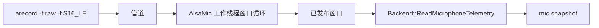
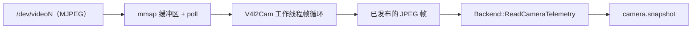

# 主机设备后端

[English](../../../../../docs/eos/develop/ext/backends/host.md)

可复用的主机设备后端直接在 `eosd` 内采集数据。目前包括 ALSA 麦克风输入和 V4L2 摄像头输入。

<a id="alsa-microphone-backend"></a>

## ALSA 麦克风后端

[扩展与后端总览](../README_cn.md)定义共享数据边界，并列出扩展集合。

[English](../../../../../docs/eos/develop/ext/backends/host.md#alsa-microphone-backend)

由 `src/eos/ext/backends/alsa/` 实现的原生 ALSA 音频采集。

### ALSA 目录

- [ALSA 概览](#alsa-概览)
- [ALSA 架构](#alsa-架构)
- [ALSA API](#alsa-api)
- [ALSA 设计](#alsa-设计)
- [ALSA 测试](#alsa-测试)

### ALSA 概览

`alsa` 后端把主机音频输入采集进 `mic.snapshot` 发布的有界 PCM 窗口。它是 `aplay` 扬声器后端的采集侧对应物，运行在 `eosd` 进程内，不涉及采集守护进程或 ROS 2 麦克风组件。

后端直接从 `PATH` 执行 `arecord`，因此主机需要安装 ALSA 工具：

```sh
sudo apt install alsa-utils
test -x "$(command -v arecord)"
```

### ALSA 架构

后端持有一个工作线程：打开设备、按固定大小读取窗口、发布最新的那一个。`ReadMicrophoneTelemetry()` 在锁内把窗口拷出，因此读取方永远不会阻塞在设备上。



麦克风是只读馈送设备：不声明任何 primitive，并拒绝所有命令路径。

运行事件通过结构化 `microphone` logger 写入，并路由到 `var/log/eos/latest/eosd/ext-alsa.log`。日志记录后端启动、停止与 halt、每次打开后的首个有效窗口、采集中断及有界重试元数据；绝不记录 PCM 样本或编码音频。重复的打开失败由仓库统一的文件 sink 去重器折叠。

### ALSA API

在所选 binding 中声明设备并选用该原生后端：

```toml
[[profile.site.device]]
class = "mic"
part_id = "default"
description = "Host ALSA microphone"

[profile.site.device.backend]
type = "alsa"

[profile.site.device.backend.alsa]
alsa_device = "default"
frame_id = "mic"
sample_rate_hz = 16000
channels = 1
window_frames = 320
read_timeout_ms = 2000
```

所有键都是可选的，默认值就是音频契约自身的取值：16 kHz 单声道、320 帧（20 ms）、读超时上界 2000 ms，以及 `mic` 安装坐标系。`alsa_device` 和 `frame_id` 不得为空。`sample_rate_hz` 限制在 1..192000，`channels` 在 1..8，`window_frames` 在 1..48000，`read_timeout_ms` 在 1..60000。未知键会被拒绝；`type = "alsa"` 要求该表存在；`alsa` 只对 `mic` 类实现。

`demo.toml` 中提交的两个 profile 都以 `alsa_device = "default"` 使用该后端；麦克风数据来自本地采集，绝不来自 WebSocket 输入或合成回退。`demo-host` 与 `demo` profile 唯一的区别是使用 V4L2，而不是外部 simulator camera。请从 `[mode.binding]` 中选择所需 profile。主机摄像头变体见 [V4L2 摄像头后端](#v4l2-摄像头后端)。

用以下命令设置当前用户兼容 PulseAudio 的系统默认输入源：

```sh
./scripts/sys_dev.sh --list
./scripts/sys_dev.sh --set mic --index 1
```

`--index` 是 `MICROPHONE` 下显示的从 1 开始的编号。该命令只修改主机音频服务器；它既不会写入 部署绑定中的 `alsa_device`，也不能证明服务账户使用相同的音频会话。`scripts/mic.sh` 仍是独立的 EOS 配置选择器。

### ALSA 设计

**缺失就报缺失。** 设备打不开、或数据流结束，都会清空已发布的窗口并把健康状态降为 not-alive，于是 `mic.snapshot` 报 `device_present: false`，而不是继续供上一个陈旧窗口或一个空窗口。`alive` 的含义是“已经交付过至少一个窗口”：被启动的 `arecord` 在读到数据前不会报错，所以这是在不编造的前提下能给出的最强声明。

**回退到合成音频刻意不做成本后端的行为。** 一个设备后端如果悄悄供合成样本，`device_present` 就变成了假话；而回退是一项选择，属于启动层，应该在那里被显式声明。

**`Clamp()` 是空操作。** 麦克风没有执行通路，且采集是连续的——没有更安全的状态可保持，被丢弃的窗口也会立刻被重新填上。真正让设备停下来的是 `Halt()`，被 halt 的设备不再提供窗口。

“只采集”由 primitive 目录保证，而不是由本后端保证。目录中没有任何面向 `mic` 类的 primitive，因此采集设备根本声明不出 primitive。这样将来若要新增 `mic.*` primitive，本后端无需预先声明自己做不到什么。

### ALSA 测试

`alsa_mic_test` 通过一份脚本化的采集流驱动后端，因此所有用例都不需要声卡：窗口按配置原样发布、设备打不开时报缺失而非空窗口、数据流结束、`Clamp()` 后连续采集仍存活、`Halt()` 使其停止、所有命令路径被拒绝、以及配置不完整时拒绝构造。

另有两个用例直接打真实 `arecord` 边界——这半边本来会被声卡挡住。一个把替身 `arecord` 放到 `PATH` 最前面，让它回放一段已知的斜坡样本，于是真实的 `posix_spawn`、管道与窗口拼装都会执行；另一个向真实 `arecord` 要一个不存在的设备，并断言“缺失”被如实上报且从不发布任何窗口。两者合起来在没有音频硬件的主机上覆盖了该进程边界的成功与失败两条路径。

`BindingTest.AlsaMicConfigurationStaysCaptureOnly` 覆盖 binding 层：默认值、必须存在的表、类限制、取值范围、未知键，以及该表在别的后端类型下非法。

<a id="v4l2-camera-backend"></a>

## V4L2 摄像头后端

[扩展与后端总览](../README_cn.md)定义共享数据边界，并列出扩展集合。

[English](../../../../../docs/eos/develop/ext/backends/host.md#v4l2-camera-backend)

由 `src/eos/ext/backends/v4l2/` 实现的原生 Video4Linux2 采集。

### 目录

- [概览](#概览)
- [架构](#架构)
- [API](#api)
- [设计](#设计)
- [测试](#测试)

### 概览

`v4l2` 后端把主机摄像头采集进 `camera.snapshot` 发布的有界 JPEG 帧。它是 `aplay` 扬声器后端的采集侧对应物、也是 `alsa` 麦克风的姊妹后端：`eosd` 进程内一个工作线程独占设备，不涉及采集守护进程或 ROS 2 相机组件。

只支持**能输出 MJPEG** 的摄像头。本后端不含编码器，只提供原始格式的摄像头没有可贡献的数据，会被报为缺失而不是就地转码。多数 USB 摄像头与 Jetson 载板上的相机都直接支持 MJPEG，因此不需要额外依赖——整仓无需 OpenCV 或 libjpeg。

唯一的主机前置条件是设备节点：

```sh
test -r /dev/video0
v4l2-ctl --device=/dev/video0 --list-formats   # 列表里应有 MJPEG
```

### 架构

后端持有工作线程负责打开设备、出队缓冲区并发布最新帧。`ReadCameraTelemetry()` 在锁下把该帧拷出来，因此读取方不会阻塞在设备上。



摄像头是纯采集设备：不声明任何 primitive，并拒绝所有命令通路。

### API

在所选 binding 里声明设备并选用该原生后端：

```toml
[[profile.site.device]]
class = "cam"
part_id = "default"
description = "Host V4L2 camera"

[profile.site.device.backend]
type = "v4l2"

[profile.site.device.backend.v4l2]
video_device = "/dev/video0"
frame_id = "camera_optical"
width_px = 640
height_px = 480
fps = 30
read_timeout_ms = 2000
max_frame_bytes = 4194304
```

每个键都是可选的，默认值是 640x480、30 fps、读取上限 2000 ms 的 MJPEG 流、`camera` 坐标系和 4 MiB 编码帧上限。`video_device` 和 `frame_id` 不得为空。`width_px` 与 `height_px` 的取值区间为 1..16384，`fps` 为 1..240，`read_timeout_ms` 为 1..60000，`max_frame_bytes` 为 1..67108864。未知键会被拒绝；`type = "v4l2"` 必须带该表；`v4l2` 只对 `cam` 类实现。

`etc/eos/backends/demo.toml` 中的 `demo-host` 是仓库内的示例：它保留与 `demo` 相同的七设备契约，只把 external-simulator camera 替换为该 V4L2 后端。两个 profile 都使用 ALSA 麦克风采集。在 `[mode.binding]` 中以 `backend = "backends/demo.toml"` 和 `profile = "demo-host"` 选择它。`BindingTest.HostProfileSwapsOnlyTheCamera` 会逐设备比较两个 profile，防止它们漂移。

### 设计

**缺失就报缺失。** 设备打不开、不支持 MJPEG、或流结束，都会清空已发布帧并把 health 降为 not-alive，于是 `camera.snapshot` 报告“摄像头不在”，而不是提供一帧陈旧或空的画面。`alive` 的含义是“已经交付过一帧”：一个打开但已死的设备不能被判为健康——这与 ALSA 后端对被启动的 `arecord` 所作的判断是同一条。

伪造画面被有意排除在本后端之外。一个悄悄提供合成帧的设备后端会让 `device_present` 变成假话，而回退属于启动时的选择决策，应当能被声明出来。

**以协商到的分辨率为准。** `VIDIOC_S_FMT` 返回驱动实际接受的参数，发布的遥测报告的就是它；配置里的尺寸只是请求。帧率不同：驱动经常忽略 `VIDIOC_S_PARM` 却照常出帧，所以请求的帧率只是建议值，仅用于声明 `model` 速率。

**`Clamp()` 是空操作。** 摄像头没有致动通路，采集是连续的，因此没有“更安全的状态”可保持，丢掉的帧也会立刻被补上。`Halt()` 才是让设备停下来的状态，被 halt 的设备不出帧。

**后插的摄像头会被接管。** 打开失败不是终态：工作线程每隔一秒重试一次，只要后端还活着就一直重试，因此 `eosd` 启动之后再插上的摄像头无需重启即可开始出帧；同时因为重试等待会被 `Halt()` 唤醒，关闭依旧及时。

“只采集”由 primitive 目录保证，而不是由本后端保证：目录里没有任何面向 `cam` 类的 primitive，采集设备根本声明不了。这样即使将来真的加入 `cam.*` primitive，本后端也不必预先声明它做不到的事。

### 测试

`v4l2_cam_test` 通过脚本化的帧流驱动后端，因此所有用例在没有摄像头的情况下也能跑：带协商尺寸的已发布帧、打不开的设备报缺失而非空帧、流结束、`Clamp()` 让连续采集保持存活、`Halt()` 能停住它、所有命令通路被拒绝、以及配置不完整时拒绝构造。

`BindingTest.V4l2CamConfigurationStaysCaptureOnly` 覆盖 binding 层：默认值、必需的表、类限制、取值区间、未知键，以及该表在别的后端类型下无效。

## Aplay 扬声器后端

[扩展与后端总览](../README_cn.md) · [Southbound primitive](../../interfaces/actions-payloads_cn.md)

原生 `aplay` 后端从 EOS 接收一个完整且有界的 PCM WAV asset，并通过 ALSA 播放。它只是一种音频输出适配器：URI 解析、文本转语音、网络接收和 prompt 选择均在上游进行。

### 配置

```toml
[[profile.site.device]]
class = "speaker"
part_id = "default"
description = "System ALSA speaker"

[[profile.site.device.primitive]]
name = "speaker.play"
version = "1.0.0"
description = "Play one EOS-resolved WAV asset through the system speaker."

[profile.site.device.backend]
type = "aplay"

[profile.site.device.backend.aplay]
alsa_device = "default"
max_stream_bytes = 16777216
```

`alsa_device` 默认为 `default`，且不能为空。`max_stream_bytes` 默认为 16 MiB，且必须为正数。该表使用严格键检查；`model_id` 不是扬声器设置。

机器人主机必须安装 ALSA 工具，因为后端会直接执行可信路径 `/usr/bin/aplay`：

```sh
sudo apt install alsa-utils
test -x /usr/bin/aplay
aplay -L
```

### Asset 协议

Northbound `speaker.play@1.0.0` 调用携带 EOS 可读 URI。Dispatcher 解析并校验该 URI，然后向后端 release 一个完整 asset：

```json
{
  "uri": "asset://alerts/ready.wav"
}
```

Southbound command 包含 EOS 自有的 diagnostic asset ID、`audio/wav` 和所有编码字节。后端拒绝空 asset 或超限 asset、无效的 PCM WAV、不受支持的 media type，以及播放已经活动时的调用。Northbound 调用方绝不提供 chunk、stream ID、sequence 或原始音频字节。

`kAccepted` 表示后端拥有完整且已校验的 asset，并已将其排入 playback worker；它不证明已完成可听播放。设备特定的 playback telemetry 保留在 EOS 内部，因为 body discovery 只公开扬声器的通用 state 和 health。

### 校验与播放

接受 asset 前，后端会校验精确 RIFF 大小、WAVE signature、chunk 边界与 padding、一个 PCM `fmt ` chunk、一个非空 `data` chunk、非零 channel 和 sample rate、一致的 byte rate 与 block alignment、完整 frame，以及最长五分钟的声明时长。

校验后的字节写入匿名内存文件，并通过标准输入传入，所用参数等同于：

```sh
/usr/bin/aplay -q -D DEVICE
```

Route 和音频字节均不由 shell 解析。播放的 wall-clock deadline 为 WAV 时长加五秒。Clamp 或 emergency stop 会使 stream 失效，并向活动 player 发送 `SIGTERM`，必要时一秒后发送 `SIGKILL`；worker 始终回收子进程。

### 测试

使用运行 `eosd` 的同一用户和同一服务环境测试 route：

```sh
/usr/bin/aplay -q -D default /absolute/path/to/known-good.wav
```

然后使用准入的 asset URI 调用 `speaker.play@1.0.0` 并验证可听输出。`aplay_speaker_test` 无需物理音频硬件即可覆盖 asset 边界、WAV 校验、busy 拒绝、取消、halt 和播放失败。
