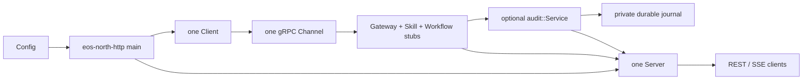

# North HTTP 进程

[扩展总览](../README_cn.md) · [REST/SSE 契约](../../interfaces/external/http_cn.md) · [配置](../../../usage/configuration_cn.md) · [English](../../../../../docs/eos/develop/ext/north_http/README.md)

`src/eos/ext/north_http/` 是独立的 browser-facing REST/SSE-to-gRPC 进程。它位于 EOS core 之外，链接生成的公开 contract 而不是 runtime domain module，且不拥有 robot、primitive、skill、workflow 或 fact state。

## Module map

| Source folder | Documentation | Responsibility |
| --- | --- | --- |
| `north_http/` | 本文 | process composition、logging setup、signal handling 与 executable lifecycle |
| `north_http/config/` | [config_cn.md](config_cn.md) | 严格 `north-http.toml` parsing 与 launch configuration |
| `north_http/client/` | [client_cn.md](client_cn.md) | 一个 process-wide EOS gRPC channel 与 generated stub set |
| `north_http/audit/` | [audit_cn.md](audit_cn.md) | optional external ActionList/fact projection、durable journal、recovery 与 health |
| `north_http/server/` | [server_cn.md](server_cn.md) | HTTP routing、ProtoJSON、SSE、CORS、bounded connection worker、class-specific admission 与 transport logging |

每个 folder 拥有自己的 CMake target 与 test。root CMake file 把这些 target 组合为 `eos-north-http`；root `main.cpp` 保持为精简的 process entry point。

## Process composition

startup 解析 layout 与 absolute config path，严格加载 `Config`，应用受支持的 command-line override，配置 `north-http` logging service，构造一个 `Client(config.upstream)`，可选构造并启动使用 derived state directory 的 `audit::Service`，然后构造 `Server(config, client, audit)`。declaration order 使 shared client 保持存活直到两个 borrower 停止并销毁之后。

`SIGINT` 与 `SIGTERM` 设置 process stop flag。`Server::Run` 观察该 flag，关闭 listener 与 active transport，取消 registered upstream context，并在返回前 join 最多包含 `max_connections` 个 accepted-connection worker 的 bounded set；process composition 随后停止 audit worker。`eosd` 既不启动也不拥有该进程。

`max_connections` 是 hard worker bound：当保留的 connection worker 达到该数量时，accept loop 不再接受 socket，因此 additional connection 在 completed worker 被 join 且 slot 被复用前受 bounded listen backlog 约束。在 accepted connection 内，unary request、SSE stream 与 live-monitor WebSocket 分别使用独立的 `max_inflight_requests`、`max_sse_streams` 与 `max_monitor_streams` capacity。server 先读取并分类 HTTP header；当该 class 已满时，它返回 HTTP `429` / `RESOURCE_EXHAUSTED`，关闭 connection，且不读取 request body。

connection worker containment 覆盖所有 request-processing exception：记录 bounded `north_http_worker_error`、关闭并 unregister transport，并始终把 slot 标记为可复用。SSE heartbeat 与 peer-disconnect helper thread 同样 containment exception、取消关联 gRPC context、在需要时主动解除 transport wait，并在其 request worker 退出前停止且 join。

## Ownership boundary

config module 拥有 process setting 的 admission。client module 拥有 gRPC connectivity object。audit module 仅拥有其 external projection 与 journal。server module 拥有 HTTP connection state 与 translation。EOS `GatewayService`、`SkillService` 与 `WorkflowService` 仍是到达 core behavior 的唯一路径；north HTTP 绝不链接 Dispatcher、SkillManager、ActionList manager、hardware 或 perception implementation。

该进程可在 EOS 缺席时启动，因为 channel construction 不阻塞。liveness 报告 adapter process，readiness 通过 shared channel 探测 EOS health。optional audit health 独立报告，不再 gate adapter。gRPC reconnect behavior 属于 channel，不会为每个 service、request、browser stream 或 audit stream 创建第二个 channel。

## Logging 与调试

该进程在 `var/log/eos/runs/<launch-id>/north-http/` 下配置 shared logging library。root lifecycle event 为 `north_http_process_started`、`north_http_process_stopped` 与 `north_http_process_failed`；listener、upstream-state、request、stream、cancellation 与 transport event 属于 server module；audit diagnostic 使用 `north-http.audit`。durable audit journal 与 diagnostic log 分离。

使用 propagated correlation ID 把 north HTTP log 中的 browser request 与 `eosd` 中对应的 `northbound` 及 domain log 连接起来。log 包含 route/RPC identity、status、duration、byte count、readiness transition 与 cancellation state，但不包含 request body、credential、media、transcript、schema、domain payload 或 raw protobuf。

## 测试

`eos_north_http_client_tests`、`eos_north_http_config_tests`、`eos_north_http_audit_tests` 与 `eos_north_http_server_tests` 覆盖四个 focused module target。aggregate REPL integration test 验证经过 composed north HTTP process 的 external client path；process-level launch 与 packaging check 保留在 EOS integration suite 与 wrapper test 中。
