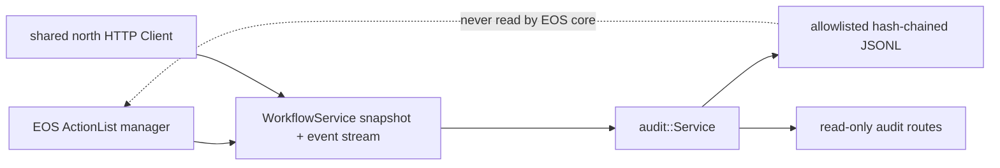

# 外部 ActionList audit

[North HTTP 进程](README_cn.md) · [gRPC client](client_cn.md) · [Server](server_cn.md) · [Workflow 契约](../../interfaces/workflow_cn.md) · [调试](../../../usage/debugging_cn.md) · [English](../../../../../docs/eos/develop/ext/north_http/audit.md)

`src/eos/ext/north_http/audit/` 实现 ActionList 与 fact mutation 的可选 durable、privacy-minimized projection。它是 `eos-north-http` 中的 external observer，而不是 EOS core module、source of truth、scheduler、recovery input 或 authorization boundary。

## Ownership boundary

公开 API 是 `eos::ext::north_http::audit::{Config, Health, ErrorCode, Status, Service}`。`Service(Client&, Config)` 借用 process-wide north HTTP client，拥有一个 worker 与其 journal，并公开 idempotent `Start()`、idempotent `Stop()`、synchronized `status()` 与 bounded `record_page(limit, budget)` selection。不存在 unbounded record-list API；public server 使用 `kMaximumRecordPageBytes = 4 MiB`。

process composition 把 audit directory 派生为 `<state>/north-http/action-list-audit`，在 HTTP server 前启动 audit，通过 `Server(Config, Client&, audit::Service*)` 注入 optional pointer，并在停止和销毁 audit 与 shared client 前停止 server。不接受 user-supplied path。

audit 使用与 browser Workflow route 相同的 `Client::workflows()` stub。它不创建第二个 channel、ActionList memory bypass 或 primitive path。禁用或丢失 audit data 绝不会改变 accepted workflow 或 physical effect。

## Durable record contract

每个 journal line 是一个 JSON object，包含 `kind`、allowlisted domain field、`segment`、`previous_hash` 与 `hash`。cursor-bearing record 使用 `cursor: {epoch, sequence}` 与 `observed_at`。numeric JSON value 在这个 internal journal 中是 native JSON number，而不是 public ProtoJSON string representation。

`snapshot_commit` 是一个 atomic bootstrap record，包含 snapshot cursor、snapshot `observed_at`、`action_lists` array 与 `facts` array。完整 bootstrap projection 在一个 journal line 中 commit，因此 restart 绝不会把 partially written multi-record snapshot 当作 valid cursor。

`action_list` projection 仅允许：

- List field：`workflow_id`、`revision`、enum `status`、`created_at`、`updated_at`、optional `superseded_by_workflow_id`、cursor 与 observation time。
- Per-action target field：`action_id`、enum `status`、optional `execution_id`、optional `command_id`、`target_kind`、exact `target_name`、exact `target_version`，以及存在时的 primitive `device_id`。

`fact` projection 仅允许 `kind`、cursor、`observed_at`、`event_time`、`received_time`、optional nonzero `source_sequence` 与 optional `source_execution_id`。fact key、value、source、frame、unit、confidence 与 validity 完全排除；low-entropy identifier 即使作为 unsalted hash 也不保留。

audit 绝不持久化 action parameter、result、reason、dependency、condition、supersession input array、schema、fact value 或 excluded fact identity、resource value、SIGNAL payload、primitive acknowledgement、credential、authentication data、origin、request/response body、raw protobuf、media、speech、prompt 或 transcript。Workflow、action、target、execution、command 与 device identifier 仍是 operationally sensitive metadata，因此 journal 仍需要 filesystem access control 与 retention review。

## Hash chain、rotation 与 retention

segment 命名为 `audit-000000000000.jsonl`，monotonically increment，并在 append 会使 non-empty segment 超过 `rotation_size_bytes` 前 rotation。每个完整 encoded JSONL line（包括 newline）必须符合该 hard cap；oversized snapshot 或 event 不会 append，audit 以 `resource_exhausted` degrade，并发出只含 stable `error_code` 的 `action_list_audit_record_too_large`。最多保留 `rotation_files` 个 segment，且 overflow-safe configured size/count product 不得超过 `kMaximumRetainedBytes = 256 MiB`；成功删除旧 segment 以及 journal/state write 会 synchronized to filesystem。service 强制 owner-only `0700` directory 与 `0600` journal/checkpoint file。

对于每条 record，`previous_hash` 是 previous retained tail hash，`hash` 是对加入 `previous_hash` 与 `segment` 之后、加入 `hash` 之前的 canonical serialized record 计算的 lowercase SHA-256。all-zero hash 开始 new journal。recovery 验证每个 retained record hash 和每个 available predecessor link；retention 剪除旧 segment 后，第一个 retained record 作为 verifiable retained suffix 的 anchor。

该 SHA-256 chain 是 corruption 与 tamper evidence，而不是 attacker-proof authenticity。没有 HMAC、signature、trusted timestamp 或 protected signing key。能够重写 journal 并重新计算所有 hash 的 attacker 可以伪造 consistent chain。

`cursor.json` 是 atomically replaced operational checkpoint，包含 epoch、sequence、tail hash、segment index 与 record count。startup 通过 segment replay 重建并验证 journal state，而不是盲目信任该 checkpoint。

## Recovery、resume 与 resnapshot

startup 创建 derived directory，拒绝 matching `audit-*.jsonl` symlink 或其他 non-regular entry 而不 follow、change 或 read 它，并排序 recognized regular segment file。在读取 content 前，它拒绝超过 `rotation_files` 的 segment count、超过 `rotation_size_bytes` 的任何 file，或 overflow-safe cumulative bytes 超过 configured product 或 256 MiB；audit 以 `resource_exhausted` degrade、发出 `action_list_audit_recovery_limit_exceeded`，且不 materialize record。否则它从旧到新 parse record，验证 retained hash chain，重建 retained record 与 latest committed cursor，并重写 `cursor.json`。仅缺少 newline 的 valid final record 会保留并修复；newest segment 中未终止的 malformed final fragment 被视为 torn append 并 truncate。blank interior record、complete malformed record、parseable unterminated tampering、broken hash 和 interior corruption 生成 `degraded/corrupt_chain`；unsafe filesystem entry 或 filesystem-operation failure 生成 `degraded/io`。这些都不会被静默跳过。

没有 recovered cursor 时，worker 调用 `GetRuntimeSnapshot`、要求 non-empty cursor epoch、写入一个 `snapshot_commit`，并从该 cursor 之后严格开始 `WatchActionListEvents`。成功但 epoch 为空的 snapshot 会在 append 前被拒绝，并以 `action_list_audit_snapshot_retry` reason `invalid_cursor` retry。存在 recovered cursor 时，它直接 resume stream，不再取得 snapshot。与 committed sequence 相同 epoch 且序号小于等于它的 event 作为 duplicate 忽略；下一个 accepted event 必须具有相同 epoch 并恰好为 sequence plus one。

local sequence gap、epoch mismatch、`FAILED_PRECONDITION` 或 `OUT_OF_RANGE` 会清除 incremental cursor、记录 `action_list_audit_resnapshot_required`、等待 `reconnect_delay_ms`、获取 fresh atomic snapshot、append new `snapshot_commit` 并 resume。其他 stream ending 记录 `action_list_audit_stream_retry`，在 bounded reconnect delay 期间把 health 转为 `stopped`，并使用 last committed cursor retry，而不 invent record。

service 仅在 projected record 与 checkpoint 都同步后才推进 durable cursor。这提供 at-least-once upstream delivery 与 journal-level duplicate suppression；它不会使 external journal 变成 authoritative，也不会在 storage failure 时反转 action。

## Health、degradation 与 HTTP visibility

`Health` wire name 是 `stopped`、`healthy` 和 `degraded`。`ErrorCode` name 是 `none`、`invalid_config`、`io`、`writer_conflict`、`corrupt_chain` 和 `resource_exhausted`。`Status` 仅公开 health、error category、running flag、epoch、sequence 与 retained record count；它有意不包含 free-form exception 或 payload detail。

audit 是 non-authoritative diagnostics，不再 gate functional readiness。`/health/ready` 仅取决于 EOS upstream；`/v1/eos/audit/status` 独立报告 disabled、stopped、healthy 或 degraded audit state。即使 audit stopped 或 degraded，`/health/live` 仍继续报告 process liveness。

permanent config、I/O、chain 与 capacity failure 会对 audit projection fail closed，并公开 stable degraded category。它们不会停止 HTTP listener 或 EOS core。operator 必须保留 affected journal 用于诊断，并在 out of band 修复或迁移它；service 绝不会删除 corrupt complete record 以使 readiness 变绿。

read-only [audit route](../../interfaces/external/http_cn.md#审计路由) 返回 `Cache-Control: no-store`。它们是 operational visibility，而不是 journal 具有 authenticity、超过 configured retention 的 completeness，或与 skill-execution sequence 同步的证明。

## Logging 与调试

Audit diagnostic 使用 logger `north-http.audit`，路由到 `<run>/north-http/ext-north-http-audit.log` 与 process `events.jsonl`。state root 下的 durable journal 与两种 diagnostic sink 分离，不受 `[log]` rotation、deduplication、overwrite 或 attachment setting 控制。

lifecycle 与 failure event 为 `action_list_audit_recovered`、`action_list_audit_partial_tail_recovered`、`action_list_audit_snapshot_retry`、`action_list_audit_stream_retry`、`action_list_audit_resnapshot_required`、`action_list_audit_invalid_config`、`action_list_audit_recovery_failed`、`action_list_audit_recovery_limit_exceeded`、`action_list_audit_tail_recovery_failed`、`action_list_audit_chain_corrupt`、`action_list_audit_record_too_large`、`action_list_audit_write_failed` 和 `action_list_audit_state_write_failed`。safe field 是 bounded operational count、cursor sequence、numeric gRPC status、`invalid_cursor` 等 stable reason 与 stable error category；record、upstream text 与 excluded payload 绝不复制到 diagnostic。

先使用 `GET /v1/eos/audit/status`，然后检查 transition 周围的 `north-http.audit` event。可用 logging correlation ID 把 generated audit snapshot/stream request 与 `eosd` 关联，但要使用 status 或 journal 中的 cursor epoch/sequence 诊断 replay continuity。参见[调试 runbook](../../../usage/debugging_cn.md)。

## 测试

16 个 `eos_north_http_audit_tests` 使用 in-process WorkflowService fixture 与 temporary durable directory。它们验证 privacy allowlisting 与 bounded record page、atomic snapshot projection、empty-cursor retry privacy、oversized append rejection、legacy over-size 与 over-count recovery refusal、event consumption、restart resume without duplicate、valid missing-newline repair、torn-tail truncation、interior blank、complete/interior/parseable-unterminated corruption rejection、rotation 与 retained-suffix recovery、gap 与 epoch resnapshot、POSIX permission、segment-symlink refusal without following，以及 stable status name。Focused config test 覆盖 strict audit key 与 limit；server test 覆盖 disabled audit route、`no-store`、Workflow SSE cursor projection 与 enabled degraded-audit readiness。
