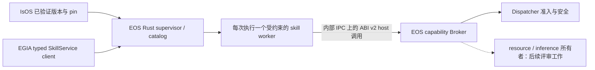

# EOS 提供的技能 ABI 与软件包边界

[English](../../../../../docs/eos/interfaces/skills/native/host-abi.md) · [原生技能编写](README_cn.md) · [C 布局](abi_cn.md) · [能力操作](capabilities_cn.md)

**设计结论：EOS 拥有并提供版本化的 host 能力 ABI。** 技能包实现 guest 查询入口和不可变描述符；它不向 EOS 提供服务 ABI，也不获得 runtime、Dispatcher、backend、device 或 socket 句柄。IsOS 负责软件包解析和版本校验。`v2` 与 `eos_skill_library_query_v2` 是现有兼容性标识，不决定 EOS 产品版本。默认 Rust runtime 已实现 R04 仅原语的原生宿主和七方法 SkillService 子集。可选 C++ 技能侧链在 Q02 末次调用者检查前仍是兼容参考。

## 首次使用顺序与职责

1. **安装和选择：** IsOS 安装精确且已验证的版本，在部署中记录显式库选择与 package pin，并只向 EOS 提供清单列出的修订绑定选择文件。仅安装不授予执行权限。
2. **准入：** IsOS 在 worker 启动前验证软件包字节。EOS 再次检查选择文件和库，然后在受约束 worker 中检查 ABI 描述符。`dlopen` 与查询函数可能在 worker 中运行静态构造函数和查询代码；无效描述符不能进入 `execute` handler。失败候选不会在新 EOS 子进程内报告 ready；跨 IsOS Restart 的旧服务代保留还需要额外的停止前 ABI 预检。
3. **发现和调用：** EGIA 等授权调用方通过 `SkillService` 发现技能，提交通过 schema 校验的参数及公开幂等 `request_id`，取得包含 `execution_id` 的快照。技能的精确 `{name, version}` 身份与 package pin 分开记录。EOS 从 request ID 派生私有 primitive command ID。
4. **观察和停止：** EOS 提供状态、有界 checkpoint，以及含 run/correlation ID 的统一 JSONL 事件。取消或关闭时先撤销授权、经 Broker 和 Dispatcher 取消已准入的 primitive，再在有界时间内回收 worker；未知的执行器结果必须明确上报，不能静默重试。

[构建指南](build-install-test_cn.md)提供命令；[ABI 参考](abi_cn.md)定义当前 C 结构与 callback；[worker 设计](../../../design/runtime/skills/external_cn.md)定义内部 IPC 和沙箱。软件包不能仅靠描述符名称声明新的 host callback。

## 目标进程边界



worker 在沙箱中加载动态库并调用 `eos_skill_library_query_v2(2)`。Rust supervisor 拥有 worker、catalog、租约、状态和事件 ID。Broker 是 guest 请求进入 runtime 能力的唯一适配器；内部 IPC 私有且独立版本化。不得在 Rust supervisor 中直接 `dlopen` 软件包代码。EGIA 的 Python 阶段图使用 typed gRPC，不实现也不消费原生 C ABI。未来 Python skill worker 是另一种静态准入 profile，只能取得相同的 broker 能力语义，不能取得原始 C 指针或不受限的 EOS API。

## 边界字段契约

除 **目标策略** 外，下表字段均已属于 ABI v2。文本长度单位是 byte，timeout 是 ms，source timestamp 是 ns，其余无单位。原始类型和布局以 [`abi.h`](../../../../../src/eos/include/eos/skill/abi.h) 与 [C 布局](abi_cn.md)为准。

| 字段或字段组 | 类型；默认值 | 用途、校验和负责人 | 兼容规则 |
| --- | --- | --- | --- |
| `abi_version`, `struct_size` | `uint32`；必填 | guest 报告 ABI `2` 和表的字节大小；EOS 要求不少于冻结的基础前缀，并将读取限制在报告及已知布局范围内。 | 基础 offset 固定；可选尾字段追加并按 size 判断。 |
| `name`, `version`, `build_id` | 借用的 UTF-8 slice；`build_id` 可空 | 库身份、精确 SemVer 和来源；EOS 校验边界及唯一性。 | 现有身份意义不变；`build_id` 只用于诊断，不授予权限。 |
| `skill_count`, `skills`, `skill_descriptor_size` | 数量、指针、byte stride；旧 stride 可缺省 | EOS 限制数组大小、检查对齐，按 stride 读取每项。 | 截止于 `skills` 的旧表使用冻结的基础 stride。 |
| 描述符 `name`, `version`, `description` | UTF-8 slice；旧包 description 可空 | 技能发现身份与操作员说明；EOS 校验。**目标策略：** 新包需要非空描述。 | 不能仅因为旧 v2 包的描述为空就拒绝原有兼容包。 |
| `parameters_schema_json`, `returns_schema_json` | object JSON Schema；必填 | EOS 编译自包含 schema，运行前校验输入，公开前校验输出；不自动插入默认值。 | 收紧既有 skill schema 应发布新的精确技能版本。 |
| `primitive_count/primitives`, `resource_count/resources`, `source_count/sources`, `inference_count/inferences` | 有界数组；零/`NULL` 表示无 | 精确能力白名单、资源 URI 模板、source 方向、推理 authority；EOS 准入与使用时均校验。 | 可选尾字段用 `EOS_SKILL_DESCRIPTOR_V2_HAS` 判断；新增权限须明确声明并发布版本。 |
| `signal_count/signals`, `claim_count/claims`, `ipc_channel_count/ipc_channels` | 有界数组；零/`NULL` 表示无 | 通信 schema/方向及整次执行资源 claim；EOS 每次使用都检查。 | community 尾字段是可选 ABI v2.1；缺失表示不可用，不是默认许可。 |
| `reentrant`, `context`, `execute` | `uint32` 0/1、不透明指针、函数指针；execute 必填 | 技能持有进程生命周期 context；EOS 对非重入执行串行化，检查入口和恰好一次 completion。 | 不移动或重新解释既有字段。 |
| `host.abi_version`, `host.struct_size`, `host.context` | `uint32`、`uint32`、不透明指针；仅本次 invocation | EOS 拥有 host 表和 token；guest 检查版本与大小，不保留或共享 context。 | 既有 callback offset 固定。 |
| Host 能力 callback | 函数指针；可选尾字段可为 `NULL` | 可选 C++ 侧链实现列出的 callback 家族。R04 Rust 必须实现已声明 primitive、取消与必需 completion；其他家族需要完整所有者后才能公开。每项已实现调用都按描述符、run、device、期限、schema 和 Dispatcher 准入校验。 | guest 同时检查 `EOS_SKILL_HOST_V2_HAS` 和指针；只有描述符不需要的家族才可以缺失并返回 unavailable。 |
| execution 内的 `command_id`, `arguments_json`, `host` | UTF-8 slice、host 指针；必填 | EOS 将 root command 与校验过的 object 参数绑定到一次执行。 | 值仅在 `execute` 期间借用。 |
| completion 的 `accepted`, `reason_code`, `result_json`, `message` | 0/1、有界 UTF-8、object JSON、可选文本 | guest 正常路径完成一次；EOS 校验结果和 reason。`message` 只供操作员阅读。 | 旧 completion 无 `message`，读取尾字段前必须检查。 |

声明能力只表示*有资格申请*。runtime 就绪状态、package pin、设备状态、claim、期限以及 Dispatcher 安全规则仍可拒绝。resource API 只读；执行器写操作必须调用声明过的 primitive。不能通过拼接 URI 绕过图节点准入。EOS 返回稳定 status/reason code；message 应有界且脱敏，不能用于控制流解析。

## 准入与执行算法

**准入：** 仅解析显式选择且经过 P01 锁定的库文件；worker 启动前拒绝符号链接、路径逃逸、digest 不符、非普通文件和重复身份；然后在受约束 worker 中查询 ABI `2`，校验基础 size、可选尾字段、数组 stride、UTF-8、长度、SemVer、自包含 object schema、声明和可用 primitive；只有全部通过才原子发布 catalog。当前 C++ loader 递归发现 `*.skill.so`；已实现的 Rust R04 策略不扫描目录，也不把递归发现当作安全边界。

未配置外部宿主时不发布可执行技能。无效选择数据在 worker 启动前拒绝。无效 ABI 描述符可能让静态构造函数和查询代码在受约束 worker 内执行，但不得进入 `execute` handler，也不得发布目录。未列入已准入描述符的能力请求在分发前拒绝。负例覆盖这些情况与 worker 清理；这只证明准入默认拒绝，不代表通用沙箱隔离。

**执行：** 校验调用方和 schema；获取 claim；创建 run/correlation ID；启动受约束 worker 和限时 Broker grant；仅传 invocation 范围 host callback；primitive 经 Broker 进入 Dispatcher；校验每次响应和最终结果；撤销 grant、释放 claim、只发布一次终态。有界队列、逐次调用 deadline、响应复制和恰好一次终态，防止一个 worker 阻塞其他运行。含糊的执行器结果不能自动重试。

**停止：** 标记 stopping 并拒绝新的能力调用；发送取消；取消未完成 primitive operation ID，等待 Dispatcher 终态；撤销 grant；请求 worker 退出，逾期则终止并回收；发出一个终态。技能自定义 `SIGNAL` 或 community 消息不能替代 manager cancellation。若不能证明执行器已经安全停止，上报 `worker.outcome_unknown` 并交由操作员恢复。

| 情况 | 对外结果 | 日志事件与恢复 |
| --- | --- | --- |
| ABI 缺失/错误或描述符无效 | catalog 准入失败，新技能不可见 | `skills.admission_rejected`，仅记录安全 reason 和 package pin；修复软件包或 host 支持。 |
| 可选 callback 缺失 | `EOS_SKILL_HOST_UNAVAILABLE` | 技能可用文档定义的退化路径；不得隐式增加权限。 |
| 能力未声明或过期 | `INVALID_ARGUMENT` 或 `UNAVAILABLE`，附稳定 reason | `skills.capability_denied`；修复声明或 runtime 就绪状态。 |
| worker 崩溃、超时、协议不匹配 | run 失败；执行器结果未确定时为 unknown | `skills.worker_failed`；撤销 grant、回收 worker、按 run/correlation 查看日志。 |
| 取消且硬件结果明确终止 | run 为 cancelled | `skills.run_cancelled`；不自动重启。 |

**兼容与里程碑：** 在 Rust supervisor 接入 broker worker 时保留查询符号、C 布局、精确技能身份及 ABI v2 尾字段检查。准入时发布支持的 ABI/功能集合。新的强制布局或 callback 语义变更需要新的 ABI major 和独立 worker 路径，不能静默重新解释 v2。实现顺序：已验证文件选择 → Rust catalog/worker 监督 → Broker/Dispatcher 桥接 → 取消与故障统计 → 统一日志/状态 → package 和旧 ABI fixtures → IsOS → EOS → EGIA 与 MuJoCo 的完整运行。完整测试输出保存到 `logs/test/<run-id>/`。

## R04 Rust 宿主选择与执行契约

本节固定 [R04](../../../../island/implementation-todo_cn.md) 的所有者交接。IsOS 拥有图声明、P01 收据及选择文件；EOS 拥有输入复核、C ABI 检查、worker、Broker、公开 SkillService 与生命周期。图上的连线不执行技能；安装软件包或读取描述符也不授予执行器权限。

EOS runtime 的 IsOS `isos.process.component@v0.1` 节点可以提供可选 `settings.skill_libraries`，显式列出 `{package:{id,version},library}` 项。缺失或空数组表示无宿主库。IsOS 在 Apply 以及 Run/Restart 前验证精确 pin 和文件，在与 `eos/graph.json` 相同的 schema-2 已选择清单中列出 `isos/skill-selection.json`，并只给 EOS 子进程传 `EOS_SKILL_SELECTION_FILE`。非空选择要求所选 runtime 通过 P05 发布精确 feature `host-skill-abi-v2`；缺失须在停止旧进程前失败。[IsOS 选择契约](https://github.com/Island-Team/isos/blob/master/docs/isos/interfaces/skill-selection_cn.md)拥有图路径和诊断。

节点类型目录必须如实描述该字段。R04 为 EOS 通用 `SettingType` 增加序列化 `data_type:"object_array"`，为 `Setting` 增加可选 `items_schema`、`min_items` 和 `max_items`；旧描述符未使用这些字段时保持原序列化。**IsOS 拥有并发布**精确的 `isos.process.component@v0.1` 描述符；它继承 `@v1.1`，同时包含 IsOS 现有的 `env_from` 和可选 `skill_libraries`，其中 `min_items:0`、`max_items:16`，`items_schema` 为如下内容。EOS 不重新定义或发布该 IsOS 类型：

```json
{"type":"object","additionalProperties":false,"required":["package","library"],"properties":{"package":{"type":"object","additionalProperties":false,"required":["id","version"],"properties":{"id":{"type":"string","minLength":1},"version":{"type":"string","minLength":1}}},"library":{"type":"string","minLength":1,"maxLength":256}}}
```

`items_schema` 是最多 8 KiB、深度最多三层的本地 object schema，仅允许 `type`、`properties`、`required`、`additionalProperties`、`minLength`、`maxLength` 和 `pattern`；未知关键字、远程引用和畸形结构都拒绝目录准入。通用 registry 检查数组长度与元素形状，IsOS 在精确节点路径另行检查包 ID、SemVer、POSIX 路径及 P01 pin。IsOS 的 `@v0.1` 是精确图类型身份；独立的 P05 `host-skill-abi-v2` feature 阻止旧 EOS 程序接受非空选择。UI 因而可显示真实 object-array 元数据。

选择文件是最多 64 KiB 的 UTF-8 object，无额外字段。字段为必需整数 `schema_version:1`（无单位）、必需 `active_revision`（IsOS 保存的完整图 SHA-256，64 位小写十六进制）、必需 `libraries` 数组（按 `package_id,package_version,library` 排序、无重复、最多 16 项）。每项包含精确 `package_id`/`package_version`、绝对的 P01 元数据目录 `package_root`、绝对的已验证字节目录 `payload_root`、1–256 UTF-8 byte、以 `.skill.so` 结尾的相对 POSIX 路径 `library`，以及小写 SHA-256 `receipt_sha256`、`release_sha256`、`payload_sha256`、`library_sha256`。链接包的 payload 根可以与 store 元数据根不同。路径不得为空、以斜杠开头、包含反斜杠、`.` 或 `..` 分量；不得扫描目录、猜测最高版本或使用环境覆盖。私有路径与摘要不进入公开 SkillService 或用户日志。有效 JSON 形状见 [R04 fixture](../../../../../tests/fixtures/r04_host_skills/selection.json)。

R04 最多准入 256 个总技能身份、8 个活动调用 worker、保留 1,024 条 execution 记录。这些是彼此独立的数量上限，不保证所有条目同时达到最大大小。SkillService 报告 `SERVING` 前，完整 `ListSkillsResponse` 编码体必须不超过 3 MiB，低于 EGIA 当前默认 4 MiB 的 gRPC 接收上限。`ListExecutionsResponse` 保留集也遵守 3 MiB 总预算：EOS 只淘汰最早的终态记录；活动记录占满预算时，新 Start 被拒绝。SkillService 单请求传输上限为 2 MiB，可容纳 1 MiB 参数体，单响应编码上限为 4 MiB；Gateway 保持独立的 64 KiB 请求上限。`WatchExecution` 的 64 条快照环或活动 watcher 丢失请求序号时，显式返回 `OUT_OF_RANGE` 缺口；最多准入 64 个 watcher，断开 watcher 不取消执行。每个库最多 64 MiB；描述符文本/名称字段最多 4 KiB，每个编译参数/结果 schema 以及参数/结果体最多 1 MiB。worker IPC 为单个最多 64 KiB 内联包或最多 64 MiB 的密封只读 memfd，每次 execution 最多排队 64 个包，全部 worker 排队 payload 总计最多 64 MiB。每库目录检查（包括父进程独立复核描述符与 schema）限时五秒。每次 Broker primitive 调用限时为 execution 剩余期限与五秒的较小者。公开 timeout 缺失表示 execution 没有总期限，仍受单次调用限制与关闭时取消。取消提供一秒协作退出、终止请求后一秒，再有一秒强制终止/回收尝试；无法中断的 worker 超过期限时必须报告可见的停止故障，不能声称完成回收。这些是实现边界，不改变 ABI 布局。

EOS 只在 R03 已管理 profile 与 grant 校验文件俱全时接受 `EOS_SKILL_SELECTION_FILE`；独立 mock 且没有选择时，技能目录不可执行。选择路径必须恰好是与 `eos/graph.json` 同一 `/v2/<revision>/<generation>/` 叶节点下的 `isos/skill-selection.json`。EOS 检查 `manifest.schema_version:2`、路径中的 revision/generation 与 manifest 相等、该相对路径在 `manifest.files` 中恰好出现一次、文件字节 SHA-256 等于清单值，且 `selection.active_revision` 同时等于 manifest revision 和 R03 verifier 的 `active_revision`。完整 generation 输入摘要由 IsOS 在启动前重算；EOS 复核清单/路径/文件绑定，绝不以 EOS projection 摘要替代保存修订。EOS 再检查 P01 收据/release/payload、各路径分量、普通文件所有者/权限、库文件不超过 64 MiB 以及精确摘要。它以 nofollow 打开源库，从同一描述符哈希并复制到 EOS 私有只读临时文件；worker 只加载该副本。复制期间源描述符元数据和内容必须稳定。相同 UID 的恶意管理员不在该本地信任声明内。不完整交接、清单或库变化在新 EOS 子进程启动调用 worker 或报告 ready 前失败。IsOS 现已在旧子进程 Stop 前运行私有 EOS 候选 ABI／目录预检，并在发布候选前要求旧 Stop 确认。精确合并版本的确认与未知 Stop 重放记录见[首次使用指南](../../../develop/host-skills_cn.md#r04-精确合并版本可检查退休验收2026-11-02)。

### 私有候选目录预检

EOS 私有命令与共用静态就绪校验器已经实现。IsOS 执行停止前编排与可检查的候选 grant 退休。精确合并版本的实时重放确认一次成功替换，以及 Stop 未知时旧运行身份得到保留；实时 90 秒超时和预检后可执行文件／库变更的证据范围另有限制。

IsOS 使用**同一所选 `aether-runtime` 可执行文件**调用 `--skill-catalog-preflight --profile <selected-v2-leaf>/eos/graph.json --run-id <candidate-run-id>`，并传入实际选择的 `--node-types` 参数。清理后的 manager 私有子进程环境提供新建 R03 候选校验文件 `EOS_CONTROL_GRANTS_FILE` 与 `EOS_SKILL_SELECTION_FILE=<selected-v2-leaf>/isos/skill-selection.json`；不需要、也不输出明文 bearer grant。此私有命令只接受非空受管技能选择，并拒绝 socket、journal、adapter、backend、scene、listener 等额外运行参数。它不创建公开 socket、gRPC listener、adapter、backend 子进程、journal，不执行 primitive，也不调用 `execute`。仅在常规沙箱设置完成后，受约束检查 worker 中可能运行所选库的静态构造函数与 ABI 查询。

预检读取与启动相同的保存修订 profile、候选 grant verifier、schema-2 manifest、选择文件和软件包输入，核对精确 `v2/<revision>/<generation>` 叶目录及 `run_id` 绑定。它逐一复核 P01 receipt/release/payload/库字节、ELF 依赖、ABI v2 size/stride/schema/身份、重复身份、已声明 callback 的 Broker 覆盖、每项已声明 primitive 在部署中具有静态已准入 binding，以及完整 `ListSkillsResponse` 编码体的 3 MiB 上限。后三项在 `Catalog::admit` 后由预检与正常启动共用的纯数据就绪校验器执行。它只使用复制出的描述符、`admitted_bindings(profile)`、与实时投影相同的 profile 级 primitive 资格规则，以及同一公开描述符投影／Protobuf 编码，不构建 Runtime、Projection、Dispatcher、adapter 或 listener。实时终态停止围栏、adapter、health 与 Dispatcher 检查仍属启动／调用门槛；预检不声称这些物理事实。ABI 已准入但任一静态就绪门槛失败的目录，必须在旧子进程停止前返回 `ok:false`。它暂存精确验证字节并按现有每库五秒限时在受约束 worker 内检查；成功前必须清理所有检查 worker 与暂存文件。worker 回收不能确认则预检失败。成功只说明候选检查通过，不授予执行权限，也不发布活动目录。

命令向 stdout 只写一行最多 16 KiB 的 UTF-8 JSON。成功时退出码为 `0`：

```json
{"schema_version":1,"ok":true,"active_revision":"aaaaaaaaaaaaaaaaaaaaaaaaaaaaaaaaaaaaaaaaaaaaaaaaaaaaaaaaaaaaaaaa","generation":"bbbbbbbbbbbbbbbbbbbbbbbbbbbbbbbbbbbbbbbbbbbbbbbbbbbbbbbbbbbbbbbb","run_id":"candidate-1","selection_sha256":"cccccccccccccccccccccccccccccccccccccccccccccccccccccccccccccccc","libraries":[{"package_id":"island/example-skills","package_version":"0.1.0","library":"lib/island/skills/example.skill.so","library_sha256":"dddddddddddddddddddddddddddddddddddddddddddddddddddddddddddddddd","abi_version":2,"skill_count":1}]}
```

`schema_version` 是必填整数 `1`（无单位）；`ok` 是必填布尔值；`active_revision`、`generation`、`selection_sha256` 均为必填小写 SHA-256 字符串（无单位）；`run_id` 是必填 R03 候选运行身份（无单位）。`libraries` 是必填有序数组，包含 1–16 项（单位：项），顺序与选择文件相同。每项包含精确安全包 ID、SemVer、相对库路径、小写库字节摘要、必填整数 `abi_version:2`（无单位）及 `1..256` 的整数 `skill_count`，符合检查 worker 不允许空描述符表的规则（单位：技能）。全部字段是 EOS 已复核的结果，不能由 guest 原样提供；不含根目录、grant、schema 正文或软件包字节。未知字段、重复键、错误 JSON 或回显不匹配均由 IsOS 拒绝。结果不是可复用的启动许可。

拒绝时在有界清理后非零退出，输出一行脱敏结果，例如 `{"schema_version":1,"ok":false,"stage":"abi","code":"abi_descriptor_invalid"}`。失败形状恰好包含 `schema_version`、`ok:false`、`stage` 和 `code`；不得复制消息、路径、描述符或 stderr。下表是此命令封闭的阶段／代码映射；实现须将底层错误映射至表中值，不得加入自由文本原因：

| `stage` | 允许的 `code` 值 |
| --- | --- |
| `input` | `preflight_arguments_invalid`, `preflight_grants_invalid`, `preflight_profile_invalid` |
| `selection` | `selection_invalid`, `selection_revision_mismatch`, `selection_manifest_invalid`, `selection_digest_mismatch`, `selection_handoff_incomplete` |
| `package` | `package_invalid`, `package_changed`, `package_unsafe`, `library_changed` |
| `elf` | `library_not_elf`, `library_dependency_unsafe` |
| `worker` | `worker_spawn_failed`, `worker_sandbox_failed`, `worker_inspection_failed`, `worker_timeout`, `worker_reap_failed` |
| `abi` | `abi_library_invalid`, `abi_descriptor_invalid`, `abi_schema_invalid`, `abi_capability_unowned` |
| `catalog` | `catalog_duplicate_identity`, `catalog_capacity`, `catalog_broker_unavailable`, `catalog_binding_unavailable`, `catalog_list_oversize` |

检查子进程回收未确认映射为 `worker/worker_reap_failed`，优先于起始故障。IsOS 对 stdout 和 stderr 分别最多捕获 16 KiB，解析恰好一行 JSON，拒绝重复键，并比较每项回显。有效的 `ok:false`／非零退出映射为 IsOS 诊断 `skill_catalog_preflight_rejected`；缺失、多行、过大、畸形或回显不匹配的输出，以及退出码与 `ok` 不一致，映射为 `skill_catalog_preflight_invalid_output`；硬期限到期或信号映射为 `skill_catalog_preflight_timeout`；预检进程或候选 grant 清理无法确认映射为 `skill_catalog_preflight_cleanup_unconfirmed`。这四个代码是现有 `deployment_preflight_failed` 事件中的固定 IsOS manager-session 诊断；日志字段只可包含安全的修订、generation、run／correlation ID、stage 和 code，不含输出正文或 stderr。IsOS 对预检执行实行**全局硬性 90 秒挂钟期限**，包括 payload 树读取、暂存和逐库检查；它是上限，不保证最多 16 个库或最大 payload 字节都能完成。期限到达时 IsOS 终止预检进程组；之后可另行有限尝试回收，但不得将已超时的预检改判为成功。接近期限的超时仍须保留旧运行；若清理无法确认则报告清理代码，不得声称成功。

IsOS 先完成 P01/P04/P05 与候选进程规格预检，创建候选 `run_id` 和 verifier，但不发布候选 run scope；随后在 `managers.remove(name)` 或停止旧子进程**之前**调用本预检。它把返回值与保存修订、已选 generation、run ID、选择文件摘要及有序包 pin／库摘要逐项比较。任何预检或预检后停止前检查失败时，IsOS 必须通过可检查结果的路径显式退休候选 grant bundle；`Supervisor::stop()` 与 Drop 不能作为可检查退休的清理证据。退休失败返回 `skill_catalog_preflight_cleanup_unconfirmed`，保留旧 PID、run ID、活动修订、grant 和 run scope，并要求操作员修复后才能再次替换。被拒绝的预检若成功退休 grant，旧运行同样保持不动，也无需创建恢复 run。成功预检之后，IsOS 在停止旧运行与启动候选前仍立即重查保存修订、generation 文件清单、所选可执行文件字节、grant 与 P01 文件；同一候选 grant bundle 保留用于启动。实际新 EOS 启动独立重复受管准入、`Catalog::admit` 与共享纯数据就绪门槛，重新暂存已验证字节并在 ready 前重建目录。预检到启动之间若输入变化，启动默认拒绝并走现有恢复路径；预检结果不能缓存为启动权限。相同运行中的自动 EOS 子进程重启也重复启动准入，无需替换预检。此预检不证明 R05 的物理释放围栏，也不证明 R06 的执行器停止及模拟器回收顺序。

对于已选择的软件包，EOS 复核收据与 release 的字节摘要、软件包/版本/source/asset 关系、完整 P01 payload 树摘要及所选库摘要。IsOS 在启动前负责完整 P01 release schema 与 generation 文件清单验证。EOS 要求 `receipt.json`、`release.json` 和**每个 payload 文件**（包括与所选库无关的文件）均为 EOS 有效 UID 所有的普通文件，且不能由 group/other 写入（`mode & 022 == 0`）。所选 `isos/` 目录由该 UID 所有且权限为 `0700`；软件包根目录需为安全绝对路径，不含符号链接且确为目录。此边界防止不同本地 UID 修改所选字节；相同 UID 的操作仍在信任边界内。

暂存的 ELF 仅可依赖固定、可信的宿主系统库，SONAME 限于 `libc.so.6`、`libm.so.6`、`libpthread.so.0`、`libdl.so.2`、`libgcc_s.so.1` 和 `libstdc++.so.6`，并从 root 所有的固定 `/lib` 或 `/usr/lib` loader 路径解析。EOS 在启动 worker 前解析所选 ELF dynamic section，拒绝 `DT_RPATH`、`DT_RUNPATH`、`DT_AUDIT`、`DT_DEPAUDIT`、`DT_FILTER`、`DT_AUXILIARY`、未列出的 `DT_NEEDED`、软件包本地依赖或非 ELF 文件；worker 在 `dlopen` 前再次检查。最低环境没有 `LD_*` 覆盖；Landlock 只允许读暂存文件及固定可信的系统 loader/库路径。若需要另一个软件包 `.so`，必须在后续契约中显式设计、锁定并暂存；R04 不发现或执行未锁定的传递依赖。最小 C fixture 可只用 libc；C++17 fixture 可用列出的宿主 `libstdc++` 与 `libgcc_s` ABI 库。该策略不锁定宿主 OS 的系统库字节；宿主镜像属于测试环境记录。

默认 Rust 构建在每次检查和调用时，以私有 `--skill-worker` 模式重新执行选中的 `aether-runtime`，仅继承所有者 IPC 通道和一份暂存文件描述符；它不开公开监听器，不依赖可选 C++ `eos-skill-worker` 或第六个公开程序。父进程对其他描述符设置 close-on-exec 或关闭，包括硬件、日志、grant、模拟器、gRPC 与私有监听器；它先 `env_clear`，仅传明确列入白名单的最低环境，绝不传 `EOS_CONTROL_GRANTS_FILE`、`EOS_SKILL_SELECTION_FILE`、IsOS `env_from`、grant、秘密变量或任意 loader 搜索路径。worker 在加载包前拒绝意外的环境键或继承描述符。子进程在 `dlopen` 前必须建立 `no_new_privs`、资源限制、只读 Landlock 和拒绝网络及子进程创建的 seccomp；任何强制措施不可用则拒绝。受约束 worker 中的构造函数和查询代码仍可能执行，因此只有纯数据故障可宣称在 guest 代码之前被拒绝。描述符无效不得进入 `execute`，不得获得调用 grant；检查 worker 即使失败也须有界回收。C++ 递归 loader 只保留在可选历史侧链，待 Q02 末次调用者检查。私有 IPC 采用有版本、有上限的消息与 `SO_PEERCRED`，对端、协议或大小不匹配即拒绝。

父进程在 worker 查询后独立复核每个复制出的描述符，包括连续 handler 下标、精确名称与 SemVer 语法、重复身份、primitive 白名单和已编译的自包含 JSON Schema。guest 自行写入的 IPC catalog 消息不能绕过这些检查。随后父进程将已验证且安全的 `{package_id,package_version}` pin 附到内部描述符，用于关联 JSONL 事件；guest 不能自行填写该 pin，公开投影不包含路径、摘要或 token。调用取消使用可复制的 pidfd 信号句柄，session 所有者仍负责有界回收；worker 消息发送采用五秒非阻塞期限。seccomp 在 `dlopen` 前检查精确架构并拒绝网络 socket、创建子进程、io_uring 及 x86_64 x32 syscall 绕行。

目录准入根据 `struct_size` 和 descriptor stride 协商冻结的 C ABI `2` 基础前缀与可选尾字段；过短基础表、过量项、未对齐指针、无效 UTF-8、重复技能身份、非 object 或远程引用 schema、缺失 `execute`、未声明 primitive 均原子拒绝。有效旧 v2 前缀保留；既有空 description 不单独导致拒绝。R04 必须通过 Broker 实现声明的 primitive 路径。在相应 Rust 所有者具备完整实现之前，任何 `resource_count`、`source_count`、`inference_count`、`signal_count`、`ipc_channel_count` 或 `claim_count` 非零的描述符均在目录准入时拒绝，不能进入可执行 `ListSkills`；R04 Rust 目录投影的 `SkillDescriptor.claims` 始终为空。未声明家族的可选 callback 可缺席/`NULL`，不得绕路模拟。没有声明字段的可选 log/checkpoint callback 也可为 `NULL`，handler 必须按 ABI 检查可用性。检查目录不调用 `execute`，也不创建 grant。每个库最多 256 个描述符；总目录和活动 worker 另外限量。公开 `SkillDescriptor` 仅包含 `skills/catalog.proto` 字段，不包含本机路径、摘要或 token。

`StartExecution` 校验精确 `{name,version}`、object 参数 schema、1–96 byte 公开 `request_id`、可选正数且最多一小时的 timeout、活动修订与 R03 `egia-control`。沿用现有 gRPC metadata：`authorization: Bearer <64 位小写十六进制 grant>` 与 `x-eos-active-revision: <保存图 SHA-256>`，不新增 proto 字段或公开 grant。缺失/畸形/未知 grant 返回 `UNAUTHENTICATED`，有效 operator grant 返回 `PERMISSION_DENIED`，缺失/畸形修订返回 `INVALID_ARGUMENT`，格式正确但过时返回 `FAILED_PRECONDITION`；全部发生在 worker 与物理释放前。`request_id` 是 manager 全局、进程内的幂等键；`execution_id` 是 EOS 响应中的不透明身份；部署 `run_id` 与两者不同。保留期内相同 ID 且内容相同返回原快照，冲突内容返回 `ALREADY_EXISTS`。Start 受到全局八个 worker 槽限制。`reentrant=0` 时同一精确 `{name,version}` 同时最多一个 `execute` handler，其余已接受 Start 按该身份 FIFO 排队，过期或取消的排队项不启动 worker，也不能越过较早的排队项；`reentrant=1` 可在总容量内并发。worker 只取得经私有 Broker IPC 的本次调用 ABI callback，不取得 runtime、Dispatcher、adapter、图、socket 或任意文件系统句柄。Broker 在每次调用前核对精确声明、目标、execution、绑定代和截止时间；执行器请求以服务端确认的 `skill-worker` 入口及私有派生 command ID 进入同一 R03 Dispatcher。worker 死亡或客户端断连不会重放含糊的执行器命令。

每次 primitive 调用的持久 command ID 是 `sk-` 加 64 位小写十六进制 SHA-256，输入依次为 ASCII 域标记 `eos-skill-primitive-v1\0`、IsOS `run_id`、精确技能 name、version、公开 `request_id`（每个 UTF-8 字节串前加小端 `u32` 字节长度），最后是从零开始的小端 `u64` 调用序号。67 byte ID 满足 Dispatcher 限制且不含秘密。同一 IsOS 运行内 EOS 子进程重启会为相同调用得到同一 ID，日志阻止结果未确定的物理命令重放；新 IsOS 运行有新 run ID，可重用公开 request ID 而不与旧持久命令碰撞。日志仍比较完整的角色、入口、修订、绑定、目标与 typed 参数；哈希身份不能替代这些检查。

`ListSkills`/`GetSkill` 是本地免 grant 的只读发现。`StartExecution`/`TerminateExecution` 是必须带当前修订与 EGIA grant 的写入。`GetExecution`/`WatchExecution`/`ListExecutions` 要求当前运行的 EGIA grant，但不要求当前修订，以便授权方查看旧修订的保留结果。缺失/未知 grant 是 `UNAUTHENTICATED`；有效错误角色、错误运行、封存或外来记录与不存在的 execution ID 对单项读取统一返回不透明 `NOT_FOUND`。七个方法是 R04 必需的 Rust 门面；其他已发布 SkillService 方法保留身份，直到另行评审的完整实现前返回 `UNIMPLEMENTED`。`WorkflowService`、ActionList、图技能序列、子进程 callback、`egia.tensor`、任意模型权重和 Python 技能 worker 均不在 0.x 内。详见 [SkillService](../../skills_cn.md) 的逐方法矩阵。

单次 execution 取消先停止新的 Broker 调用并撤销 grant，经 Dispatcher 取消活动 command ID，有限等待终态或明确的未知结果，再通知、必要时终止并回收 worker。发布的 proto 没有 UNKNOWN execution status；执行器结果未确定时必须为 `EXECUTION_STATUS_FAILED`，稳定 `reason_code = "worker.outcome_unknown"`，保留 movement inhibit，且不得自动重试。整个 EOS 关闭先封闭公开/宿主入口，`dispatcher.quiesce`，再立即调用 `stop_guard.stop` 发出执行器停止，不能等 worker 宽限期；随后撤销/取消/回收 worker，R06 才可终止/回收模拟器。共用 JSONL 事件记录脱敏 package pin、阶段、execution ID、correlation ID、终态 reason 与回收结果，不记录 payload、grant、路径或库字节。[R04 fixture](../../../../../tests/fixtures/r04_host_skills/README_cn.md)覆盖纯数据拒绝、受约束描述符失败、ABI 兼容、未声明调用、幂等、崩溃、取消、未知运动与回收。

### 已选原生包 pin 与事件交付

已选原生技能的 `package_id` 最多 96 个 ASCII byte，采用 P01 的小写 `namespace/name` slug；`package_version` 最多 64 个 ASCII byte，以 ASCII 数字开头，至少有三个以点分隔的段，且只含 ASCII 字母、数字、`.`、`-` 或 `+`，例如 `0.1.0+build.1`。EOS 在 `SERVING` 前的目录准入阶段拒绝过长或畸形 pin，避免已选目录随后因共用 JSONL 字段校验而丢失全部生命周期事件。IsOS P01 可存储更长身份；IsOS 应在停止旧子进程前的 Validate／预启动门槛应用此已选技能限制。事件接收器故障会保留为宿主停止故障，不会静默报告干净停止。通用 `skill_stop_unconfirmed` 事件同时覆盖待完成的 Dispatcher 取消与尚未回收的 worker。

若 worker 子进程已启动但调用消息无法发送，EOS 在返回启动故障前显式执行有界终止／回收步骤。启动错误携带子进程是否实际回收的结果。未回收子进程继续占用 worker 和不可重入计数，设置宿主停止故障锁存，禁止宣称宿主已干净停止；后台等待者仅用于最终 OS 清理，不算成功证据。

相同的启动后规则适用于检查 worker：Inspect 消息发送失败时显式尝试有界终止／回收；若未确认回收，以 `worker_reap_failed` 覆盖原传输错误。`pidfd_open` 失败时先杀死子进程，再使用有界 `try_wait` 循环；启动不会无限期阻塞在 `wait()`。目录准入期间的 `worker_reap_failed` 会在通用启动故障事件之前发出 `eos_skill_stop_unconfirmed`，且不得就绪或启动 backend。不可中断的子进程仍可能比父进程活得更久；该结果报告为未确认，而不是干净回收。

调用模式中的 `pidfd_open` 故障若回收未确认，同样把 `worker_reap_failed` 和 `worker_reaped:false` 传给执行 manager，不能重新归类为启动前故障。
