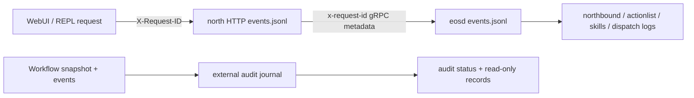

# EOS 调试 runbook

[EOS 总览](../README_cn.md) · [运行时](../design/runtime/README_cn.md) · [Logging library](../design/lib_cn.md#log) · [North HTTP 契约](../develop/interfaces/external/http_cn.md) · [外部 audit](../develop/ext/north_http/audit_cn.md) · [English](../../../docs/eos/usage/debugging.md)

在检查 implementation state 前使用 observable boundary。health 识别哪个 process boundary 不可用，correlation ID 把一个 request 跨进程与 asynchronous owner 连接起来，domain ID 连接后续 lifecycle transition，external audit cursor 在不使 audit 变成 authoritative 的前提下诊断 retained ActionList continuity。

## Evidence map



diagnostic log 回答 process 或 boundary 为何 accept、reject、retry 或 fail。audit journal 回答哪些 allowlisted ActionList/fact projection 按 cursor order 被 durably observed。两者都不替代 live EOS state、hardware-controller evidence、metric 或 authenticated security audit system。

## 从 liveness 与 readiness 开始

先检查 adapter process：

```sh
curl -sS http://127.0.0.1:16005/health/live
curl -sS -i http://127.0.0.1:16005/health/ready
curl -sS http://127.0.0.1:16005/v1/eos/audit/status
```

`/health/live` 返回 `200` 仅证明 north HTTP listener 能回答。`/health/ready` 探测 EOS gRPC health，并在 `[action_list_audit].enabled = true` 时同时要求 audit health 为 `healthy`。带 `EOS gRPC upstream is not ready` 的 `503` 指向 EOS reachability/health；带 `ActionList audit is not ready` 的 `503` 指向 audit startup、reconnect 或 degradation。audit failure 绝不会使 liveness fail，也绝不会改变 EOS core execution。

north HTTP 缺席时，检查其 process manager 与 `var/log/eos/latest/north-http/events.jsonl`。north HTTP live 但 EOS not ready 时，检查 `eosd` process、configured `upstream`、EOS listener 与 `var/log/eos/latest/eosd/events.jsonl`。仅 audit not ready 时，在尝试修复前保留其 state directory，并检查 `north-http.audit` diagnostic。

## 关联一个 request

在 reproducing HTTP call 上提供 stable request ID：

```sh
request_id="debug-workflow-001"
curl -sS -H "X-Request-ID: ${request_id}" http://127.0.0.1:16005/v1/eos/runtime:snapshot
```

response echo `X-Request-ID`。North HTTP 把它作为 `x-request-id` gRPC metadata 传播；EOS 将其绑定到 receiving northbound scope，并在已文档化的 asynchronous ActionList、skill 与 dispatch work 上保留它。

精确搜索 current JSONL file：

```sh
request_id="debug-workflow-001"
grep -F "\"correlation_id\":\"${request_id}\"" \
  var/log/eos/latest/north-http/events.jsonl \
  var/log/eos/latest/eosd/events.jsonl
```

使用 `jq` 时，仅保留 timeline 所需的 field：

```sh
request_id="debug-workflow-001"
jq -c --arg id "${request_id}" \
  'select(.correlation_id == $id) | {ts,service,logger,event,fields}' \
  var/log/eos/latest/north-http/events.jsonl \
  var/log/eos/latest/eosd/events.jsonl
```

request 早于 current segment 时，包括 rotated `events.jsonl.*` file。不得把 request body、credential、payload、transcript 或 attachment dump 到 debugging ticket 来扩大 production search。

## 跟随 domain ownership

从 `north-http` request 或 stream completion 与 `northbound` gRPC method record 开始。然后跟随 operation 指向的 owner：

- Primitive call：`dispatch` 记录 admission、per-device FIFO contention、cancellation、timeout、release 与 bounded acknowledgement metadata；backend-specific log 解释 transport/device behavior。
- Skill call：`skills` 记录 exact runtime routing、queue/claim transition、execution ID、SIGNAL lifecycle、cancellation、timeout 与 terminal status；`dispatch` 跟随任何 primitive capability call。
- Workflow call：`actionlist` 记录 workflow/action revision、target dispatch、fact acceptance metadata、supersession 与 terminal transition；使用 `execution_id` 跟随到 `skills`，或使用 `command_id` 跟随到 `dispatch`。
- Resource/model call：`northbound`、`body` 与 `models.*` 分离 transport conversion、read-only projection、provider call 与 normalized result health。

correlation ID 识别 originating work，但后续 autonomous observation 可能需要 exact `workflow_id`、`action_id`、`execution_id`、`command_id`、device ID、model ID 或 fact source sequence。这些 identifier 是 metadata，而不是记录其关联 payload 的许可。

skill 失败时，先查看唯一的 `skill_execution_terminal` record。`reason` 是稳定、 machine-readable 的类别，`message` 只是有界 operator hint；存在时再检查 `last_failed_activity`。provider 的 `skill_execute_completed` 只是 debug-level implementation detail。随后在 `GetExecution`、watch/SSE terminal snapshot 或 REPL 中确认相同 reason/message，再关联对应 `dispatch` failure。不要把 argument、result、 acknowledgement、resource value、device identity、具体 URI、SIGNAL payload、识别文本、 credential 或 raw ABI/protobuf data 加入临时 diagnostic。

## 诊断 Workflow SSE 与 cursor

使用 runtime snapshot bootstrap browser state，并保留 `actionListCursor.epoch` 与 decimal-string `sequence`。使用 encoded `epoch:sequence` cursor 打开 Workflow SSE stream：

```sh
curl -N 'http://127.0.0.1:16005/v1/eos/workflows:watch?cursor=BOOT_EPOCH%3A0'
```

每个 event 名为 `action-list-event`；其 SSE `id` 是 exact `epoch:sequence`，`data` 是一个完整 ProtoJSON `ActionListEvent`。仅在应用 payload 后 persist ID。ordinary disconnect 后，使用 `Last-Event-ID` 或 `cursor` query 重连。两者同时存在时 query 是 authoritative。

数字 gRPC code 为 `9` (`FAILED_PRECONDITION`) 或 `11` (`OUT_OF_RANGE`) 的 in-band `event: error` 表示 incremental assumption 无效或过期。获取新 `/v1/eos/runtime:snapshot`、替换 cached ActionList/fact state、存储其 `actionListCursor` 并 resume。不得猜测 epoch、在本地增加 sequence、合并 partial ActionList，或从 ActionList revision number 推断 missing fact event。

## 诊断外部 audit

使用 no-cache 读取 operational status：

```sh
curl -sS http://127.0.0.1:16005/v1/eos/audit/status | jq .
curl -sS 'http://127.0.0.1:16005/v1/eos/audit/action-lists?limit=100' | jq .
```

`healthy` 表示 audit 具有 committed snapshot/cursor 或 active stream，且没有 permanent storage/chain/capacity failure。`stopped` 是 non-degraded startup/reconnect/stop state。`degraded` 加 `invalid_config`、`io`、`corrupt_chain` 或 `resource_exhausted` 会对 projection fail closed，并在 enabled 时使 readiness 保持 false。route 的 `records` counter 是 retained record count；configured rotation 限制 durable history，而 record route 单独强制 4 MiB page 并报告 `truncated`。

journal file 位于 `<state>/north-http/action-list-audit/`，与 log 分离。在 offline analysis 前一起保留 `audit-*.jsonl` 与 `cursor.json`。service 只能 truncate 与 torn append 一致的 unterminated malformed tail。complete malformed record、parseable unterminated tampering、interior chain break 或 hash mismatch 必须保持 degraded；不得仅为恢复 readiness 而删除 evidence。

SHA-256 chain 可检测 retained corruption，但不是 cryptographic authenticity，因为没有 protected key。在将其视为 security evidence 前，验证 filesystem ownership、deployment history 与 external backup。

## Logging 与 audit data

`events.jsonl` 与 routed text file 是由 `[log]` 控制的 diagnostic sink：level、rotation、repeat suppression、append/overwrite、redaction 与 attachment policy 适用。它们携带 process/run identity、logger、event、correlation ID 与 bounded operational field，并可能省略 repeated 或 below-threshold event。

ActionList audit 是由其自身 rotation 与 retention 控制的独立 `[action_list_audit]` journal。它仅按 cursor order 存储文档化 projection，绝不使用 logging deduplication，也不会被 `[log].overwrite` 清除。相反，diagnostic log 不得仅为使 audit debugging 更容易而复制 journal record、ActionList/fact payload 或 cursor value。

`north-http.audit` 是 diagnostic logger，而不是 durable audit 本身。它路由到 `var/log/eos/latest/north-http/ext-north-http-audit.log` 与 `events.jsonl`；`north-http.client` 有 reserved `ext-north-http-client.log` route，但当前不发出 event 或 request-context policy。

## Privacy-safe collection

在分享 diagnostic 前，只收集所需的最小 time window 与 identifier。限制 raw journal access，因为 allowlisted workflow、action、target、execution、command 与 device ID 即使排除了 argument、result、reason、fact identity/value、schema 与 media，仍可能泄露 operation。

不得添加 temporary payload logging。使用 explicit ID 复现，只在必要时提高现有 logger threshold，保留 original timestamp、`launch_id` 与 `run_id`，并在 capture 后恢复 configured level。`var/log/eos/runs/<launch-id>/attachments/` 下的 attachment 也可通过 `var/log/eos/latest/attachments/` 访问；它们是 opt-in binary evidence，需要独立 privacy review，且绝不嵌入 JSONL。该目录是扁平的，文件名带 category prefix。durable workflow 与 ActionList audit journal 保持在 `var/lib` 下、这些 run tree 之外。

## Verification command

更改 boundary 后运行 focused suite：

```sh
cmake --build build/aether --target \
  eos_north_http_client_tests eos_north_http_config_tests \
  eos_north_http_audit_tests eos_north_http_server_tests
ctest --test-dir build/aether/src/eos --output-on-failure \
  -R '^(eos_lib_tests|NorthHttp|AuditTest)'
ctest --test-dir build/aether/src/eos --output-on-failure \
  -R '^(eos_actionlist_tests|eos_northbound_tests|eos_dispatch_tests|eos_skill_manager_tests)$'
```

对于 contract change，还需通过 repository test target 运行 `tests/eos/test_contract_interfaces.py`。对于 runtime incident，在 restart 前保留 exact binary/config version、`run_id`、current 与 rotated diagnostic log、audit status 与 retained audit directory。重启 north HTTP/audit 会保留 EOS ActionList epoch 并 resume 其 durable cursor；重启 `eosd` 会使用 new epoch 重建 ActionList manager，并可能移除 live core reproduction state。
