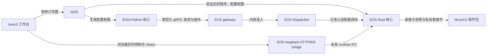

# Island 0.x 目标架构

[English](../../docs/island/architecture.md) · [层连接与数据流](layer-dataflow_cn.md) · [详细实现 TODO](implementation-todo_cn.md) · [约定](conventions.v1.3.0_cn.md) · [EOS 基础设计](../eos/design/runtime/foundation_cn.md)

**目标设计——尚未作为一个版本完整实现。** 各仓库已经具备部分可运行能力；当前接口文档和测试描述现有行为。本页确定首个基于 MuJoCo 的 0.x 版本的所有权与集成顺序。依次参照[实现里程碑](implementation-milestones_cn.md)、[EOS 路线图](../eos/maintenance/todo_cn.md)和各组件路线图。WorkflowService、ActionList DAG 执行及 workflow 模板不属于 0.x 目标；历史线协议身份仅作兼容参考。

## 首次使用路径

操作员先安装 IsOS 和选定的核心构建，运行 `isos init`，验证 `island/mujoco-sim@0.1.1` 软件包，把节点集组合进部署图，校验并应用该图，最后启动部署。IsOS 直接启动 EOS 和 EGIA；EOS 再直接启动经过验证的模拟器并准入声明的适配器。之后操作员在 IsosUI 中查看就绪状态、仅控制图中声明的节点、观察数据与日志，并停止部署。命令由 [IsOS 首次运行指南](https://github.com/Island-Team/isos/blob/master/docs_cn/isos/usage/get-started_cn.md) 负责，本页说明组件边界。

| 产品 | 目标版本 | 运行时与所有权 |
| --- | --- | --- |
| EOS | `0.2.0` | Rust 负责图准入、硬件适配器、gRPC 网关、健康状态和唯一的执行器 Dispatcher；狭窄的 CXX/C ABI 适配器可实现设备集成。 |
| EGIA | `0.1.0` | Python 负责 Agent 状态、类型化阶段数据流、策略、模型调用和北向投影，并通过现有 gRPC 契约调用 EOS。 |
| IsOS | `0.1.0` | Rust 负责编辑图、已验证的软件包存储、生成子进程配置、进程监管、本地 API、日志和版本预检。 |
| IsosUI | `0.1.0` | React 负责图编辑器与操作工作台；通过 IsOS 写入配置，只向 EOS 发送已准入的控制请求。 |
| MuJoCo 软件包 | `0.1.1` | 外部可执行文件负责仿真、场景资源、遥测、渲染和仅所有者可访问的 Unix 套接字。 |

图的层级是 `core → layer → group → node`。注册的节点类型定义位置、设置、类型化端口、能力和生命周期；实例提供身份、描述、所选设置、软件包固定版本和连接。软件包元数据不是命令载荷，也不是第二个图权威。[层连接图](layer-dataflow_cn.md)区分包含、类型化图边、进程依赖、服务边界、固定安全路径及日志流。下图仅显示主要权威所有者。

## 独立版本与兼容性

新编写的图使用 `0.1.0`，新的注册类型 ID 使用 `@v0.1`。现有 `1.0.0` 图和 `@v1.0` 类型仍可按其安全的既有行为读取。读取器按图版本选择解析器，校验原始身份与固定版本，在内存中规范化；只有显式且按修订比较的迁移才保存新版本。未知的未来图或类型版本给出明确诊断。历史 `isos.process.component@v1.0` 任意命令形态只用于迁移展示，绝不启动。

上述产品版本不等于 protobuf 命名空间、HTTP 路由、发布清单 schema、MuJoCo 套接字帧、原语 ID 或历史标签的版本。保留这些已发布标识与精确的软件包固定版本；通过带默认值的可选字段扩展接口，保留 protobuf 字段号与 ProtoJSON 名称。IsOS 预检将实际图和所需功能与各程序声明的支持版本比较，不再假定唯一版本。不能读取新图的旧程序会在启动前失败并给出升级提示。

## 配置与可观测性算法

IsOS 根据 `ISOS_HOME` 或 XDG 配置、数据和运行目录选择根路径。编辑图与 `isos.toml` 放在配置目录；经过验证的精确版本软件包与不可变的生成子进程配置放在数据目录；仅所有者可访问的套接字与锁放在运行目录；下载缓存单独存放。IsOS 校验草稿、解析精确的软件包固定版本与资源、把 EOS/EGIA 配置渲染到按修订命名的暂存目录、核对子程序能力，然后原子提升生成修订。EOS 只读已应用图。密钥以环境引用形式只向目标子进程解析，不写入图、生成诊断或日志。

组件输出[统一 JSONL 事件](conventions.v1.3.0_cn.md#统一可观测性与发布记录)。IsOS 按部署和来源聚合，保留有界轮转文件并提供游标读取。启动时操作员看到每个模块的一条就绪事件或一条可处理的故障，后续事件代表状态变化。游标遇到轮转时，客户端从新快照重新读取。关联 ID 连接图 Apply、启动、EOS 命令、EGIA 任务与模拟器结果，不记录原始媒体或模型内容。

## 所有权规则

- IsOS 负责软件包注册表查询、摘要和平台校验、安装、图修订、选择器选项、进程顺序和版本预检。安装不会激活软件包。
- EOS 负责类型化硬件载荷、适配器工厂、运行状态与健康、EGIA 使用的 gRPC 对端、命令日志、准入，以及先停止执行器再停止模拟器子进程。
- EGIA 负责 Agent 阶段值与决策。安全阶段可拒绝操作，但不能绕过 EOS 准入。类模型服务在部署图外运行，同时纳入共同状态与日志。
- IsosUI 渲染工作页面，以及可独立浮动或停靠的控制、监视、Vision 和日志面板。视觉布局是本地 UI 状态；节点设置与连线 QoS 属于图状态。

## 实现顺序

先完成图与节点类型兼容，再完成目录字段、软件包选择器、连线 QoS、生成配置和能力预检；随后集成 EOS gRPC 与 EGIA 阶段；最后验证 MuJoCo 生命周期和 IsosUI 工作台。确认最后调用方后才删除未使用的 C++ 运行时，同时保留有效的 CXX mock、适配器 ABI 和 EGIA 所需 schema。此目标不发布 1.0.0 标签。
