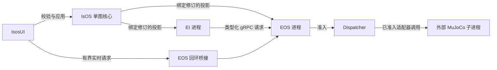

# IsOS 0.2.1 架构目标

[English](../../docs/island/architecture.md) · [合并设计](unification-v0.2.1_cn.md) · [数据流](layer-dataflow_cn.md) · [共用约定](conventions.v1.3.1_cn.md)

**集成目标，尚未发布。** IsOS（Island OS）是产品，也是新部署图中唯一的核心。EOS（Embodied OS）和 EI（Embodied Intelligence，原 EGIA）仍可作为独立受监管进程运行，各自保留安全及生命周期职责。IsosUI 是同仓库中的图编辑器与操作工作台。外部 `island/mujoco-sim@0.1.1` 软件包提供经过验证的模拟器，不导入本仓库。现有公开 EOS `0.2.0` 发布属于历史证据。本次集成不创建 `v0.2.1` 标签或产品发布。

## 图与源码布局

图层级仍为 `core → layer → group → node`。`0.2.0` 图格式只有 `isos` 核心。IsOS 管理器层保留原名；EOS 域使用 `eos_*` 层，EI 域使用 `ei_*` 层，浏览器节点使用 `ui` 层。新注册类型 ID 使用 `isos.<layer>.<name>@v0.2`。目标路径不冲突时保留组和实例 ID。产品源码版本为 `0.2.1`；图、类型、HTTP、protobuf、软件包和模拟器版本分别维护。

| 源码 | 职责 | 入口 |
| --- | --- | --- |
| `crates/isos/` | 图、软件包准入、修订、进程监管、本地 API 和日志 | [IsOS 指南](../isos/README_cn.md) |
| `crates/aether-*` 与 EOS 契约 | 设备适配器、健康、Dispatcher 准入、命令结果及 MuJoCo 直接子进程 | [EOS 指南](../eos/README_cn.md) |
| `ei/` | 认知、阶段数据、模型调用和 EI 安全 | [EI 指南](../ei/README_cn.md) |
| `ui/` | 图编辑器、状态、日志、Vision 及已准入浏览器控件 | [IsosUI 指南](../isosui/README_cn.md) |

## 配置与运行流

IsOS 校验完整图和所选软件包凭据，然后写入绑定修订的 EOS、EI 投影。各子进程在就绪前校验自身投影。图负责地址和配置；跨进程仍需显式、明确所有者的传输。EI 安全可拒绝提议。无论请求来自 EI 还是浏览器桥接，EOS Dispatcher 始终是唯一的执行器准入路径。EOS 只读已应用图，并在结束 MuJoCo 子进程前停止已准入执行器。IsOS 按依赖顺序停止并回收直接子进程。

首次使用依次验证外部 MuJoCo 软件包、必要时迁移旧图、Validate 与 Apply、启动修订、检查所有者就绪、相机数据和一次已准入控制结果，最后验证故障、重启及安全 Stop。[IsOS 使用指南](../isos/usage/README_cn.md)负责操作命令；[层数据流](layer-dataflow_cn.md)说明边界。

## 兼容性与证据

带 `isos`、`eos`、`egia`、`isosui` 核心的受支持 `0.1.0` 图在显式原子迁移前保持只读；迁移同时重写路径、类型 ID、引用、连线、绑定和生成配置。未知类型、目标路径冲突和歧义映射返回源路径诊断，保留原始字节与修订。已记录的安全 `1.0.0` 旧图读取继续保留。现有 EOS HTTP v2、protobuf 身份和模拟器套接字契约独立维护版本，除非所有者契约显式修改。本目录的历史资格验证页面记录当时提交与已测行为，不代表 0.2.1 目标已经发布。
