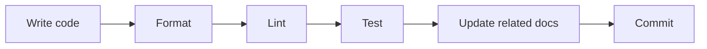

# Coding Conventions

General coding conventions and practices. Adapt paths, tooling, and optional sections to each repository.



When a component-specific note under `docs/<component>/` conflicts with this file, the component doc wins for that scope only.

Island 是团队名称，Aether 是产品版本名称，EOS 是组件名称。按各自角色使用名称；为兼容性保留既有传输名称。参见 [Aether EOS 契约](contracts_aether_cn.md)。

---

## 代码内文档

**代码内注释应简短、低调。** 只有名称、类型、签名和邻近代码无法说明重要约束、单位、所有权、安全或并发不变量、意外故障或设计理由时，才添加注释或文档字符串。将其放在相关声明或操作旁。不要为了覆盖率而逐一解释显而易见的公开项、文件或简单封装；详细设计写在 `docs/` 中。

采用语言惯用的注释形式，例如 Rust 文档注释、Python 文档字符串、TypeScript TSDoc、Go 声明注释，以及生成参考文档所需的 C/C++ Doxygen。只记录调用者或维护者无法从代码推断的信息。公开 C/C++ 头文件中的所有权、阻塞及错误行为若影响调用者，仍须说明。行为变更时同步修正注释。代码注释和文档字符串使用英语。

仅修改文档的提交使用 `docs:` 前缀；代码与文档共同变更时使用主要变更类型的前缀。

---

## Markdown 文档

采用文章式写法：每段讲述一个要点，用标题引导阅读。优先使用正文和少量**加粗强调**。只有真实的步骤或清单才使用项目符号；表格只用于有助于比较的场合。减少行内代码标记、装饰性图表和大段围栏代码块，不要求目录列表或固定模板。精确语法重要时，可以使用简短的载荷示例。每个 Markdown 正文段落在源码中占一行，不设 80 字符宽度限制，由阅读器自行换行；保留代码块、表格、列表和有意使用的硬换行。

手写文档放在所属组件目录下。EOS 按读者任务组织：`usage/` 用于部署和操作，`develop/` 用于接口与扩展开发，`design/` 用于架构和运行时内部机制，`chore/` 用于发布工作。组件根目录保留简短的 `README.md` 和 `doc_index.md`。`docs_cn/` 与英文目录对应，文件扩展名前加 `_cn`；译文保留相同结构和 API 名称，并在页面开头互相链接。行为变化时同步更新两种语言。不要手工修改生成的参考文档。

**所有手写接口契约仅放在所属组件文档树的 `interfaces` 目录中**，例如 `docs/island/interfaces/`、`docs/eos/develop/interfaces/` 及对应的 `docs_cn/` 目录。这包括 HTTP、WebSocket、RPC、IPC、插件、技能和硬件接口。设计页面可以解释接口缘由并链接契约，但不要重复定义载荷。

接口页面说明调用方与负责人、调用方式或传输机制、输入输出、生命周期和可观察的错误。**用简短且有效的示例展示载荷**，使用真实的传输字段名和值。适用时同时给出请求与响应，并在有帮助时给出错误示例。在示例旁解释约束，避免用表格重复字段。示例须与 schema、头文件、处理代码和测试一致。当前行为用现在时描述，计划明确标为未来工作。

---

## REST API contracts

Hand-written wire specs for HTTP/REST (and related WebSocket) endpoints. Keep them in the owning component’s `interfaces` directory (for example `docs/egia/interfaces/<domain>.md`) and update the matching file in the **same PR** as the client or server handler.

### One file per domain

Filename matches the first path segment after the API root: `users.md` for `/users/*`, `orders.md` for `/orders/*`, and so on. Cross-cutting auth or session guidance gets its own file (for example `auth.md`) when it would otherwise be duplicated in every domain doc. Endpoint request/response bodies live in the domain file, not in the auth overview.

### Required sections

Each domain doc covers these topics in a readable order:

**Overview** — what the service owns, where data persists, and boundaries (what it does *not* do).

**Authentication** — whether routes need credentials (Bearer token, API key, cookie, mTLS, etc.) and any role or scope gates. Link to a shared auth doc for token lifetimes, rotation, and client storage; do not copy that prose into every domain file.

**Interfaces** — shared wire rules: `Content-Type`, success/error envelope, shared types, validation limits, and enum literals used across routes.

**Routes** — one `## METHOD /path` heading per endpoint. Each route explains auth, request, success, and errors through minimal valid payload examples using the server’s wire names.

Optional **Architecture**, **Configuration**, or **Testing** sections when they help readers more than repeating route tables.

### Envelope and errors

Document the project's standard success and error JSON shapes when one exists. If some routes use a different shape (health probes, legacy catch-alls, streaming responses), call that out explicitly. List error codes per route; use the exact wire string from the server.

Timestamps are RFC3339 strings unless noted otherwise. Document ID formats (UUID, ULID, etc.) once in Interfaces.

### Clarity rules

Write for a client author who does not have the server open. Each route should make obvious: **who** may call it, **what** to send, **what** comes back on success, and **which codes** mean validation vs auth vs not-found vs server fault.

Use wire field names from the server in JSON examples. When a client maps wire names to local types, document the mapping once in a design or security doc — do not alias fields inside API JSON blocks.

Prefer minimal request/response examples per route over tables that restate the same fields. Use Mermaid for service dataflow when prose is unclear; do not use ASCII diagrams in `.md` files.

Cross-link related domains at the bottom (**Related:**). Use relative links within the owning `docs/<component>/` tree.

When the server and client use different terms for the same concept (visibility vs scope, `label` vs `role`), document each layer in its own file and link between them instead of merging models.

### Review

API doc-only changes use commit prefix `docs:`. Mixed handler/client + contract changes use the primary prefix (`feat:`, `fix:`, …) and still update the affected API doc.

---

## Code style (general)

Use **2 spaces** for indentation (no tabs). Encapsulate distinct functionalities in separate files. Keep functions focused and small. Prefer explicit types over type inference when it improves readability.

Follow the official [Rust Style Guide](https://doc.rust-lang.org/style-guide/) and **Google style** for [Go](https://google.github.io/styleguide/go/), [TypeScript](https://google.github.io/styleguide/tsguide.html), and [C++](https://google.github.io/styleguide/cppguide.html).

**Format before push:** `cargo fmt`, `gofmt`, `prettier`, `clang-format`, etc. CI should reject unformatted code.

---

## 编辑器与 IDE 设置

**以仓库配置为准。** 将格式化、静态检查、缩进和类型检查规则写入仓库配置，让开发工具和 CI 使用相同规则。任何编辑器或 IDE 都应采用这些设置及对应语言工具。说明需要的能力和仓库设置，不指定某个应用、扩展、菜单或编辑器专有配置文件。代码助手也遵循与其他贡献者相同的约定和配置。

---

## Rust

Follow the official [Rust Style Guide](https://doc.rust-lang.org/style-guide/). Run `cargo fmt` before committing and `cargo clippy -- -D warnings` before pushing.

**Tests.** Unit tests live alongside code in `#[cfg(test)]` modules at the bottom of each `src/*.rs` file. Integration tests live in the crate's top-level `tests/` directory. Add tests where the module is non-trivial or logic is easy to get wrong; small glue code may ship without a dedicated test file. Name tests like a sentence: `test_<what>_<condition>_<expected>()`.

**Logging.** Use `tracing` / `tracing-subscriber` for structured logging. Prefer structured fields (`tracing::info!(action = "connect", socket = path)`) and never log secrets.

**Error handling.** Use `anyhow` for applications and `thiserror` for libraries. Prefer `Result<T, E>` over panics; use `context()` when propagating.

**Async.** Use `tokio`. Never block in async contexts; wrap blocking work in `tokio::task::spawn_blocking`.

---

## TypeScript

Follow the [Google TypeScript Style Guide](https://google.github.io/styleguide/tsguide.html). Use `eslint` and `prettier` for consistent formatting.

Use `.tsx` for JSX and `.ts` for logic, hooks, services, and types. Prefer `interface` over `type` and union literals over `enum`. Exported functions need explicit return types. React projects use functional components only.

---

## Frontend (Web)

Optional section for TypeScript + React SPAs. Adjust paths and tooling to the repository.

A typical stack uses TypeScript (strict), React with functional components, SCSS or CSS modules (avoid CSS-in-JS unless the repo already uses it), Webpack/Vite/esbuild, npm/yarn/pnpm with no CDN links in source, and REST plus WebSocket or the project's chosen client.

**Naming.** Components and module entry files use `PascalCase.tsx`. Helpers and partials use `kebab-case.ts`. Co-locate one stylesheet per component when practical. Use single quotes in TS/JS and double quotes in HTML. Indent with 2 spaces; follow the project linter on semicolons.

**Styling.** Prefer design tokens (`var(--token)`) over raw colors in components. When the project supports themes, define tokens in a central theme file and apply via a provider or root attributes. Aim for WCAG AA contrast.

**Responsive.** Mobile-first breakpoints via a shared mixin or media-query helper. Grid for page shells; Flexbox inside components. Touch targets ≥ 44×44 px.

**Networking.** Centralize HTTP and WebSocket logic in a `services/` (or equivalent) layer. When APIs change, update the matching doc below the owning component's `docs/` root.

**Accessibility.** Use semantic landmarks (`nav`, `main`, `article`, `section`, `footer`). Actions use `<button>`; navigation uses `<a>`. Every control has visible text or `aria-label`.

**Build.** Keep production output self-contained (no runtime CDN dependencies unless explicitly allowed). Configure the server or host for SPA fallback to `index.html` when using client-side routing.

---

## C and C++

Target **C++17** or later. Set `CMAKE_CXX_STANDARD` to at least 17 in module CMake; do not rely on compiler-specific extensions unless documented in the module design doc.

Follow the [Google C++ Style Guide](https://google.github.io/styleguide/cppguide.html) with a **100-column** line limit.

Format all C/C++ with **clang-format** (`BasedOnStyle: Google`, `ColumnLimit: 100`). Commit a repo-root `.clang-format` when the project uses C/C++.

```bash
# One file
clang-format -i path/to/file.cpp

# Whole tree (from repo root)
find . \( -name '*.c' -o -name '*.cc' -o -name '*.cpp' -o -name '*.h' -o -name '*.hpp' \) \
  -not -path './build/*' -not -path './generated/*' -not -path './third_party/*' \
  -exec clang-format -i {} +
```

**Documentation**

Each C or C++ module that exposes a C ABI, C-style interface, or C++ class interface should provide a public header under `include/`. Keep implementation-only helpers in module-local headers or `detail/`; never include private headers outside the module.

Public headers under `include/` may use **brief Doxygen** comments for non-obvious cross-module contracts. Document ownership, units, thread-safety, blocking behavior, and error handling when they affect callers.

```cpp
/// Returns the current joint positions in radians.
/// Thread-safe; safe to call from non-RT contexts.
std::vector<double> GetJointPositions();
```

Implementation code should also contain short inline notes for non-obvious control flow, numerical assumptions, concurrency decisions, hardware constraints, or safety-critical behavior. Keep inline comments close to the code they explain; do not restate the code.

Run Doxygen in CI; never edit generated output by hand.

---

## Python

Target **Python 3.12** unless the repository pins another version. Pin the runtime in module docs or packaging when a module has extra constraints.

Follow the [Google Python Style Guide](https://google.github.io/styleguide/pyguide.html), except **indent with 2 spaces** (not 4).

Type hints on public functions. Use a brief docstring only when a module, class, or function has a non-obvious contract; Google docstring format is fine. All in-code comments, docstrings, and inline notes must be written in English. Add inline comments for non-obvious algorithm choices, numerical assumptions, async/concurrency behavior, hardware assumptions, or failure handling. Do not comment obvious assignments or direct framework calls.

Set type checking to at least **standard** (pyright/pylance). Prefer `[tool.pyright]` in `pyproject.toml` so the mode applies in any editor:

```toml
[tool.pyright]
typeCheckingMode = "standard"
```

Use `pyproject.toml` or `.editorconfig` so indent stays 2 outside the editor too.

---

## CMake

Every C/C++ module directory that compiles code has its own `CMakeLists.txt`. Pattern:

```cmake
add_library(example_module
  store.cpp
)

target_include_directories(example_module
  PUBLIC  ${CMAKE_SOURCE_DIR}/include
  PRIVATE ${CMAKE_CURRENT_SOURCE_DIR}
)

target_link_libraries(example_module
  PUBLIC  example_contracts
  PRIVATE …
)

if(BUILD_TESTS)
  add_subdirectory(tests)
endif()
```

Root `CMakeLists.txt` adds subdirs in dependency order. Build options (for example `BUILD_TESTS`) live in a shared project config file when the repo uses one. Generated targets are wired through a CMake helper; modules link the generated interface target, not raw generated paths.

Executable modules use `add_executable` and the same include/link rules.

---

## Module layout

C++ and Python modules share the same idea: one folder, one concern, optional tests beside the code, and one module doc below its owning `docs/` root.

**C++**

```
module/state/
├── CMakeLists.txt
├── store.h              # module-local header (if not in include/)
├── store.cpp
├── detail/              # private headers — never included outside this module
└── tests/
    ├── store_test.cpp
    └── mock/            # fakes for backends, clocks, IPC
```

**Python**

```
module/gateway/
├── srv.py
├── resources.py
└── tests/
    └── test_srv.py
```

**Tests** — 当语言工具适合共址时，优先将本地 unit test 放在 `<module>/tests/`。在此独立仓库中，`tests/eos/` 负责 component-wide 与 contract 行为，C++ module test 则与各自 module 共址。合并产品树可以增加 EGIA、integration、 system 或 hardware test tree，但这些路径不属于当前 checkout。并非每个 module 都需要自己的 test tree；简单 adapter 和单行 wrapper 通常不需要。当 module 较大、 包含非显而易见的算法，或手工调试成本高时，**必须添加测试**。

When present, each test file targets one unit, feeds **mock or stub input**, and asserts **expected output**. No hardware in unit tests — mock backends and contracts at the module boundary. Acceptable kinds include **smoke**, **unit with mock**, **stubbed integration**, **simulation**, **replay**, **benchmark**, **hardware-in-loop**, and **manual acceptance** — name the method in the module doc. Cross-module smoke checks live beside the composed process; deeper manual verification uses in-code debug hooks or a dedicated test plan rather than ad-hoc top-level trees.

### Module documentation

Document public modules in the mirrored `docs/` tree and update affected pages in the same PR as the code. The structure is free: choose headings and page boundaries that express the subject clearly instead of filling a universal template. A Contents list is useful for a long page but is not required.

Write about the data, not the source layout. Use logical and semantic names from contracts and the problem domain. Explain where data originates, what admits or rejects it, how it is validated and normalized, who owns or stores it, how it is transformed and routed, and what is emitted or made observable. File, class, and function names are optional implementation pointers rather than the organizing vocabulary.

Explain conditions that materially change behavior, especially relevant bounds, lifecycle, ordering, timeouts, degraded dependencies, and observable failures. Avoid exhaustive lists of inapplicable cases.

Describe stable inputs, outputs, data types, ownership, units, timing, caller responsibilities, and compatibility constraints. Include a minimal example or sequence when it clarifies correct use. Link to generated API detail instead of duplicating signatures.

Explain algorithm choices, invariants, state transitions, timing assumptions, dependencies, known limits, and deliberately unsupported cases. Treat simulation, replay, mock, hardware backends, and live services as interchangeable data sources behind the same interface where practical.

State how the documented conditions are verified, how to run the checks, and what counts as pass or failure. Name the method used: smoke test, unit test with mock, stubbed integration test, simulation, replay, benchmark, hardware-in-loop, or manual acceptance test. Summarize results instead of pasting long logs.

Every module set, subsystem, large module, and integrated module has an overview at the nearest shared documentation directory, normally `README.md` or a clearly named topic page. The overview defines shared ownership boundaries and end-to-end dataflow, then links to focused child pages. Each child page links back to its overview. Keep condition-level details in the focused page rather than duplicating them in the overview.

Services and tools talk to runtime through **public contracts** (RPC, IPC, or HTTP interfaces), not by linking backend implementations directly.

---

## Documentation workflow

Hand-written docs live under `docs/{island,egia,eos}/`. Generated API detail (Doxygen, Sphinx, rustdoc) goes to a generated output directory; never edit it by hand. Link to it from module docs instead of duplicating every signature.

公开的 EOS 接口定义只在 `share/contracts/eos/` 下的专注 proto 文件中维护。`share/ext/eos/` 下的 JSON Schema 与清单，以及可选的 `share/ext/north_http/openapi.json`，均为生成产物。修改 proto 后重新生成，不要直接修改生成的 JSON。

Canonical roles: the product **layout** lives at `docs/island/layout.md`; component **doc maps** live at `docs/<component>/doc_index.md`; EOS pages use `usage/`, `develop/`, `design/`, and `chore/`. The doc map is the navigation index.

**New or redesigned module**

1. Define the public interface before choosing final data sources.
2. Write or update the module docs so ownership, dataflow, contracts, conditions, failures, and verification are discoverable; update the nearest overview.
3. Build an MVP with the smallest useful API; add tests when the module warrants them (see [Module layout](#module-layout)); record the first meaningful test result in Testing when tests exist.
4. Add brief inline notes for non-obvious interface constraints before other modules depend on them.
5. Ship code, tests, and docs in the **same PR**.

**Small change to an existing module**

1. Update affected interface and design docs when behavior changes.
2. Implement the code and focused tests when behavior is non-trivial or regression-prone.
3. Update only the module doc sections affected by the change (especially API and Testing).
4. Commit code and required doc updates together.

---

## Development workflow

Use the larger workflow when adding or redesigning a module. Use the small-change workflow when the architecture and API already exist.

**Module workflow**

1. Define the problem, success criteria, constraints, and non-goals.
2. Research existing approaches, dependencies, algorithms, hardware limits, and failure modes.
3. Define the public interface before choosing final data sources. Keep simulation, replay, mock, hardware, and live inputs behind the same contract where practical.
4. Write or update the module doc in clear prose, following the subject rather than a fixed section template.
5. Build an MVP with the smallest useful API. Add tests when the module is large or algorithm-heavy; record the first meaningful test result in the Testing section.
6. Add brief inline notes for non-obvious interface constraints before relying on them from other modules.
7. Finish the implementation, tests, docs, formatting, and local checks.
8. Commit the complete module change after review-ready code and docs are together.
9. Run global tests or CI before merging.

**Small implementation workflow**

1. Update affected interface and design docs when the change touches public behavior.
2. Implement the code.
3. Add inline notes only where behavior is not obvious.
4. Add or update focused tests when the change touches non-trivial logic; use mocks or stubs at module boundaries where helpful.
5. Commit the code and required documentation. Do not upload local test artifacts, logs, build outputs, or generated reports unless the repository explicitly tracks them.

---

## File naming

Use **one word** for file names when possible. If a single word isn't descriptive enough, prefer **abbreviations** over multi-word names.

```
scheduler.cpp     # good — one word
ipc.hpp           # good — one word
dds_node.h        # ok — abbreviation, not "dds_node_participant"
srv.py            # good — abbreviation for "server"
boot_seq.cpp      # ok — abbreviated, not "boot_sequence"
cam_info.idl      # ok — abbreviated, not "camera_info"
```

Avoid hyphens and underscores to join multiple full words. Abbreviate instead: `seq` not `sequence`, `cfg` not `config_file`, `srv` not `server`, `cam` not `camera`, `det` not `detection`.

Focused module docs use the module base name as the filename: `docs/egia/runtime/northbound.md`, not role suffixes. Use `README.md` for a directory overview, or a semantic topic name when several overviews share a directory.

Public command names and private-program namespaces are deliberate exceptions to the general file rule. Stable CLI names may use hyphens (`eos-repl`, `island-stop`), and Python import roots under `libexec/` use brief underscores (`egia_ext`, `eos_ext`, `island_admin`).

---

## Configuration

When adding configuration options, add the field to the corresponding config struct or schema, update the config file with the new setting, use sensible defaults, and document the purpose and valid range of values.

---

## Git 工作流

每项修改都从最新的目标分支（通常是 `master`）创建新分支。修复分支命名为 `fix(<scope>)/<short-description>`，例如 `fix(runtime)/queue-overflow`；描述使用小写单词和连字符。其他修改沿用对应类型，例如 `feat(<scope>)/...` 或 `docs(<scope>)/...`。不要直接在目标分支上开发。

提交信息简短明确，以 `feat:`、`fix:`、`docs:`、`refactor:`、`test:` 或 `chore:` 开头。每次提交只包含一项逻辑修改；代码与文档同时变更时采用主要修改类型。提交前检查 diff，只暂存本次修改需要的文件，不提交日志、构建产物、缓存、密钥或本机配置。

通过 PR 合并。修复 PR 标题使用 `fix: <brief description> (#<index>)`，例如 `fix: handle queue overflow (#123)`；其他类型使用相同的类型前缀和索引格式。`#<index>` 是关联的问题或任务编号。PR 应说明行为变化、验证结果，并链接相关文档。合并时选择 **Squash and merge**，让每个 PR 在目标分支成为一个提交，保持仓库历史线性。合并前先让分支与目标分支同步，并解决冲突、重跑相关检查；不要在共享分支上强制推送，除非团队同意。

---

## Review checklist

Before pushing code:

- [ ] Code is formatted (`cargo fmt`, `gofmt`, `clang-format`, `prettier`, etc.).
- [ ] Lint passes (`cargo clippy -- -D warnings`, `eslint`, etc.).
- [ ] Tests pass.
- [ ] Logging is appropriate (no excessive debug output, no silent failures).
- [ ] Errors are handled and propagated with context.
- [ ] Documentation is updated if APIs change (interface docs and brief comments where needed).
- [ ] Configuration files are updated if new options are added.
- [ ] Related `docs/` files updated.
- [ ] No secrets or credentials in the diff.
