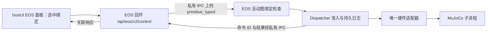
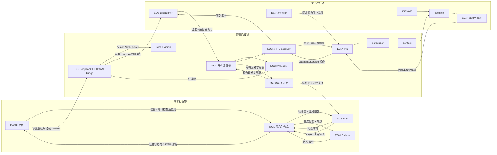

# 0.x 目标的层连接与数据流

[English](../../docs/island/layer-dataflow.md) · [架构概览](architecture_cn.md) · [详细 TODO](implementation-todo_cn.md)

**目标设计，完整链路尚未实现。** 本页说明首个 IsOS → EOS → MuJoCo → EGIA 部署中的跨核心连接。文件夹或图路径表示**包含关系**（`core/layer/group/node`）；类型化 `inputs` 来源表示**数据边**；`references` 和进程 `depends_on` 表示不传样本的依赖。gRPC、私有模拟器套接字和 UI API 是服务边界，不是隐含图连线。本轮 0.x 不包含 WorkflowService、ActionList DAG 或图中编排的技能序列。精确字段以文末的所有者契约为准。

## 首次使用链路

| 步骤 | 连接与所有者 | 操作者可见证据 |
| --- | --- | --- |
| 1. 安装 | IsOS 验证精确包收据、节点贡献、资源及二进制文件；此时不启动进程。 | 包锁定、摘要和可用性或具体故障原因。 |
| 2. 编排 | IsosUI 从注册类型编辑 IsOS 草稿；IsOS 校验位置、类型化端口、包选择器及边。 | 类型/实例描述、稳定 ID、连线 QoS 和路径级错误。 |
| 3. 应用 | IsOS 按修订比较并交换保存图，解析验证路径，生成不可变 EOS/EGIA 配置，检查声明的版本/特性集合。 | 保存修订与活动修订在重启前保持区分。 |
| 4. 启动 | IsOS 启动 EOS；EOS 启动验证过的 MuJoCo 子进程并激活声明的适配器；EOS 就绪后 IsOS 启动 EGIA。 | 各所有者实际报告的进程、节点及 gateway 就绪状态。 |
| 5. 观察和行动 | 相机/底盘/机械臂证据经 EOS 传输；EGIA 通过 EOS gRPC 发现。计划中的 IsosUI 原语演示选择活动图中的一项绑定，通过浏览器 bridge 调用；两种入口最终都由 EOS dispatcher 准入。 | 所选绑定与目标、来源、健康、命令 ID 以及终态或未知结果。 |
| 6. 排查和停止 | 先看实时状态；部署启动前，日志从管理器会话首条 Apply/包故障开始；启动后从部署运行首条就绪/故障变化开始，再按节点和关联 ID 过滤。EOS 先停执行器再停模拟器；IsOS 停止依赖核心。 | 单一因果时间线、明确的未知结果与有界停止结果。 |

## 首个原语控制演示——目标 UI 设计

一个 `eos.dispatcher.primitive_base` 或 `eos.dispatcher.primitive_manipulator` 实例声明**一个**原语名称/版本/模式。IsOS 图中的 `command` 输出只连接一个兼容硬件目标。目标 0.x UI 在 EOS 面板中把活动图的每个绑定显示为一项控制；选中后显示注册类型与实例描述、类型化参数帮助、精确目标及 EOS 实时健康。图连线只声明绑定，本身不传浏览器调用。当前 Rust runtime/bridge 已接受 `primitive_typed`；IsosUI 的绑定控件与激活轨迹仍在计划中。

面板先检查保存/活动修订、EOS 就绪、绑定的唯一目标、声明模式及目标当前健康。它取得 EOS 单调时钟时间，构造[原语绑定契约](../../docs/eos/interfaces/primitive-bindings.md)中的有界类型化请求，并经现有浏览器 bridge 提交。EOS 按**活动**图验证来源与目标，解码精确类型和版本，再交由 Dispatcher 准入；只有适配器可执行物理动作。用户调用后，所选节点可暂时显示 `sending`，随后显示 EOS 的精确结果：`Completed`、`Cancelled`、`Rejected`、`InProgress` 或 `OutcomeUnknown`。`InProgress` 在经授权的结果读取确认前始终是非终态。视觉脉冲跟随关联响应或运行事件，不宣称图连线自行执行。修订过期、绑定缺失、目标不健康、类型化载荷无效或 bridge 故障时，禁用或拒绝调用并显示原因。停止仍经现有受治理路径。EGIA 使用独立的已发布 `island.eos.v2.CapabilityService` gRPC 入口，并汇入同一 Dispatcher；`eos/gateway/primitives` 只是概念层标签，不是新图路径或线协议身份。

## 三个平面及其权威所有者

图中箭头跨越**不同机制**。IsOS 到核心传递不可变配置并拥有进程，不传样本。EOS 到 EGIA 使用现有类型化 gRPC 服务身份；EGIA 不持有模拟器套接字或适配器指针。IsosUI 通过 IsOS 读图和应用；浏览器实时控制与 Vision 使用现有 EOS loopback HTTP/WebSocket bridge，由它将有界请求转发到 runtime 私有套接字。EGIA 使用独立 gRPC gateway。`Dispatcher` 在 EOS 内部，UI/EGIA 不能直接调用它。MuJoCo 拥有套接字协议；EOS 拥有客户端适配器、子进程生命周期和停止顺序。模型类服务是 EGIA 的独立依赖，可在状态/日志中看到，但不是部署图节点。

## 各层连接规则

| 来源 → 目标 | 数据及连接种类 | 所有者/关口 | 故障行为 |
| --- | --- | --- | --- |
| IsOS `process/component` → EOS、EGIA | `depends_on`、生成配置及子进程启动；**不是数据边** | IsOS 启动前检查实际图/类型支持及包锁定。 | 特性缺失或子进程失败阻止依赖方就绪。 |
| EOS `process/mujoco` → `hardware/{camera,base,manipulator}` | `references`、验证过的适配器设置及私有套接字；**不是任意图连线** | EOS 将每个声明设备 ID 与已编译工厂、精确包绑定。 | 不匹配时适配器不可用，不替换设备。 |
| EOS `hardware/camera.frame` → `interface/gate.frame` | 类型化 `camera_frame` 边，再输出只读 `vision_frame` | EOS 校验类型/基数；活动 gate 有界地保存最新帧。 | 错误/过期帧被拒绝；Vision 不编造图像。 |
| EOS 资源/健康 → EGIA `io/link` → `evidence/perception` → `cognition/context` | 类型化 gRPC 边界，之后是 EGIA 进程内阶段端口 | EOS 拥有负载；EGIA link 校验完整发现代，perception 和 context 限制容量。 | 部分发现阻止行动；溢出计数并归因。 |
| 操作者意图 → EGIA `cognition/missions` → `cognition/decision` 及 context | 已校验意图和类型化阶段值，不是执行器请求 | EGIA 拥有任务修订/选择、模型调用和提议解析。 | 空队列等待；无效模型输出被拒绝。 |
| EGIA decision → `governance/safety` → 固定 `io/link` 出口 → EOS gateway | 提议、已准入 primitive 请求与操作结果 | EGIA safety 查精确绑定/策略；EOS dispatcher 再查权限、健康、界限、期限和命令身份。 | 图边不能直接连接提议和执行器；不确定结果不算成功。 |
| EGIA `governance/monitor` → 固定紧急出口 | 健康锁存与 emergency-stop 请求 | Monitor 仅有专用 stop 路径；EOS 最终控制物理停止。 | 锁存跨重启保留，直到授权重置。 |
| IsosUI → EOS loopback HTTP/WS bridge → runtime | 有界浏览器控制和只读 Vision；**不是 EGIA gRPC** | Bridge 检查来源和请求界限；EOS 依据活动图校验节点，UI 在保存/活动修订不同时禁用控制。Vision 订阅自带修订。 | 禁止来源、非活动节点或过期 Vision 修订失败；过期草稿禁用 UI 控制。 |
| EOS `dispatcher` → 硬件适配器 → MuJoCo | 已准入类型化运动和终态结果 | 每个执行器只有一条 EOS dispatcher 路径；受管理严格模式下模拟器校验实际设备和数值。 | 拒绝或未知结果明确报告；不隐式重试已下发运动。 |
| 各核心 → IsOS 日志 → IsosUI 日志面板 | 脱敏事件封套和游标，**不是控制边** | 生产者拥有事件语义；IsOS 拥有轮换/游标汇总。 | 采集器丢失不改变命令结果；实时状态仍是权威。 |

[IsOS 图契约](https://github.com/Island-Team/isos/blob/master/docs/isos/interfaces/node-graph.md)定义来源对象字段及修订语义。[EOS 硬件](../../docs/eos/interfaces/hardware.md)、[Vision](../../docs/eos/interfaces/vision.md)、[控制](../../docs/eos/interfaces/control.md)、[gRPC](../../docs/eos/interfaces/grpc.md)和[节点贡献](../../docs/eos/interfaces/node-contributions.md)定义 EOS 负载/类型。[EGIA pipeline](https://github.com/Island-Team/Island-egia/blob/master/docs/egia/interfaces/pipeline.md)定义阶段值。[MuJoCo 套接字](https://github.com/Island-Team/isos-mujoco-sim/blob/master/docs/mujoco/interfaces/socket.md)定义模拟器帧。本页不重复字段表。

## 图准入与路由算法

1. 按图版本解析并保留原字节/修订。将每个类型解析为声明的 `(core, layer, group)`、字段、输入/输出端口和生命周期。仅在内存中规范化受支持的旧默认值；未知未来身份报告路径及受支持集合。
2. 校验每个来源：规范节点及输出端口存在、数据类型与传输兼容、必填输入及基数、许可的跨核心边界、无自连、循环策略。跨进程值只通过明确归属的桥接移动：EOS gRPC、EOS 私有模拟器套接字客户端、EOS HTTP/WS bridge 或 IsOS API；不假定跨进程共享内存。`references` 和 `depends_on` 分别校验。
3. 拒绝任何让提议不经 EGIA safety 和 EOS dispatcher 就到达执行器的路径。safety→link、monitor→stop 和 dispatcher→adapter 是运行时固定路径。包节点集只能建议节点，不能建立另一条命令路径。
4. 先按运行时所有者分类：EOS 负责本核心类型化边，EGIA 负责进程内阶段边，没有运行时的边标 `design only`。每条符合条件的**已实现证据边**由所属核心分配有界队列及单调时钟 token bucket。可选 `frequency_hz` 是有限正数传递上限；缺省表示该边不设上限。将 nice `-20..19` 映射为明确的正权重，以有界加权公平调度。生产端 `expected_rate_hz` 只是容量提示。设计边没有运行时调度器，IsosUI 必须标记。
5. Apply/启动前校验完整部署、精确包收据和每个子进程声明的图/类型/特性集合。全部通过后才原子发布新生成配置。旧保存字节及活动修订直到显式比较并交换迁移和重启前保持不变。

EOS [调度器设计](../../docs/eos/design/runtime/scheduler.md)定义 EOS 核心内队列/token 细节。EGIA 拥有对应的进程内证据策略；必需的 result、health、latch 值及固定 safety→link、monitor→stop 路径不能被静默限频或丢弃。IsOS 拒绝在不可路由或固定安全路径上由用户设置 QoS。被丢弃的可替换观察增加 gap 计数并发出限频警告；执行器命令不能像观察一样静默丢弃。停止时关闭准入，按边种类取消或排空，取得执行器终态或标记未知，再按依赖顺序回收子进程。优先级永不覆盖安全；频率既不是命令租期也不是 monitor 心跳间隔。

## 追踪一次命令与一次故障

EGIA 提议带有 backend、设备、primitive、版本、类型化参数和关联身份。Safety 校验完整发现代及策略，再经固定 link 路径调用 EOS `CapabilityService.SubmitOperation`。EGIA 通过 `WatchOperation` 跟进，watch 断线后以 `GetOperation` 恢复；只有匹配的终态成功和 acknowledgement 才算成功。EOS 解析精确绑定、保留命令身份、经 Dispatcher 准入，只调用所选适配器。MuJoCo 子进程校验设备和操作；终态结果经 EOS、EGIA link 返回 perception/mission 状态。IsosUI 从所有者读取实时结果/状态。每个边界的拒绝有稳定所有者和事件码；物理下发后超时是 `unknown`，不会自动重放。

场景验证失败时，IsOS 在 Apply/启动前停止，并用管理器会话 run ID 记录包/资源故障，因为此时尚无部署运行。启动后套接字故障时，EOS 标记相关适配器不可用、关闭准入、尝试有界执行器停止并报告未知结果。EGIA link 使发现代失效，safety 拒绝新动作；IsosUI 先显示失败的实时状态，再显示本次运行第一条因果故障事件。这些路径列于[详细 TODO](implementation-todo_cn.md)的验收矩阵。
