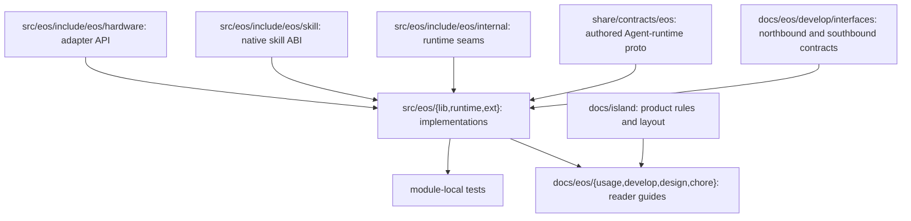

# Island-EOS layout

**Status:** Adopted standalone component layout, prepared for a history-preserving Island product merge

**Scope:** EOS native execution runtime and its Island integration surface

**Intent:** Preserve the product filesystem roles and the Agent–EOS process boundary with one component-neutral contract source

[English](../../docs/island/layout.md)

## Purpose

This checkout contains EOS under `src/eos/` together with the product-level build scaffolding needed to compose it into IslandOS Aether. EOS owns device integration, read-only body and scene projection, configured outbound perception clients, command admission, execution, and the final hard-safety boundary before hardware. It has no separate runtime state or world-model foundation. Agent remains a separate process and communicates through the canonical contracts in `share/contracts/`.

The repository root is a relocatable development prefix, not a Linux root filesystem. Public commands, reference configuration, source, tests, documentation, generated builds, and mutable checkout state each have a distinct role.

## Boundaries


EOS does not embed Agent or own product prompts. Agent does not open hardware devices or bypass EOS command admission. Both components consume `share/contracts/`; `EOS_CONTRACTS` may select an installed absolute copy.

## Repository roles

`bin/`: `eosd`、`eos-north-http`、`eos-simulator`、`eos-repl` public wrapper。

`etc/eos/`: versioned EOS process and safety configuration. Secrets do not belong here.

`src/eos/`: C++17 implementation, public headers, native modules, and module-local unit tests.

`src/eos/include/eos/skill/`: public C ABI for deployment-owned native skill libraries, installed as `eos/skill/abi.h`; skill implementations do not belong in EOS runtime source.

`tests/eos/`: component-wide and cross-module EOS verification.

`docs/island/`: product layout and cross-repository conventions.

`docs/eos/`: EOS architecture, interfaces, operations, and module references.

`build/`: ignored build output and downloaded build dependencies.

`var/`: ignored mutable checkout state, caches, logs, runtime files, and scratch data.

diagnostic launch 位于 `var/log/eos/runs/<launch-id>/`，`latest` 指向最新 run；overwrite mode 使用 `runs/current`。可选 media evidence 位于同一次 launch 的扁平 `attachments/` directory，也可通过 `var/log/eos/latest/attachments/` 访问。文件使用 `asr-`、`tts-`、`vision-` 等 category prefix，不存在 category subdirectory。overwrite mode 在写入新日志与附件前清空整个 `runs/current` launch，不影响 retained run。用于恢复的 workflow 与 ActionList audit journal 保持在 `var/lib` 下、run tree 之外。

The combined Island product may also provide `libexec/`, `src/egia/`, `src/island/`, and product-level test trees. This standalone history carries only the component-neutral runtime contracts within the shared product role.

## Source and documentation map



Implementation-only headers stay beside their module. EOS-owned driver interfaces live below `src/eos/include/eos/hardware/`; runtime-only cross-module seams live below `src/eos/include/eos/internal/`. Public modules are mapped from [the EOS documentation index](../eos/doc_index_cn.md).

`src/eos/runtime/` 按 domain 组织：`init` 组合严格 configuration 与 immutable schema；`hardware` 拥有 backend；`perception` 投影 read-only resource；`models` 拥有 outbound model call；`dispatch` 是唯一 primitive gate；`actionlist` 拥有 workflow DAG、fact、cursor 与 retained mutation event；`skills/manager` supervision logical skill runtime，`skills/core` 保存其 neutral contract，每个 execution profile 保持在各自 `skills/{native,managed,external}` folder；`northbound/workflow` 拥有 WorkflowService adapter，`northbound` 拥有 shared gRPC listener 与其余 adapter。`src/eos/ext/north_http/{config,client,server,audit}` 分别拥有独立 REST/SSE 进程的 strict configuration、一个 shared gRPC channel/stub set、HTTP server 与 external non-authoritative ActionList journal。

## Build and test

The root CMake project is a thin product-composition layer. It discovers `src/eos/CMakeLists.txt`, enables C++17 without compiler extensions, and can conditionally compose other Island components when their histories are present.

```sh
cmake --preset dev
cmake --build --preset dev -j
ctest --preset dev
```

Build products remain below `build/`; source, tests, build trees, local logs, and runtime state are never installed as product resources.

## Installation map

`bin/eosd`, `bin/eos-north-http`, `bin/eos-simulator`, `bin/eos-repl` -> `/usr/bin/`

Native `eosd`, `eos-north-http`, `eos-simulator`, `eos-repl` -> `/usr/libexec/island/`

`etc/eos/` -> `/etc/island/eos/`

Combined-tree `share/contracts/` -> `/usr/share/island/contracts/`

`docs/` -> `/usr/share/doc/island/`

Checkout `var/lib`, `var/cache`, `var/log`, `var/run`, `var/tmp` -> the corresponding `/var/lib/island`, `/var/cache/island`, `/var/log/island`, `/run/island`, and `/var/tmp/island` roles.

Public wrappers resolve their own location and do not depend on the caller's current working directory. Installed process lifecycle belongs to the service manager; repository helpers must not stop processes by broad name or port matching.

## Ownership rules

Product-wide paths are resolved once at composition boundaries and passed inward. Normal runtime writes are confined to resolved mutable roots. Configuration changes update both the schema or C++ representation and [the configuration reference](../eos/usage/configuration_cn.md). Interface or process-boundary changes update the corresponding file below `docs/eos/` in the same change.

The canonical coding, documentation, module, and Git workflow is defined in [conventions.md](conventions_cn.md).
