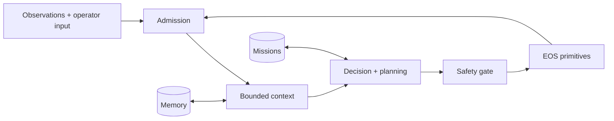

<div align="center">


# IsOS · EI

**Cognition and decision runtime for embodied systems**

`Python 3.12+` · `gRPC` · `WebSocket` · `uv`

[中文](README_cn.md) · [Get started](#quick-start) · [Documentation](docs/README.md) · [EOS runtime](../README.md) · [Public WebUI](https://www.os-island.com)

</div>

EI (Embodied Intelligence) is the cognition and decision runtime in IsOS (Island OS). It turns admitted observations and operator instructions into missions, plans, and safety-gated device actions. The published `egia` command and Python import path remain compatibility aliases through 0.2.1; new integrations should use `ei`. See the [transition guide](../docs/ei/ei-transition.md).

EI connects cognition to the [Embodied Operating System (EOS)](../README.md), which owns hardware integration, low-level motion, physical safety, automatic speech recognition, and text-to-speech synthesis. The single IsOS graph core configures both domains while their runtime processes retain explicit safety and lifecycle boundaries. EOS build, device, gateway, and hard-safety contracts are in this repository under [EOS documentation](../docs/eos/README.md).

**Current source status:** EI and EOS are in this unified IsOS repository at product version `0.2.1`; no `v0.2.1` release has been published. EI uses capability operations with durable operation IDs, explicit cancellation, and fail-closed capability admission. The former EOS 2 development pin `c43e5a32eafd9bf22b2dba2940662dcded60111c` remains in the [historical compatibility record](../docs/island/eos-contracts.md) as provenance.

## What EI provides

- **Structured cognition:** bounded context assembly, model lanes, planning, missions, and memory.
- **One governed action path:** planner and operator requests pass through the same primitive registry, policy checks, safety gate, and EOS transport.
- **Multi-robot composition:** named runtime modes select one workcell, one live robot, or a fleet of stable backend aliases.
- **Observable operation:** WebSocket projections expose health, backend state, model activity, missions, perceptions, primitives, and native-skill metadata.

## Architecture



An EOS primitive is one typed, atomic device operation. A native skill is deployment-supplied EOS code whose metadata describes how primitives can be composed. EI discovers both, uses skill metadata as planning guidance, and executes only primitives through its safety gate. See the [core runtime](../docs/ei/core/modules.md), [northbound WebSocket](../docs/ei/northbound.md), and [southbound EOS](../docs/ei/southbound.md) references for the complete contracts.

## Quick start

### Prerequisites

- Python 3.12 or newer
- [`uv`](https://docs.astral.sh/uv/)
- An OpenAI-compatible chat-completions endpoint
- The in-repository EOS runtime implementing Gateway discovery, `island.eos.v2.CapabilityService`, and `island.eos.v1.SkillService`

Python 3.12 is the default. The checkout launch/build wrappers use `uv` unless you select an interpreter with `EI_PYTHON=/path/to/python`; legacy `EGIA_PYTHON` remains accepted. A Conda environment is also supported:

```sh
conda create -n ei python=3.12
conda activate ei
python -m pip install -e .
EI_PYTHON="$(command -v python)" ./bin/ei --no-tui
```

For `uv`, run `uv sync --extra dev --extra vec --python 3.12` before launching. Set `EI_PYTHON` to the selected environment's interpreter for `bin/ei` and `bin/islandctl`; no system Python path is assumed. CMake accepts `-DPython3_EXECUTABLE=/path/to/python`.

### 1. Validate the in-repository EOS

The EI component lives in `ei/` of the unified IsOS checkout. The checked-in [`etc/island.toml`](etc/island.toml) reads this component's defaults and the root `share/` contracts, then launches the root `bin/eosd` when standalone composition is requested. From `ei/` run:

```sh
uv sync --extra dev --extra vec --python 3.12
./bin/islandctl validate
```

The unified IsOS manager owns the deployment graph for managed runs. The historical EOS contract commit remains documented in the [compatibility record](../docs/island/eos-contracts.md) as provenance, not as a sibling checkout requirement.

### 2. Configure the model and runtime

```sh
cp .env.example .env
```

Set only the secret named by the selected model binding's `api_key_env`, then review:

- [`etc/egia/egia.toml`](etc/egia/egia.toml) — server, model selection, runtime subsystems, logging, and prompts path
- [`etc/egia/models.toml`](etc/egia/models.toml) — independent fast-controller and slow-reasoner bindings, endpoints, and limits
- [`etc/egia/modes.toml`](etc/egia/modes.toml) — `sandbox`, `live`, and `fleet` connection profiles
- [`etc/egia/profiles/`](etc/egia/profiles/) — backend addresses and operator primitive exposure
- [`etc/egia/prompts.toml`](etc/egia/prompts.toml) — authoritative EI prompts; the path remains compatible
- [`etc/egia/missions.toml`](etc/egia/missions.toml) — optional model-selectable canonical Missions and protected initial plans; enable with `[decision] load_mission_templates = true`

The packaged fast-controller and slow-reasoner bindings expect the sibling Island-models Gemma4 router at `127.0.0.1:18011`. Configure those lanes under `[decision.controller]` and `[decision.reasoner]`; `EGIA_MODEL` overrides the auxiliary default binding. Override the runtime profile with `EGIA_MODE` or `--mode`.

### 3. Build and validate

```sh
uv sync --extra dev --extra vec --python 3.12
./bin/islandctl validate
uv run python scripts/print_prompt.py
uv run python scripts/test_model.py
uv run python scripts/test_model.py --mission-template home_living_2026
```

The prompt preview is offline and uses deterministic mock hardware. The model test performs one bounded request, so start the configured model service first. Its default mode is a connectivity probe; `--mission-template` explicitly reads the catalog for diagnostics and sends the selected canonical Mission and protected initial Plan through the same fast-controller message shape used at runtime. Runtime template exposure remains disabled unless `[decision] load_mission_templates = true`.

### 4. Launch

For a deployment managed by IsOS, validate and apply the single-core graph, then start its selected deployment from the repository root:

```sh
./crates/isos/bin/isos config validate path/to/graph.json
./crates/isos/bin/isos config apply path/to/graph.json
./crates/isos/bin/isos run
```

The graph format is `0.2.0` with one `isos` core. Its `ei_*` layers are projected to EI with the saved revision; EOS receives its `eos_*` layers. IsOS owns the EOS, EI, service, and backend lifecycle. The old `egia` process role and configuration paths remain compatibility inputs through 0.2.1. Follow the [graph migration guide](../docs/isos/usage/configuration.md) for older deployments.

To start only EI against an already running compatible EOS, use the direct launcher:

```sh
./bin/ei --no-tui
```

`./bin/ei` accepts `--etc`, `--island-config`, and `--mode`. It expects EOS to be managed externally. IsOS launches EI with `--managed --no-tui`; managed mode refuses `[launch] sandbox = true` because the sandbox must be a separate backend node. `./bin/egia` and `./egia-launch.sh` remain compatibility launchers. `./kill.sh` is a checkout-only helper; IsOS deployments use `./crates/isos/bin/isos stop` so only deployment-owned processes are stopped.

## Configuration model

The component-level `etc/island.toml` selects prefix-relative shared-resource roots from this component and the unified repository. EI treats them as one logical tree and rejects duplicate relative paths rather than choosing a winner. Every JSON Schema below logical `contracts/` and `primitives/` is loaded at startup.

Runtime modes separate portable EGIA configuration from deployment topology:

- `sandbox` targets a local development or simulation workcell.
- `live` targets one externally managed robot runtime.
- `fleet` targets several robot runtimes through stable aliases.

Copy `live.example.toml` or `fleet.example.toml` to a profile without the `.example` suffix before selecting it. For standalone EGIA with an alternate product resource selection, pass the same file to validation and EGIA:

```sh
./bin/islandctl --config path/to/island.toml validate
./bin/ei --no-tui --island-config path/to/island.toml
```

## Interfaces and ports

The operator-facing WebSocket API lives under `/api/aether/egia/`. The default local ports are:

- `16060` — EGIA northbound WebSocket server and optional sandbox media route
- `16022` — optional sandbox EOS gRPC gateway (explicit overrides remain valid)
- `16003` — default external EOS backend

The browser workbench source is in [`ui`](../ui/); the public site is [os-island.com](https://www.os-island.com).

## Build and install

`egia-build.sh` remains an architecture-aware compatibility wrapper. The EI CMake distribution target is:

```sh
cmake -S . -B build
cmake --build build --target ei-dist
```

`egia-dist` remains a compatibility target. The root IsOS CMake build includes EI as part of the unified source tree.

For a staged system install:

```sh
cmake -S . -B build -DCMAKE_INSTALL_PREFIX=/usr -DISLAND_INSTALL_ETCDIR=/etc/island
DESTDIR="$PWD/stage" cmake --install build
```

CMake validates and merges configured shared roots into the installed `share/island/` tree, then generates an installed `island.toml`. Use `-DISLAND_PRODUCT_CONFIG=/path/to/island.toml` to package another composition.

## Development

Run the repository gates before handoff:

```sh
uv run ruff check .
uv run pytest
uv run pyright
PYTHONPATH=src:libexec uv run lint-imports
./bin/islandctl validate
```

Native skills belong in the EOS source tree. EGIA discovers their public descriptors through the dedicated skill service; native ABI and library provenance remain private to EOS. New primitives are end-to-end contract changes: define and expose them in EOS, add their schema to one configured shared root, admit them in EGIA's typed registry, and cover discovery, gating, acknowledgement, and contract behavior with tests. Do not loosen or repurpose the built-in primitive contracts.

For development services available only over SSH, configure `.env` and use `./scripts/ssh-tunnel.sh`; the [SSH tunnel runbook](docs/island/ssh-tunnel.md) documents the supported variables and security constraints.

## Repository map

- `src/egia/` — cognition, planning, missions, memory, safety, and northbound I/O
- `src/island/` — composition, path layout, configuration, launch, and validation
- `bin/` — public commands
- `libexec/egia_ext/` — private out-of-process extensions
- `share/defaults/` — packaged factory configuration
- `etc/` — deployment configuration and overlays
- `../docs/ei/` — canonical EI architecture, interface, and operations documentation; component-local `docs/` preserves composition history
- `tests/` — runtime, contract, configuration, and installation checks

Start with the unified [documentation guide](docs/README.md). The [release checklist](../docs/ei/chore/release.md) contains the complete shipping gate.
The [historical public release procedure](../docs/ei/chore/public-release.md) records the former separate `Aether-EGIA-R` source snapshot.

## Team

Built by [Island Team](https://www.os-island.com) · [ashexlv278@gmail.com](mailto:ashexlv278@gmail.com)
