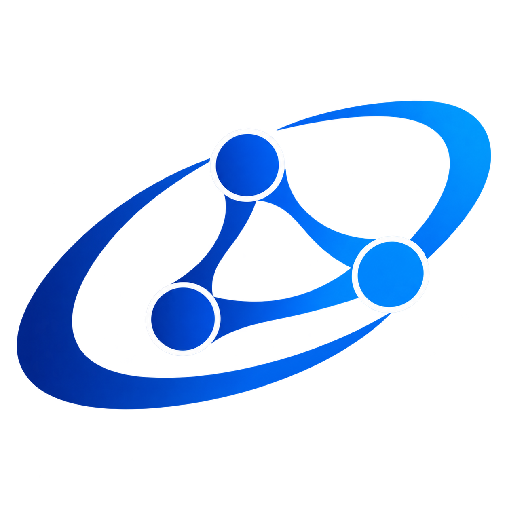
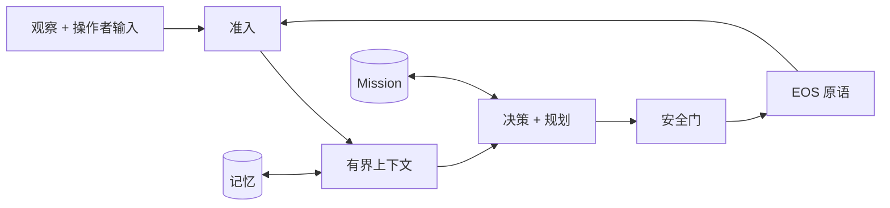

<div align="center">



# IsOS · EI

**面向具身系统的认知与决策运行时**

`Python 3.12+` · `gRPC` · `WebSocket` · `uv`

[English](README.md) · [快速开始](#快速开始) · [文档](docs_cn/README.md) · [EOS 运行时](../README_cn.md) · [公共 WebUI](https://www.os-island.com)

</div>

EI（Embodied Intelligence）是 IsOS（Island OS）中的认知与决策运行时。它把已经准入的观察和操作者指令转换为 Mission、Plan 以及经过安全门控的设备动作。已发布的 `egia` 命令和 Python 导入路径在 0.2.1 中仍作为兼容别名；新集成使用 `ei`。参见[迁移说明](../docs_cn/ei/ei-transition.md)。

EI 通过 protobuf 定义的接口连接 [Embodied Operating System（EOS）](../README_cn.md)。EOS 负责硬件集成、底层运动、物理安全、自动语音识别和文本转语音。单个 IsOS 图核心配置两个领域，运行进程仍保留各自的安全和生命周期边界。EOS 的构建、设备、gateway 与硬安全契约见本仓库的 [EOS 文档](../docs_cn/eos/README_cn.md)。

**当前源码状态：** EI 和 EOS 位于统一 IsOS 仓库，产品版本为 `0.2.1`；尚未发布 `v0.2.1`。EI 使用 capability operation、持久 operation ID、显式取消和 fail-closed capability 准入。旧 EOS 2 开发提交 `c43e5a32eafd9bf22b2dba2940662dcded60111c` 仅作为来源证据保留在[历史兼容性记录](../docs_cn/island/eos-contracts.md)。

## EI 提供什么

- **结构化认知：** 有界上下文组装、模型 lane、规划、Mission 和记忆。
- **唯一受治理动作路径：** 规划器和操作者请求都经过同一个原语注册表、策略检查、安全门和 EOS transport。
- **多机器人组合：** 命名运行模式可选择一个工作单元、一个在线机器人或由稳定后端别名构成的机群。
- **可观察运维：** WebSocket 投影公开健康、后端、模型活动、Mission、感知、原语和原生技能元数据。

## 架构



EOS primitive 是一个有类型的原子设备操作。Native skill 是部署提供的 EOS 代码，其元数据描述如何组合 primitive。EI 发现两者，将 skill 元数据作为规划指导，但只通过安全门执行 primitive。完整文档入口见 [核心运行时](../docs_cn/ei/core/modules.md)、[北向 WebSocket](../docs_cn/ei/northbound.md) 和 [南向 EOS](../docs_cn/ei/southbound.md)。

## 快速开始

### 前置条件

- Python 3.12 或更高版本
- [`uv`](https://docs.astral.sh/uv/)
- OpenAI-compatible chat-completions endpoint
- 实现 Gateway discovery、`island.eos.v2.CapabilityService` 与 `island.eos.v1.SkillService` 的仓库内 EOS 运行时

默认使用 Python 3.12。checkout 的启动与构建 wrapper 默认使用 `uv`；设置 `EI_PYTHON=/path/to/python` 可选择其他环境解释器，旧 `EGIA_PYTHON` 仍可使用，`EGIA_PYTHON_VERSION` 可调整 `uv` 默认请求的 Python 版本。Conda 也可使用：

```sh
conda create -n ei python=3.12
conda activate ei
python -m pip install -e .
EI_PYTHON="$(command -v python)" ./bin/ei --no-tui
```

使用 `uv` 时先运行 `uv sync --extra dev --extra vec --python 3.12`。`bin/ei` 与 `bin/islandctl` 使用 `EI_PYTHON` 指定的解释器；CMake 可传 `-DPython3_EXECUTABLE=/path/to/python`，无需假定系统 Python 路径。

### 1. 验证仓库内的 EOS

EI 位于统一 IsOS 仓库的 `ei/`。检入的 [`etc/island.toml`](etc/island.toml) 读取 EI 默认资源和根目录 `share/` 契约，独立组合时使用根目录 `bin/eosd`。在 `ei/` 中运行：

```sh
uv sync --extra dev --extra vec --python 3.12
./bin/islandctl validate
```

托管运行的部署图由统一的 IsOS manager 管理。历史 EOS 契约提交保留在[兼容性记录](../docs_cn/island/eos-contracts.md)中，作为来源证据，而非同级检出要求。

### 2. 配置模型和运行时

```sh
cp .env.example .env
```

只设置所选 model binding 的 `api_key_env` 指定的 secret，然后检查 `etc/egia/egia.toml`、`models.toml`、`modes.toml`、`profiles/`、`prompts.toml` 和可选的 `missions.toml`。`EGIA_MODE` 或 `--mode` 可覆盖运行 profile；`EGIA_MODEL` 可覆盖辅助默认 binding。

### 3. 构建并验证

```sh
uv sync --extra dev --extra vec --python 3.12
./bin/islandctl validate
uv run python scripts/print_prompt.py
uv run python scripts/test_model.py
uv run python scripts/test_model.py --mission-template home_living_2026
```

Prompt 预览离线运行并使用确定性的 mock hardware。模型测试只发送一次有界请求；运行前应启动配置的模型服务。只有 `[decision] load_mission_templates = true` 时，runtime 才会暴露 Mission template。

### 4. 启动

由 IsOS 管理的部署先验证并应用单核心图，再从仓库根目录启动：

```sh
./crates/isos/bin/isos config validate path/to/graph.json
./crates/isos/bin/isos config apply path/to/graph.json
./crates/isos/bin/isos run
```

图格式为 `0.2.0`，只有一个 `isos` 核心。IsOS 将 `ei_*` 层和已保存的修订号交给 EI，将 `eos_*` 层交给 EOS，并负责两个进程与后端的生命周期。独立启动 EI 使用 `./bin/ei --no-tui`，旧 `./bin/egia` 和 `./egia-launch.sh` 作为兼容入口保留。IsOS 启动 EI 时使用 `--managed --no-tui`；managed 模式拒绝 `[launch] sandbox = true`。停止部署使用 `./crates/isos/bin/isos stop`。

## 配置模型

组件级 `etc/island.toml` 选择 EI 组件与统一仓库的相对前缀共享资源根。EI 将它们视为一个逻辑树；相同相对路径是冲突，不存在隐式覆盖优先级。逻辑 `contracts/` 与 `primitives/` 下的 JSON Schema 在启动时全部加载。

`sandbox` 用于本地开发或模拟工作单元，`live` 指向一个外部管理的机器人运行时，`fleet` 通过稳定别名连接多个机器人运行时。自定义组合必须把同一个配置路径同时传给验证和启动：

```sh
./bin/islandctl --config path/to/island.toml validate
./bin/ei --no-tui --island-config path/to/island.toml
```

## 接口和端口

操作者 WebSocket API 位于 `/api/aether/egia/`。默认端口为 `16060`（EGIA northbound 和可选 sandbox media）、`16022`（可选 sandbox EOS gRPC，可显式覆盖）以及 `16003`（默认外部 EOS backend）。浏览器工作台源码位于 [`ui`](../ui/)；公共网站为 [os-island.com](https://www.os-island.com)。

## 构建和安装

`egia-build.sh` 作为兼容 wrapper 保留。EI 的 CMake distribution 与 staged install 命令为：

```sh
cmake -S . -B build
cmake --build build --target ei-dist
cmake -S . -B build -DCMAKE_INSTALL_PREFIX=/usr -DISLAND_INSTALL_ETCDIR=/etc/island
DESTDIR="$PWD/stage" cmake --install build
```

`egia-dist` 仍是兼容构建目标；仓库根目录的 IsOS CMake 构建也会包含 EI。

CMake 会验证并合并配置的共享根，然后生成安装后的 `island.toml`。可用 `-DISLAND_PRODUCT_CONFIG=/path/to/island.toml` 打包其他组合。

## 开发

交付前运行：

```sh
uv run ruff check .
uv run pytest
uv run pyright
PYTHONPATH=src:libexec uv run lint-imports
./bin/islandctl validate
```

Native skill 属于 EOS 源码树。EGIA 通过专用 skill service 发现其公开 descriptor；native ABI 与库来源仍属于 EOS 私有信息。新增 primitive 是端到端契约变更：在 EOS 中定义并暴露、向一个共享根添加 schema、在 EGIA 类型注册表中准入，并覆盖发现、门控、确认和契约测试。

## 仓库地图

- `src/egia/`：认知、规划、Mission、记忆、安全和北向 I/O。
- `src/island/`：产品组合、路径布局、配置、启动和验证。
- `bin/`：公共命令。
- `libexec/egia_ext/`：私有进程外扩展。
- `share/defaults/`：打包的工厂配置。
- `etc/`：部署配置与 overlay。
- `../docs/ei/` 与 `../docs_cn/ei/`：EI 的规范架构、接口和运维文档；组件内 `docs/` 保留组合历史。
- `tests/`：运行时、契约、配置和安装检查。

从统一的 [中文文档指南](docs_cn/README.md) 开始。完整发布 gate 位于 [发布检查表](../docs_cn/ei/chore/release.md)。
旧的 `Aether-EGIA-R` 独立源码快照流程见[历史公开发布文档](../docs_cn/ei/chore/public-release.md)。

## 团队

由 [Island Team](https://www.os-island.com) 构建 · [ashexlv278@gmail.com](mailto:ashexlv278@gmail.com)
