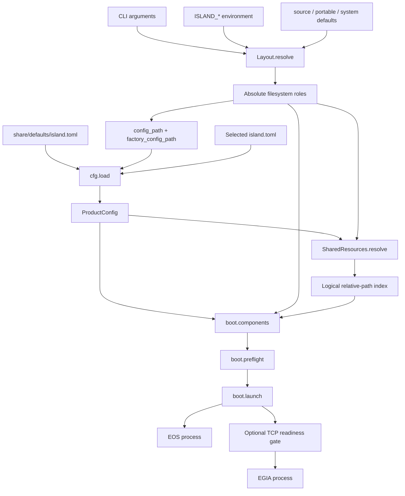

# Island composition data flow

[中文](../../docs_cn/island/composition.md)

This page describes how `src/island/` handles data from filesystem-root selection through process supervision. It is the module-set overview for `island.path`, `island.cfg`, `island.share`, `island.boot`, and `island.ctl`; those modules form one composition boundary and are documented together because each stage consumes the preceding stage's validated result.

**Migration status:** the process-supervision sections below describe the retained `island.boot` implementation for legacy tests and configuration inspection. The public `bin/island` command now forwards to `isos start`; IsOS owns live deployment supervision. Use `bin/egia` for standalone EGIA. The old `--config` option is not accepted by the wrapper; run `isos config init`, copy its settings into the JSON graph, and apply the file with `isos config apply <file>`.

## Contents

- [Overview](#overview)
- [End-to-end data flow](#end-to-end-data-flow)
- [Filesystem layout](#filesystem-layout)
- [Product configuration](#product-configuration)
- [Shared resources](#shared-resources)
- [Component plan](#component-plan)
- [Preflight and launch](#preflight-and-launch)
- [Inspection and validation](#inspection-and-validation)
- [Failure model](#failure-model)
- [Testing](#testing)

## Overview

Island accepts path overrides, environment values, a product TOML document, and trailing EGIA arguments. It turns them into absolute filesystem roles, a typed `ProductConfig`, a collision-free `SharedResources` index, and an ordered tuple of immutable `Component` launch records. Validation stops at this boundary; component-specific runtime configuration remains owned by EGIA or EOS.

Island reads source, configuration, executable, and shared-resource paths. It does not write runtime state and does not create role directories. Children write only through the state, cache, log, run, and temporary roles they receive through their own configuration. `islandctl` is read-only. The launcher mutates process state only by executing, spawning, terminating, killing, and reaping configured children.

The generated modules in `src/island/generated/` are protobuf bindings, not composition inputs. Their source and synchronization rules are documented in [Shared contracts](../../../docs/island/contracts.md) and [EOS contracts](../../../docs/island/eos-contracts.md).

## End-to-end data flow



There is no implicit current-working-directory input. Relative product configuration, component launch, and shared-root paths are resolved below the selected Island prefix. Explicit layout-root overrides and their environment equivalents must be absolute. This distinction keeps deployment-relative product data portable while preventing ambient shell location from changing filesystem roles.

## Filesystem layout

`Layout.resolve` produces a frozen `Layout` whose paths are absolute and normalized. Its input precedence for `prefix` and every role root is explicit argument, matching `ISLAND_*` environment value, then the selected mode default. An explicit `environ` mapping replaces `os.environ` for deterministic callers and tests.

Mode selection uses an explicit `mode`, then `ISLAND_MODE`, then `source` when the module's checkout root contains `pyproject.toml`; otherwise it uses `system`. Values outside `source`, `portable`, and `system` fail through `Mode` conversion. The checkout root comes from the installed module location, never the current working directory.

`source` and `portable` default immutable roles below `prefix`: `etc`, `share`, and `libexec`. Their mutable defaults are `var/lib`, `var/cache`, `var/log`, `var/run`, and `var/tmp`. Only `source` exposes `Layout.src`, resolved as `<prefix>/src`; `portable` and `system` expose `None`.

`system` defaults `prefix` to `/usr`, configuration to `/etc/island`, shared data to `<prefix>/share/island`, private executables to `<prefix>/libexec/island`, and mutable roles to `/var/lib/island`, `/var/cache/island`, `/var/log/island`, `/run/island`, and `/var/tmp/island`. Its documentation root remains `<prefix>/share/doc/island`, including when a custom system prefix is supplied. The portable documentation root is `<share>/doc`; the source documentation root is `<prefix>/docs`.

The legacy `var` argument is the one exception to absolute role input. An absolute value is used directly; a relative value is resolved below `prefix`. It supplies `lib`, `cache`, `log`, `run`, and `tmp` defaults below that root. Explicit `state`, `cache`, `log`, `run`, or `tmp` arguments still win. When `var` is present, mutable-role environment values are deliberately ignored so a legacy caller receives one internally consistent role tree.

All other explicit or environment root values are expanded for `~`, must be absolute, and are normalized with `Path.resolve`. A relative value raises `ValueError`. `Layout` does not require the paths to exist and creates none of them.

`component_etc`, `component_state`, `component_cache`, and `component_log` append a component namespace to their role root. Only `egia` and `eos` are valid namespaces; every other value raises `ValueError`. `contracts` and `prompts` are convenience views below the single physical `Layout.share` root and do not replace the configured multi-root resource index.

## Product configuration

`cfg.load(path, defaults=...)` reads the optional factory TOML first, then the required deployment TOML. Tables merge recursively. A deployment scalar, list, or value of another type replaces the factory value at that key; it is not appended. The result is validated only after layering, so an intentionally partial deployment overlay is valid when the factory document supplies the omitted required fields.

Both files are read as binary TOML. A missing file reports its role and path. Other filesystem failures and TOML syntax failures become `ConfigError` with the original detail. Omitting `defaults` starts from an empty document. Supplying a defaults path makes that file required just like the deployment document.

The recognized product data is:

- `name`: required non-empty string, stripped before storage.
- `profile`: required non-empty string, stripped before storage and later passed to EGIA as `--mode`.
- `share`: required non-empty list of non-empty, prefix-relative path strings. Absolute entries and duplicate normalized strings are rejected. Entries may traverse to a sibling checkout, such as `../share`; resolution and existence checks occur later.
- `[components.egia]` and `[components.eos]`: both tables are required after layering. No other component names are accepted.
- `enabled`: required boolean. Integers are not accepted as booleans by the explicit type check.
- `launch`: required non-empty prefix-relative path. It is stripped and later resolved below `Layout.prefix`.
- `ready`: optional non-empty string. Its `host:port` syntax is intentionally validated only if the launcher waits on it.
- `ready_timeout_s`: optional positive integer or float, defaulting to `30.0`; booleans, zero, and negative values are rejected, and the stored value is a float.
- `[logging]`: required session-collector policy. `max_bytes`, `backup_count`, and `retained_sessions` are positive integers, with packaged defaults of 32 MiB, five rotated backups, and twenty retained sessions. Session logging is a launch invariant and has no disable switch.

Unknown keys inside a component table are rejected and named. Unknown names inside `[components]` are rejected and named. The current loader extracts the recognized top-level product fields but does not reject additional top-level tables or keys; callers must not assume such data is retained in `ProductConfig`.

`ProductConfig`, `Components`, and `ComponentConfig` are frozen, slotted values. They contain validated configuration data only and do not resolve files, open sockets, or start processes.

## Shared resources

`SharedResources.resolve(product, layout)` resolves each `share` entry below `Layout.prefix`, preserving configuration order in `roots`. Every root must exist as a directory. A missing or non-directory root is a `ConfigError`; an empty directory is valid.

Each physical root is traversed recursively. Regular files are indexed by their POSIX path relative to that root. Traversal is sorted, and the final `files` mapping therefore has deterministic insertion order. Directories are not indexed as files. If two roots contribute the same relative file path, resolution fails and reports the logical path and both physical files. Root order never creates overlay precedence and no file is overwritten.

`require(relative)` converts a string or `PurePosixPath` to a logical key and returns its physical file. A missing key raises `ConfigError` naming that key.

`directory(relative)` checks the physical roots rather than the file index. No contributing directory is an error. More than one contributing directory is also an error even when its files are disjoint, because the method promises one physical directory owner. Exactly one match returns that physical directory.

`under(relative)` returns every indexed file equal to or below the logical path, ordered by its POSIX key. An absent prefix produces an empty tuple rather than an error. This operation can safely combine files from different physical roots because file-level collisions were already rejected.

`configured_resources(layout, config=None)` chooses the product config from its explicit argument, then `ISLAND_CONFIG`, then `<layout.etc>/island.toml`. An absolute selected path stays absolute; a relative one resolves below `layout.prefix`. It always layers `<layout.share>/defaults/island.toml` and then constructs the resource index. `repository_resources(root)` creates a source layout with an empty injected environment and selects `<root>/etc/island.toml`, making repository checks independent of the caller's environment and working directory.

## Component plan

`boot.components` converts `ProductConfig` into an ordered `(eos, egia)` tuple without starting either process. Each `Component` records the name, enabled flag, resolved executable path, argument vector, environment additions, readiness endpoint, and readiness timeout. `Component.available` is true only for an executable regular file.

EOS receives only its executable path as `argv`. EGIA receives forwarded arguments, the selected product path as `--island-config` when the caller supplies `product_config`, and the configured profile as `--mode`. Forwarded arguments preserve their order. The public launcher removes one leading `--` separator before building this tuple.

When EOS is enabled, its launcher path exists as a file, and a `SharedResources` index was supplied, planning requires both `eos/contracts/eos/gateway.proto` and `eos/schemas/eos/actions/ack.v1.json`. Both must belong to the same configured physical root. That root is exported to EOS as both `ISLAND_SHARE` and `EOS_CONTRACTS`. A missing resource or split ownership fails before launch. The resource condition is not evaluated for disabled EOS, a missing EOS file, or callers that omit `shared_resources`; the normal `main` and `islandctl validate` paths supply it.

If the resolved EOS launcher is outside the Island prefix and its inferred prefix contains `adapters/eos-cxx`, it is treated as a sibling source checkout. Its environment gains `ISLAND_PREFIX=<eos-prefix>` and `ISLAND_MODE=source` in addition to any shared-resource variables. Ordinary installed or in-prefix launchers do not receive these source markers.

`config_path` selects `<layout.etc>/island.toml` when no CLI value is present. An explicit absolute path is normalized directly; an explicit relative path is normalized below `layout.prefix`. `factory_config_path` always selects `<layout.share>/defaults/island.toml`.

## Preflight and launch

`preflight` filters disabled components while preserving tuple order. It rejects a plan with no enabled component. It then checks every enabled command before any child starts and reports the first unavailable executable. Disabled commands may be absent without failing preflight.

After successful preflight, Island always remains as supervisor, even for one enabled component. It creates the protected session collector before spawning children and passes the resolved `ISLAND_STATE`, `ISLAND_CACHE`, `ISLAND_LOG`, `ISLAND_RUN`, and `ISLAND_TMP` roots to every component. It also passes the session identity, component name, and Unix datagram endpoint. Collector setup failure prevents any child from starting.

Components are spawned in plan order, so EOS starts before EGIA. After spawning a component with `ready`, the launcher waits before proceeding to the next component. Readiness must have a non-empty host and a decimal port separated at the final colon by `rpartition`; the port must be from 1 through 65535.

The collector writes normalized JSONL to `var/log/island/sessions/<session-id>.jsonl` and atomically publishes metadata below `var/run/island/sessions/`, including a guarded `current.json` for attach clients. `collector_sequence` is ingestion order, not causal order; source timestamps remain present. Island records supervision lifecycle events directly, receives best-effort sanitized datagrams from EGIA and TUI, and tails the locally supervised EOS `eos.jsonl` across append, truncation, rapid regrowth, and inode replacement. Component logs remain authoritative because datagrams can drop. Older EOS builds may have legacy prelaunch logs under `var/log/eos/prelaunch-N.log`; current EOS 2 launch is managed by IsOS and does not use that prelaunch path. Logs on remote EOS hosts are outside the local session.

Readiness repeatedly performs a TCP connection with a 0.2-second per-attempt timeout. Success means only that the listener accepted a connection; it does not validate an application protocol. The wait fails if the child exits first or the monotonic deadline reaches `ready_timeout_s`. Connection errors are retried at 0.1-second intervals. A readiness failure stops and reaps every child already started and prevents later components from spawning.

During supervision, a nonzero component exit is isolated: the launcher keeps surviving components running for diagnosis. When every child has exited, it returns the first nonzero code in component tuple order, or zero if all exited cleanly. A clean EGIA exit is a session-level signal: the launcher stops all remaining owned children and returns zero. A clean EOS exit alone does not stop EGIA. If EGIA is not part of the plan, only the all-children-finished rule applies.

Shutdown first calls `terminate` for every running child, then waits up to five seconds for each child. A child that misses its wait is killed and reaped. Already exited children are only reaped through the applicable wait path. `KeyboardInterrupt` performs the same bounded shutdown and returns 130. A `BootError` raised while launching or waiting also triggers shutdown and is re-raised to the composition boundary.

`boot.main` resolves the layout, config path, layered product, shared-resource index, component plan, and preflight in that order, then launches. `BootError`, `ConfigError`, and `ValueError` become one `island: ...` message on standard error and exit code 2. Component exit codes and interrupt code 130 pass through as launch results.

## Inspection and validation

`islandctl paths` prints `mode`, `prefix`, `etc`, `share`, `libexec`, `state`, `cache`, `log`, `run`, and `tmp` as `name=value`. It resolves layout data only; it does not load product configuration or verify paths exist.

`islandctl config` layers and validates the selected product configuration, builds component descriptions, and prints the selected config, product identity, profile, each configured share entry, and each component's enabled, command, and availability values. It does not resolve shared roots, enforce their collisions, require EOS contract resources, or reject unavailable enabled launchers.

`islandctl validate` additionally resolves the complete shared-resource index, applies EOS resource co-location checks while building the component plan, and preflights every enabled executable. It does not open readiness sockets or start a process, so endpoint syntax, listener availability, and runtime child behavior remain launch-time conditions.

All `islandctl` subcommands are read-only. `BootError`, `ConfigError`, and `ValueError` become one `islandctl: ...` message on standard error and exit code 2; success returns zero. Argument parsing independently rejects commands outside `paths`, `config`, and `validate` using normal `argparse` behavior.

## Failure model

Failures are reported at the stage that owns enough information to make them actionable:

- layout failures identify an unsupported mode, relative role override, or unknown component namespace;
- configuration failures identify the file role, TOML error, missing or mistyped field, unsupported component, unknown component setting, absolute product-relative path, duplicate share entry, or invalid timeout;
- resource failures identify a missing root, duplicate logical file, absent required resource, ambiguous directory owner, or EOS resources split across roots;
- preflight failures identify an empty enabled set or the enabled command whose executable is unavailable;
- readiness failures identify malformed endpoint syntax, invalid port, early child exit, or elapsed timeout;
- supervision preserves nonzero component failures for diagnostics and only tears down peers on clean EGIA session exit, interruption, or a launcher-owned error.

No stage silently chooses between conflicting resources, silently enables a disabled component, falls back to the current working directory, or writes into a source, configuration, executable, or shared-resource root.

## Testing

The composition modules use unit and stubbed integration tests with temporary filesystem trees, patched process calls, and local TCP listeners. Run the focused suite with:

```sh
uv run pytest tests/system/test_path.py tests/system/test_product_launcher.py tests/contracts/test_eos_contracts.py
```

`tests/system/test_path.py` covers mode defaults, custom system prefixes, precedence, legacy `var`, current-working-directory independence, relative-root rejection, and component namespace validation. `tests/system/test_product_launcher.py` covers configuration layering and validation, logical-root merge and collisions, source and installed command construction, EOS source environment, preflight, readiness ordering, failure isolation, clean EGIA shutdown, interruption, and wrapper layouts. `tests/contracts/test_eos_contracts.py` covers the generated protobuf and configured EOS contract boundary.

The product acceptance check is:

```sh
./bin/islandctl validate
```

It passes when product TOML layering succeeds, every shared root exists without a relative-file collision, required EOS resources share one owner, at least one component is enabled, and every enabled launcher is executable. It does not prove that a configured listener will become ready or that either component will remain healthy after launch.

**Related:** [repository layout](layout.md) · [shared contracts](../../../docs/island/contracts.md) · [EOS contracts](../../../docs/island/eos-contracts.md) · [documentation guide](../README.md)
