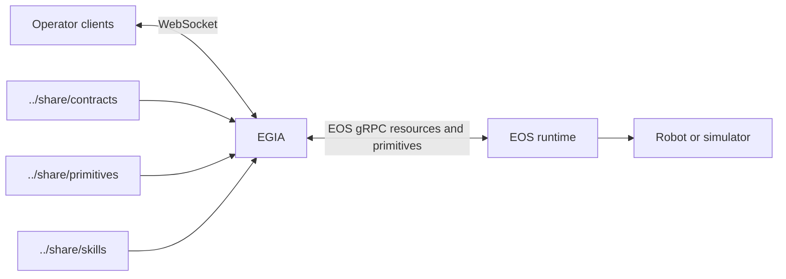

# Island-egia repository layout

[中文](../../docs_cn/island/layout.md) · [Documentation guide](../README.md) · [Composition data flow](composition.md)

This document describes the files present in this checkout. Island-egia is a Python EGIA runtime that uses `island.eos.v1.GatewayService` for discovery and resources and `island.eos.v2.CapabilityService` for primitive operations. It contains no device runtime implementation.

IsOS now owns deployment composition. `bin/island` and `isOS-Aether.sh` forward to `isos start`, while `bin/egia` and `egia-launch.sh` launch EGIA alone. IsOS launches an EGIA node with `--managed --no-tui`; managed mode rejects an internally enabled sandbox. The `island.boot` module remains for validation, but is no longer the public stack launcher. EGIA uses the EOS 2 capability-operation adapter pinned in the EOS compatibility record; public release still requires real-process integration against an exact published EOS version.

## Top-level directories

| Path | Current contents |
|---|---|
| `bin/` | Public shell launchers: `island`, `egia`, `islandctl`, and `island-stop`. |
| `etc/` | Versioned EGIA and Island configuration, model bindings, EOS connection profiles, prompts, and safety settings. |
| `libexec/egia_ext/` | Private terminal operator extension. |
| `scripts/platform/` | ARM64 and x86-64 source-checkout build and launch methods plus architecture dispatch. |
| `share/defaults/` | Packaged Island and EGIA factory configuration. |
| Configured `share` roots | Prefix-relative directories merged into one logical tree; the checkout default uses `share/` and `../share/`. |
| `src/egia/` | EGIA runtime, contracts, core pipeline, I/O, and optional features. |
| `src/island/` | Product launcher, configuration, validation, and path-layout utilities. |
| `tests/` | EGIA unit, integration, schema, launcher, and extension tests. |
| `var/` | Git-ignored local runtime state, caches, logs, run files, and temporary data. |
| `docs/` | Current runtime, interface, operations, and development documentation. |

`build/` and `dist/`, when present, are generated build and package artifacts. They are not source or runtime import roots.

The source-checkout product configuration in `etc/island.toml` declares `share = ["share", "../share"]`. Entries may name arbitrary prefix-relative directory paths and are presented to components as one logical directory. Every relative file path must be unique across the roots; a collision is a configuration error rather than an overlay precedence rule. EGIA owns the factory defaults in its local root, while EOS owns the shared wire contracts, primitive schemas, and skill boundary in the repository root used by the default development composition.

## In-repository EOS runtime

The EI component uses root `share/` contracts and root `bin/eosd` from the unified checkout. Run `./bin/islandctl validate` in `ei/` to check the selected roots and launcher. IsOS owns the graph and launches EI in managed mode. The `bin/island` compatibility launcher forwards to `isos start`.

## Runtime boundaries

EGIA owns observation admission, context construction, mission and plan execution, cognitive safety checks, model integration, and operator projections. Backends own their own device integration, execution, and physical safety. The contract boundary prevents either process from importing the other’s implementation.

## Path resolution

Public launchers can be started outside the repository root. In a source checkout, immutable resources are read from the configured roots and mutable data is written beneath `var/`. For standalone EGIA, `./bin/egia --island-config <path>` selects shared resources; `./bin/islandctl --config <path> validate` checks the same selection. The `island.path.Layout` utility also supports portable and installed layouts through explicit environment or command-line roots.

The product launcher propagates its resolved mutable roots to every local component. A supervised launch stores its normalized replay under `var/log/island/sessions/`, session metadata under `var/run/island/sessions/`, EGIA's authoritative replay under `var/lib/egia/`, and EOS diagnostics under `var/log/eos/`.

The checkout scripts `egia-build.sh` and `egia-launch.sh` use `uname -m` to select `scripts/platform/arm64/` for `aarch64` or `arm64`, and `scripts/platform/x86_64/` for `x86_64` or `amd64`. Unsupported architectures are rejected. Build methods seed locked dependencies with `uv sync --no-install-project` before packaging with `--no-build-isolation`. Architecture-specific launch methods bootstrap `.venv` when needed, then delegate to standalone `bin/egia`. The product-level `isOS-Aether.sh` delegates to `bin/island`, which forwards to IsOS. IsOS determines dependency ordering, readiness, ownership, and shutdown from its deployment graph.

At CMake configure time, `ISLAND_PRODUCT_CONFIG` selects the product config used for packaging. The install copies every configured shared root into one `${CMAKE_INSTALL_DATADIR}/island` tree after collision validation, then generates an installed `island.toml` with `share = ["share/island"]`. Its EOS component is enabled only when the merge-ready `adapters/eos-cxx/` source produced the `eosd` target. `ISLAND_BUILD_EOS` is the current build option; `ISLAND_BUILD_ECOS` remains a deprecated compatibility alias.

The install also copies EGIA factory TOML files into `<prefix>/share/defaults/egia`, the exact system-mode fallback verified by IsOS. The product's `share/island` resource copy remains available for existing resource consumers. The installed launcher fails if the factory directory is absent rather than switching to that resource copy.

Staged installs include `island_admin` and omit the checkout-only `egia_ext` operator console by default. `-DEGIA_INSTALL_PRIVATE_EXTENSIONS=ON` opts into that extension for private deployments; public source snapshots leave it off. `bin/egia` runs the core runtime on a TTY when the extension is unavailable.

Python 3.12 is the default interpreter request. `EGIA_PYTHON` selects an existing `uv`, Conda, or virtualenv interpreter for `bin/egia` and `bin/islandctl`; `EGIA_PYTHON_VERSION` changes the version requested by checkout `uv` bootstrap. CMake requires Python 3.12 or newer and accepts `-DPython3_EXECUTABLE=<interpreter>`.

Use `isos start` for the configured stack, `./bin/egia` for EGIA alone, and `./bin/islandctl validate` to check the legacy product layout. See [the composition data flow](composition.md) for legacy resolution details and [the documentation guide](../README.md) for runtime and interface details.

## Placement rules

- Runtime Python code: `src/egia/` or `src/island/`.
- Public entry points: `bin/`.
- Private child programs: `libexec/egia_ext/`.
- Versioned configuration: `etc/`.
- Canonical contracts and packaged prompts: `share/`.
- Runtime-generated durable state, cache, logs, process files, and scratch data: the corresponding `var/` role.
- Tests: `tests/`; documentation: `docs/`.

No ordinary runtime code writes into source, configuration, or shared-resource directories.
