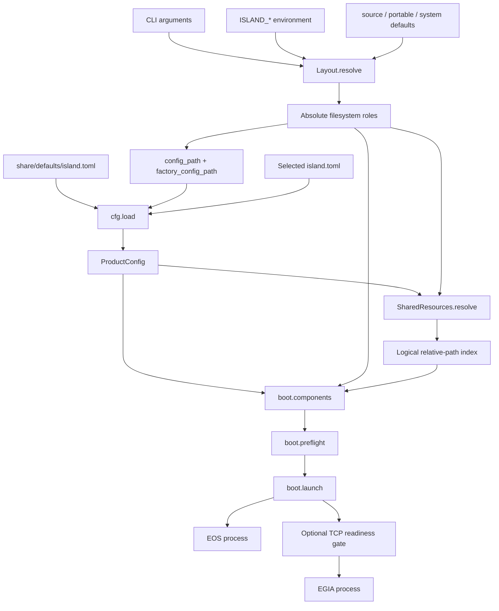

# Island 组合数据流

[English](../../docs/island/composition.md)

本页说明 `src/island/` 如何处理从文件系统根目录选择到进程监督的数据。它是 `island.path`、`island.cfg`、`island.share`、`island.boot` 和 `island.ctl` 的模块集总览；这些模块形成同一个组合边界，每个阶段都消费上一阶段的已校验结果，因此统一记录在这里。

**迁移状态：** 下文的进程监督章节描述为旧测试和配置检查保留的 `island.boot` 实现。公开命令 `bin/island` 现转发到 `isos start`，实际部署监督归 IsOS 所有。独立启动 EGIA 使用 `bin/egia`。兼容 wrapper 不接受旧的 `--config`；请用 `isos config init` 创建 JSON 图，复制需要的设置，再用 `isos config apply <file>` 应用。

## 目录

- [概述](#概述)
- [端到端数据流](#端到端数据流)
- [文件系统布局](#文件系统布局)
- [产品配置](#产品配置)
- [共享资源](#共享资源)
- [组件计划](#组件计划)
- [预检与启动](#预检与启动)
- [检查与校验](#检查与校验)
- [失败模型](#失败模型)
- [测试](#测试)

## 概述

Island 接受路径覆盖值、环境变量、产品 TOML 文档和尾随的 EGIA 参数，并将其转换为绝对文件系统角色、类型化 `ProductConfig`、无冲突 `SharedResources` 索引和有序的不可变 `Component` 启动记录元组。校验止于这个边界；组件专用 runtime 配置仍由 EGIA 或 EOS 所有。

Island 读取源码、配置、可执行文件和共享资源路径。它不写 runtime state，也不创建角色目录。子进程只能通过各自配置收到的 state、cache、log、run 和 temporary 角色执行写入。`islandctl` 只读。launcher 仅通过执行、生成、终止、强制结束和回收已配置子进程来改变进程状态。

`src/island/generated/` 中的生成模块是 protobuf binding，不是组合输入。其源文件和同步规则见[共享契约](../../../docs/island/contracts.md)和 [EOS 契约](../../../docs/island/eos-contracts.md)。

## 端到端数据流



当前工作目录不是隐式输入。相对产品配置、组件 launch 和共享根目录路径都在选定 Island prefix 下解析。显式 layout 根目录覆盖值及对应环境变量必须是绝对路径。这个区别既让相对于部署的产品数据可以移植，也避免 shell 所在目录改变文件系统角色。

## 文件系统布局

`Layout.resolve` 生成冻结的 `Layout`，其中路径均为绝对规范化路径。`prefix` 和每个角色根目录的输入优先级是：显式参数、对应的 `ISLAND_*` 环境变量、所选 mode 默认值。调用者可以传入完整 `environ` mapping 代替 `os.environ`，以实现确定性调用和测试。

mode 选择顺序是显式 `mode`、`ISLAND_MODE`、模块检出根目录含 `pyproject.toml` 时的 `source`，否则为 `system`。`source`、`portable` 和 `system` 之外的值在 `Mode` 转换时失败。检出根目录来自已安装模块位置，绝不来自当前工作目录。

`source` 和 `portable` 默认把不可变角色 `etc`、`share` 和 `libexec` 放在 `prefix` 下。其可变角色默认值是 `var/lib`、`var/cache`、`var/log`、`var/run` 和 `var/tmp`。只有 `source` 暴露解析为 `<prefix>/src` 的 `Layout.src`；`portable` 和 `system` 暴露 `None`。

`system` 的默认 `prefix` 为 `/usr`，配置为 `/etc/island`，共享数据为 `<prefix>/share/island`，私有可执行文件为 `<prefix>/libexec/island`，可变角色为 `/var/lib/island`、`/var/cache/island`、`/var/log/island`、`/run/island` 和 `/var/tmp/island`。即使提供自定义 system prefix，其文档根目录也保持为 `<prefix>/share/doc/island`。portable 文档根目录为 `<share>/doc`；source 文档根目录为 `<prefix>/docs`。

旧版 `var` 参数是绝对角色输入的唯一例外。绝对值直接使用；相对值在 `prefix` 下解析。它为该根目录下的 `lib`、`cache`、`log`、`run` 和 `tmp` 提供默认值。显式 `state`、`cache`、`log`、`run` 或 `tmp` 参数仍然优先。存在 `var` 时会有意忽略可变角色环境变量，从而让旧版调用者得到一棵内部一致的角色树。

其他所有显式或环境变量根目录值都会展开 `~`，且必须为绝对路径，然后通过 `Path.resolve` 规范化。相对值会引发 `ValueError`。`Layout` 不要求路径已经存在，也不会创建任何路径。

`component_etc`、`component_state`、`component_cache` 和 `component_log` 在对应角色根目录后追加组件 namespace。只有 `egia` 和 `eos` 是有效 namespace；其他值均引发 `ValueError`。`contracts` 和 `prompts` 是单个物理 `Layout.share` 根目录下的便捷视图，不能替代配置形成的多根目录资源索引。

## 产品配置

`cfg.load(path, defaults=...)` 先读取可选 factory TOML，再读取必需的 deployment TOML。table 递归合并。deployment 中的 scalar、list 或其他类型值会替换 factory 中相同 key 的值，而不是追加。合并完成后才进行校验，因此只要 factory 文档提供缺少的必填字段，刻意保持精简的 deployment overlay 就有效。

两个文件都按二进制 TOML 读取。文件缺失时报告其角色和路径；其他文件系统错误和 TOML 语法错误转换为带原始细节的 `ConfigError`。不传 `defaults` 时从空文档开始；传入 defaults 路径时，该文件与 deployment 文档一样是必需的。

可识别的产品数据如下：

- `name`：必填非空 string，存储前去除首尾空白。
- `profile`：必填非空 string，存储前去除首尾空白，随后作为 `--mode` 传给 EGIA。
- `share`：必填且非空的路径 string 列表；每项必须非空、相对于 prefix。绝对项和规范化 string 重复项会被拒绝。项可以跨越到相邻检出，例如 `../share`；路径解析和存在性检查在后续阶段完成。
- `[components.egia]` 和 `[components.eos]`：分层后两个 table 都必须存在，不接受其他组件名称。
- `enabled`：必填 boolean；显式类型检查不会把 integer 接受为 boolean。
- `launch`：必填非空且相对于 prefix 的路径，去除首尾空白后在 `Layout.prefix` 下解析。
- `ready`：可选非空 string；仅当 launcher 实际等待它时才校验 `host:port` 语法。
- `ready_timeout_s`：可选正 integer 或 float，默认 `30.0`；boolean、零和负数均被拒绝，存储值为 float。
- `[logging]`：必需的 session collector 策略。`max_bytes`、`backup_count` 和 `retained_sessions` 必须为正整数；打包默认值为 32 MiB、五个轮转备份和二十个保留 session。Session logging 是启动不变量，没有禁用开关。

组件 table 内的未知 key 会被拒绝并列出名称。`[components]` 内的未知名称也会被拒绝并列出。当前 loader 提取可识别的顶层产品字段，但不会拒绝额外顶层 table 或 key；调用者不得假设这些数据会保留在 `ProductConfig` 中。

`ProductConfig`、`Components` 和 `ComponentConfig` 都是 frozen、slotted value。它们只包含已经校验的配置数据，不解析文件、不打开 socket，也不启动进程。

## 共享资源

`SharedResources.resolve(product, layout)` 在 `Layout.prefix` 下解析每个 `share` 项，并在 `roots` 中保留配置顺序。每个根目录都必须作为 directory 存在。缺失或不是 directory 的根目录会产生 `ConfigError`；空 directory 有效。

每个物理根目录都会递归遍历。regular file 按相对于该根目录的 POSIX 路径建立索引。遍历已经排序，因此最终 `files` mapping 的插入顺序确定。directory 不作为 file 建立索引。若两个根目录提供相同相对文件路径，解析会失败并报告逻辑路径和两个物理文件。根目录顺序绝不形成 overlay precedence，也不会覆盖文件。

`require(relative)` 把 string 或 `PurePosixPath` 转换成逻辑 key，并返回物理文件。key 缺失时引发包含该 key 的 `ConfigError`。

`directory(relative)` 检查物理根目录，而不是 file 索引。没有贡献该 directory 是错误；即使其中的文件互不重叠，多个根目录贡献同一 directory 仍然是错误，因为此方法保证只有一个物理 directory owner。恰好匹配一个时返回该物理 directory。

`under(relative)` 返回等于逻辑路径或位于其下方的所有已索引文件，并按 POSIX key 排序。不存在的 prefix 返回空 tuple，而不是错误。因为此前已经拒绝 file-level collision，此操作可以安全合并不同物理根目录的文件。

`configured_resources(layout, config=None)` 按显式参数、`ISLAND_CONFIG`、`<layout.etc>/island.toml` 的顺序选择产品配置。绝对选择路径保持绝对；相对路径在 `layout.prefix` 下解析。它始终分层加载 `<layout.share>/defaults/island.toml`，随后构造资源索引。`repository_resources(root)` 使用空的注入环境创建 source layout，并选择 `<root>/etc/island.toml`，使仓库检查不受调用者环境和工作目录影响。

## 组件计划

`boot.components` 把 `ProductConfig` 转换为有序 `(eos, egia)` tuple，但不启动进程。每个 `Component` 记录 name、enabled flag、已解析 executable path、argument vector、额外 environment、readiness endpoint 和 readiness timeout。只有 executable regular file 才会让 `Component.available` 为 true。

EOS 的 `argv` 只有其 executable path。EGIA 接收转发参数、调用者提供 `product_config` 时作为 `--island-config` 传入的选定产品路径，以及作为 `--mode` 传入的已配置 profile。转发参数保持原顺序。公共 launcher 在构造 tuple 前移除一个开头的 `--` separator。

当 EOS 已启用、launcher path 是现有 file，且调用者提供了 `SharedResources` 索引时，规划要求同时存在 `eos/contracts/eos/gateway.proto` 和 `eos/schemas/eos/actions/ack.v1.json`。两者必须属于同一个已配置物理根目录。该根目录同时通过 `ISLAND_SHARE` 和 `EOS_CONTRACTS` 导出给 EOS。资源缺失或 owner 分离会在启动前失败。对于禁用的 EOS、缺失的 EOS file 或省略 `shared_resources` 的调用者，不求值该资源条件；常规 `main` 和 `islandctl validate` 路径会提供索引。

若已解析 EOS launcher 位于 Island prefix 之外，且推断出的 prefix 包含 `adapters/eos-cxx`，它会被视为相邻 source checkout。除了共享资源变量，其 environment 还会得到 `ISLAND_PREFIX=<eos-prefix>` 和 `ISLAND_MODE=source`。普通 installed 或 prefix 内 launcher 不接收这些 source marker。

未提供 CLI 值时，`config_path` 选择 `<layout.etc>/island.toml`。显式绝对路径直接规范化；显式相对路径在 `layout.prefix` 下规范化。`factory_config_path` 始终选择 `<layout.share>/defaults/island.toml`。

## 预检与启动

`preflight` 过滤禁用组件，同时保留 tuple 顺序。没有启用组件的计划会被拒绝。随后它在启动任何子进程前检查全部启用命令，并报告第一个不可用 executable。禁用命令可以不存在而不导致预检失败。

成功预检后，即使只启用一个组件，Island 也始终保留为 supervisor。它在生成子进程前创建受保护的 session collector，并向每个组件传递解析后的 `ISLAND_STATE`、`ISLAND_CACHE`、`ISLAND_LOG`、`ISLAND_RUN` 和 `ISLAND_TMP` 根目录，同时传递 session identity、component name 和 Unix datagram endpoint。Collector 初始化失败时不会启动任何子进程。

组件按计划顺序生成，所以 EOS 先于 EGIA 启动。生成带 `ready` 的组件后，launcher 会先等待，再继续下一个组件。readiness 必须具有非空 host 和十进制 port，并由 `rpartition` 在最后一个 colon 处分隔；port 必须在 1 到 65535 之间。

Collector 将规范化 JSONL 写入 `var/log/island/sessions/<session-id>.jsonl`，并在 `var/run/island/sessions/` 下原子发布 metadata，包括供 attach client 使用且受保护的 `current.json`。`collector_sequence` 表示摄取顺序，而不是因果顺序；源时间戳会保留。Island 直接记录 supervision lifecycle event，接收 EGIA 与 TUI 的 best-effort sanitized datagram，并在 append、truncate、快速重新增长及 inode 替换时持续跟随本地受监督 EOS 的 `eos.jsonl`。由于 datagram 可能丢失，组件日志仍是权威恢复源。较早 EOS 构建可能在 `var/log/eos/prelaunch-N.log` 留有兼容性旧日志；当前 EOS 2 由 IsOS 管理启动，不使用该 prelaunch 路径。远程 EOS 主机上的日志不属于本地 session。

readiness 会重复进行 TCP 连接，每次尝试 timeout 为 0.2 秒。成功仅表示 listener 接受连接，不校验 application protocol。子进程先退出或 monotonic deadline 达到 `ready_timeout_s` 时等待失败。连接错误以 0.1 秒间隔重试。readiness 失败会停止并回收已经启动的所有子进程，并阻止后续组件生成。

监督期间，非零组件退出保持隔离：launcher 让存活组件继续运行以供诊断。当所有子进程都退出时，按组件 tuple 顺序返回第一个非零 code；若全部正常退出则返回零。EGIA 正常退出是 session-level signal：launcher 停止其余全部 owned child 并返回零。EOS 单独正常退出不会停止 EGIA。计划中没有 EGIA 时，仅应用“全部子进程完成”规则。

shutdown 先对每个仍运行的 child 调用 `terminate`，再分别等待最多五秒。超过等待时间的 child 会被 kill 并回收。已经退出的 child 只通过适用的 wait 路径回收。`KeyboardInterrupt` 执行相同的有限 shutdown 并返回 130。启动或等待期间产生的 `BootError` 同样触发 shutdown，随后重新抛到组合边界。

`boot.main` 依次解析 layout、config path、分层 product、shared-resource index、component plan 和 preflight，最后启动。`BootError`、`ConfigError` 和 `ValueError` 转换成写入 standard error 的一条 `island: ...` 消息以及 exit code 2。组件 exit code 和 interrupt code 130 作为启动结果直接返回。

## 检查与校验

`islandctl paths` 以 `name=value` 打印 `mode`、`prefix`、`etc`、`share`、`libexec`、`state`、`cache`、`log`、`run` 和 `tmp`。它只解析 layout 数据，不加载产品配置，也不验证路径存在。

`islandctl config` 分层加载并校验选定产品配置，构造组件描述，并打印选定 config、产品 identity、profile、每个配置的 share 项，以及每个组件的 enabled、command 和 availability。它不解析共享根目录、不强制其 collision 规则、不要求 EOS contract resource，也不拒绝不可用的已启用 launcher。

`islandctl validate` 还会解析完整 shared-resource index，在构造 component plan 时执行 EOS resource co-location 检查，并预检每个已启用 executable。它不打开 readiness socket 或启动进程，因此 endpoint 语法、listener availability 和 runtime child behavior 仍是启动时条件。

所有 `islandctl` 子命令都只读。`BootError`、`ConfigError` 和 `ValueError` 转换成写入 standard error 的一条 `islandctl: ...` 消息以及 exit code 2；成功返回零。参数解析通过普通 `argparse` 行为独立拒绝 `paths`、`config` 和 `validate` 之外的命令。

## 失败模型

失败由掌握足够信息、能够给出可操作错误的阶段报告：

- layout failure 标识不支持的 mode、相对 role override 或未知 component namespace；
- configuration failure 标识 file role、TOML error、缺失或类型错误字段、不支持的 component、未知 component setting、绝对 product-relative path、重复 share 项或无效 timeout；
- resource failure 标识缺失 root、重复 logical file、缺少 required resource、歧义 directory owner 或 EOS resource 分布在不同 root；
- preflight failure 标识空的 enabled set，或 executable 不可用的已启用 command；
- readiness failure 标识格式错误的 endpoint、无效 port、child 提前退出或 timeout 到期；
- supervision 保留非零 component failure 供诊断，仅在 EGIA session 正常退出、interrupt 或 launcher-owned error 时拆除 peer。

任何阶段都不会在冲突资源之间静默选择，不会静默启用禁用组件，不会回退到当前工作目录，也不会写入 source、configuration、executable 或 shared-resource root。

## 测试

组合模块使用临时文件系统树、patched process call 和本地 TCP listener 实现 unit test 与 stubbed integration test。运行聚焦测试：

```sh
uv run pytest tests/system/test_path.py tests/system/test_product_launcher.py tests/contracts/test_eos_contracts.py
```

`tests/system/test_path.py` 覆盖 mode default、自定义 system prefix、precedence、旧版 `var`、不依赖当前工作目录、拒绝相对 root 和 component namespace 校验。`tests/system/test_product_launcher.py` 覆盖配置分层与校验、逻辑根目录 merge 与 collision、source 与 installed command construction、EOS source environment、preflight、readiness ordering、failure isolation、EGIA 正常 shutdown、interrupt 和 wrapper layout。`tests/contracts/test_eos_contracts.py` 覆盖生成 protobuf 与已配置 EOS contract boundary。

产品 acceptance check 为：

```sh
./bin/islandctl validate
```

当产品 TOML 分层成功、每个共享根目录存在且没有相对文件 collision、所需 EOS resource 同属一个 owner、至少启用一个组件、每个已启用 launcher 均可执行时，该检查通过。它不能证明已配置 listener 将进入 ready，也不能证明任一组件启动后持续健康。

**相关页面：** [仓库布局](layout.md) · [共享契约](../../../docs/island/contracts.md) · [EOS 契约](../../../docs/island/eos-contracts.md) · [文档指南](../README.md)
